# FIRKODE versus ARKODE: implicit Runge-Kutta methods and structure-exploiting steppers

Status: pre-registered. The question, the decision rules, the methodology and the predictions
and pass and fail rules of every family are fixed before the full sweep; the generated
sections are filled by `scripts/make_report.py --report arkode` from the CSV files of
`results/<run-id>/`. Sections marked **[pending]** have no data yet; Section 9 gives the
commands. The companion report `BENCHMARK_BDF.md` compares FIRKODE with CVODE and IDA.

Evidence tags: **[measured]** = a row of a CSV file in `results/`, **[predicted]** = written
down before the runs, **[development]** = seen in a single run while the harness was written
(Section 9.2; not a result, restated as a prediction where it shaped one), **[verified]** =
read from the SUNDIALS sources or examples at the commit of this report.

## 1. Question and decision rules

### 1.1 Question

At matched accuracy, is FIRKODE (Radau IIA, s = 3, order 5, stage order 3, L-stable and
stiffly accurate) faster than ARKODE, and can every win or loss be attributed to a named
mechanism? Two comparisons are asked separately:

1. **Implicit Runge-Kutta against implicit Runge-Kutta** (families A0-A4): FIRKODE against
   ARKStep with its diagonally implicit (DIRK, ESDIRK, SDIRK) tables on the full problem.
   Both are one-step methods with an A-stable (mostly L-stable) implicit method; they differ
   in stage order, error constant, the cost of a step and the step-size control.
2. **Full implicitness against structure** (families A5-A8): FIRKODE, which treats the
   whole right-hand side implicitly, against ARKODE steppers that exploit a structure the
   user knows: ARKStep IMEX (an explicit and an implicit part), LSRKStep (explicit
   stabilized methods for a near-real spectrum with an eigenvalue bound) and MRIStep
   (multirate, a slow and a fast part).

### 1.2 Decision rules

A family **supports** its candidate if FIRKODE s = 3 is faster than the stated ARKODE class
at matched mixed digits (mescd = -log10 of the mixed error at the final time, interpolated in
log time) in at least one regime **and** the counters show the predicted mechanism; it
**refutes** the candidate if the class stays faster across the sweep. A win is called only at
>= 1.2x and when adjacent tolerance cells agree; concurrent workers add noise (rows record
`nworkers`).

The DIRK class is reported three ways, because the minimum over several noisy
configurations is biased low:

- **best default**: the fastest of ARKODE's default tables of order 3, 4 and 5;
- **best of all**: the fastest of the nine declared DIRK configurations (Section 3.1), all
  chosen before the runs;
- **tuned**: the settings of `examples/arkode/C_serial/ark_robertson.c` on ROBER, tuned on
  that problem by its authors; reported apart and never part of a verdict.

A verdict is stated for the best default and for the best of all; it is "robust" only when
both agree.

### 1.3 Cost model behind the candidates [predicted]

- **FIRKODE**: each simplified Newton iteration costs 3 right-hand sides and 3 k_lin block
  solves with one N x N matrix `M - h gamma0 J` (k_lin = stacked FGMRES iterations per Newton
  iteration, 2.5-5 on the small problems [measured in `BENCHMARK_BDF.md`, B3]), about 2
  Newton iterations per step; one factorization per setup.
- **ARKStep DIRK**: an ESDIRK of s stages solves s - 1 implicit stages in sequence, each with
  1-3 Newton iterations of one right-hand side and one solve, all with the same
  `M - h gamma J` (one diagonal coefficient), so also one factorization per setup.
  ARKODE's order-4 default (6 stages) costs about 5 x 2 = 10 right-hand sides and solves per
  step, FIRKODE about 6 right-hand sides and 15-30 block solves: comparable per-step work.
- **Steps decide.** No ARKODE DIRK table has stage order above 2 (Section 3.1); Radau IIA
  has stage order 3. In the stiff limit of a problem with time-dependent forcing a method's
  global error falls to about its stage order plus one (Prothero-Robinson analysis,
  Hairer-Wanner II, Section IV.15 [verify]), so DIRKs need more steps as the tolerance
  tightens. On the small problems ARKODE's DIRK defaults were slower than FIRKODE s = 3 in
  most cells of an older suite (DIRK4 by 1.3-20x, DIRK5 by 1.3-76x at mescd 4-8, with DIRK3
  and DIRK5 faster in one HIRES cell each) [measured in the 2026-10-05 suite on
  `work/firkode-benchmark` with an older harness and older FIRKODE defaults; not comparable
  with this sweep].
- **Structure.** IMEX removes the nonlinear and the full-Jacobian work of the explicit part
  at the price of its step-size limit; LSRK has no linear algebra at all at the price of
  about sqrt(h rho) stages per step and order 2; MRI takes few slow implicit steps while the
  cheap fast part takes many explicit ones.

## 2. Environment and provenance

<!-- begin generated: provenance -->
[pending]
<!-- end generated -->

## 3. Methodology

### 3.1 Harness and configurations

`firkode_benchmark` runs one cell per process and prints one CSV row; the driver
`scripts/run_benchmarks.py` sweeps the families with `--family arkode` (A0-A8), computes the
references, and runs serially or with `--workers N` (README). FIRKODE runs as in
`BENCHMARK_BDF.md` (BEGINNER mode, s = 3). The ARKODE integrators:

| integrator | stepper | configurations (label) |
|---|---|---|
| `arkode` | ARKStep, implicit part only (fe = 0) | DIRK3/4/5 (ARKODE's defaults: ESDIRK325L2SA_5_2_3, ESDIRK436L2SA_6_3_4, ESDIRK547L2SA2_7_4_5), DIRK4/5 optimal (`ARKStepSetOptimalParams`), SDIRK_5_3_4, ESDIRK437L2SA_7_3_4, KVAERNO_7_4_5, ARK548L2SAb_DIRK_8_4_5; DIRK4 [ark_robertson settings] |
| `arkode-imex` | ARKStep IMEX on the problem's `imex` splitting | IMEX3/4/5 (ARKODE's default pairs ARK324L2SA, ARK437L2SA, ARK548L2SAb), linearly implicit (`ARKodeSetLinear`) where the implicit part is linear |
| `arkode-lsrk` | LSRKStep | RKC2 and RKL2 with the problem's eigenvalue bound; RKC2 power with the power iteration on difference quotients |
| `arkode-mri` | MRIStep, explicit ARKStep inner stepper | MRI ESDIRK34a (MRI-GARK ESDIRK34a on the `mri` splitting), MRI ESDIRK34a htol (MRIHTol control), MRI IMEX-SR32 (IMEX-MRI-SR32 on `mri-imex`) |

Properties of the DIRK tables [verified: `src/arkode/arkode_butcher_dirk.def`,
`doc/arkode/guide/source/Butcher.rst`]: the seven tables above are A-stable, L-stable and
stiffly accurate; the ESDIRK tables (explicit first stage) have stage order at most 2 and
SDIRK_5_3_4 (implicit first stage) stage order 1. ARKStep rejects tables with
entries above the diagonal, so Radau IIA cannot run in ARKODE
(`src/arkode/arkode_arkstep.c`, `arkStep_CheckButcherTables`).

Defaults that differ between the packages [verified]: ARKODE's step-size controller is the I
controller and its error estimate is the embedded difference `h sum (b - d) f` without the
`(I - h gamma J)^-1` filter of RADAU5 that FIRKODE applies; its predictor is the trivial
one; Newton tolerance 0.1, at most 3 iterations, setup every 20 steps or when gamma changes
by 20 percent, a new Jacobian every 51 steps.

### 3.2 Tolerances and references

As in `BENCHMARK_BDF.md` Section 3.2, plus: `kprmri`, `pr`, `kpr`, `analytic` and `sector`
have exact solutions; family A4 uses the extended-precision references of B13 (FIRKODE
s = 3 at rtol 1e-16 in 80-bit precision, cross-checked by CVODE).

<!-- begin generated: references -->
[pending]
<!-- end generated -->

### 3.3 Timing protocol

As in `BENCHMARK_BDF.md` Section 3.3: median wall time of setup plus evolve over repetitions
of about one second, one cell at a time per worker, `OMP_NUM_THREADS=1`; the sentinel cell
runs before and after every family in every worker, its rows are in
`results/<run-id>/sentinel.csv` and its spread in `results/<run-id>/tables/sentinel.md`.
Profiled twins (`[profile]`) are untimed and never enter a ratio.

### 3.4 Fairness caveats

1. **Best of K.** See Section 1.2; the configuration list is fixed before the runs.
2. **Controllers and error estimates differ** (Section 3.1). Only matched accuracy is
   compared; the only ARKODE tuning is ARKODE's own deprecated `ARKStepSetOptimalParams`,
   whose parameter sets were tuned for older default tables.
3. **IMEX, LSRK and MRI use structure FIRKODE is not given**: the splitting, a linear implicit
   part (`ARKodeSetLinear`: one Newton iteration, a setup whenever gamma changes), exact
   block preconditioners of the implicit part, and eigenvalue bounds. Families A5-A8 answer
   whether a user who knows the structure should prefer ARKODE; the problems were chosen
   because they split.
4. **No stability function is supplied** to the IMEX runs (`ARKodeSetStabilityFn`), so the
   explicit part's stability limit is enforced by the error controller.
5. **LSRK eigenvalue bounds** are exact for `heat2d`, `sector`, `pr` and `analytic` and a
   Gershgorin bound for `bruss3d` (2 percent above the power iteration at n = 6 and the
   initial state [measured by `--check-domeig` in the validation]); an overestimate costs
   about the square root of its ratio in stages.
6. **MRI has many tuning choices** (coupling, inner method, inner tolerance, controller).
   Only ARKODE's inner default (an explicit ERK at the slow tolerances) and the two declared
   controllers run.
7. **`nfe` means different things**: the implicit right-hand side (ARKStep, MRI slow implicit),
   all right-hand sides (LSRK), FIRKODE's evaluations; `nfe_e` and `nfe_f` count the explicit
   and fast parts. Figures plot wall time only.
8. **Mass matrices** (A3): ARKStep with a fixed mass matrix does about 2 mass solves per
   attempted step and 1 per accepted step for tables that are not stiffly accurate
   (`doc/arkode/guide/source/Mathematics.rst` [verified]); the tables here are stiffly
   accurate, which saves the solve for the new state.

### 3.5 Harness validation

`--validate` replicates repository examples and tests and compares their counters with the
answer files by the criterion `test/testRunner` applies to them; for this report it adds
replicas of `ark_analytic` with a table chosen by name, the ARKStep logging tests (DIRK and
ImEx), `ark_analytic_lsrk` and three `ark_kpr_mri` runs (MRI-GARK IRK21a, IMEX-MRI-SR21,
MERK21), and the self-checks `--check-split` (the pieces of every splitting add up to f, the
implicit Jacobian matches differences) and `--check-domeig` (every eigenvalue bound against
the power iteration). The sweeps run only if every replica and check passes.

<!-- begin generated: validation -->
[pending]
<!-- end generated -->

## 4. Problems

| name | system | N | interval | families |
|---|---|---|---|---|
| ROBER, VDPOL, OREGO, HIRES | the small stiff problems of `BENCHMARK_BDF.md` (B1) | 3, 2, 3, 8 | README | A1, A4 |
| `kpr` | Kvaerno-Prothero-Robinson of `test/unit_tests/problems/kpr.hpp` with its IMEX splitting | 2 | [0, 0.5] | A0 |
| `pr` | Prothero-Robinson `y' = lambda (y - phi) + phi'`, exact solution | 4, 1000 | [0, 1] | A2 |
| `sector` | `y' = A (y - phi) + phi'`, eigenvalues `r_k (-cos theta +- i sin theta)` (B8) | 20, 200 | [0, 1], [0, 10] | A0, A2, A4, A6 |
| `heat1dfem`, `wave1dfem` | P1 finite elements with a mass matrix (B5, B9) | 101-401, 200-800 | [0, 1], [0, 4] | A3 |
| `bruss3d` | 3-D Brusselator; IMEX: explicit reaction, implicit linear diffusion | 2 n^3 | [0, 10] | A4, A5 |
| `heat2d` | 2-D advection-diffusion, 200 x 100; IMEX: explicit advection and forcing, implicit diffusion; MRI: slow implicit diffusion, fast advection | 20000 | [0, 1] | A6 |
| `kprmri` | multirate Kvaerno-Prothero-Robinson of `ark_kpr_mri.c` (slow stiffness G = -100, separation w, coupling e = 0.5) | 2 | [0, 5] | A0, A7 |
| `diurnal` | 2-species diurnal kinetics; IMEX: explicit transport, implicit kinetics | 2 mx my | [0, 86400] | A8 |

## 5. Results

### 5.1 A0: method selection (gate)

**Purpose.** Show that every table, coupling and method the families use runs with its
order, so that the labels can be trusted.

**Cells.** Fixed steps with a tightly converged Newton iteration and exact solutions: the
seven DIRK tables and the three IMEX pairs on `kpr` (h = 0.1 / 2^k, k = 0..5, t in [0, 0.5]);
MRI-GARK ESDIRK34a and IMEX-MRI-SR32 on the non-stiff `kprmri` (G = -1, slow step
h = 0.05 / 2^k, fast step h / 100 with Dormand-Prince 5(4)); RKC2 and RKL2 on SECTOR at
theta = 0 (r in [1, 100]). 80 cells, untimed.

**Rule [predicted].** A method passes when its observed order on the finest admissible pair
is at least its order minus 0.3; an observed order above the order plus 0.3 is marked, not
failed (error cancellation on `kpr`: ESDIRK436L2SA showed order 5.06 there in the 2026-10-05
suite [measured, older harness]). A failure voids every label that uses the method.

<!-- begin generated: A0_orders -->
[pending]
<!-- end generated -->

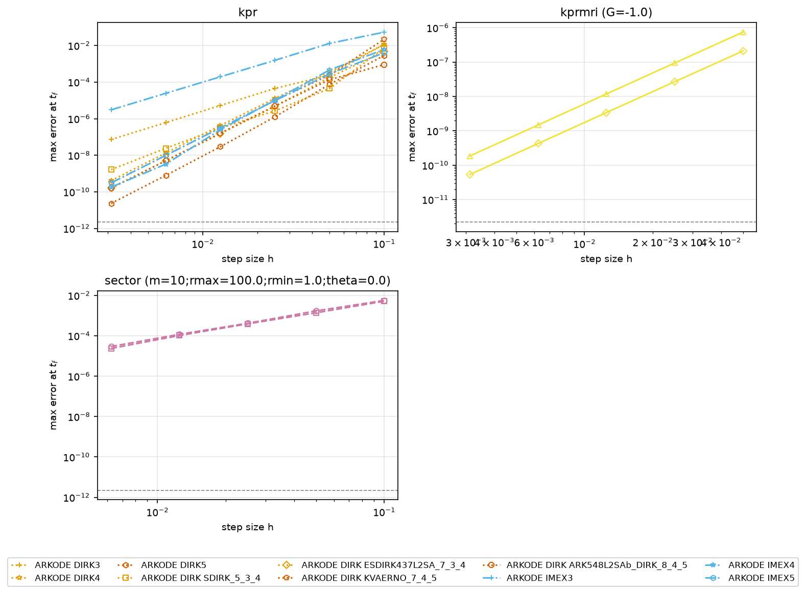

**Verdict.** [pending]

### 5.2 A1: small stiff problems (candidate 1, steps against per-step work)

**Purpose.** On ROBER, VDPOL, OREGO and HIRES (N <= 8), is FIRKODE faster than ARKODE's
DIRK methods, and is the reason the step count?

**Sweep.** rtol 1e-2 ... 1e-10 in half decades (B1's grid), FIRKODE s = 3 and the nine DIRK
configurations; the ark_robertson settings on ROBER (tuned, reported apart). 697 cells.

**Predictions [predicted].**
- P1.1: t(best default) / t(FIRKODE) > 1.2 at mescd 6 and 8 on ROBER, VDPOL and OREGO;
  HIRES within [0.5, 1.5].
- P1.2: where P1.1 holds, the DIRK step count at rtol 1e-6 is >= 1.5x FIRKODE's while the
  time per step stays within [0.5, 2]x (the win comes from the steps).
- P1.3: the optimal parameter sets change the best default by <= 1.5x and flip no verdict.
- P1.4: the best of all changes the P1.1 ratios by <= 1.5x; SDIRK_5_3_4 (stage order 1) is
  the slowest order-4 table on ROBER and VDPOL.
- P1.5: the tuned settings beat FIRKODE on ROBER at mescd 4-6.

**Pass and fail.** Supports candidate 1 if P1.1 holds for the best of all on at least 3 of
the 4 problems; refutes it if the best of all is >= 1.2x faster than FIRKODE on at least 2
problems at mescd 6.

**Results [pending].**

<!-- begin generated: A1_ratio -->
[pending]
<!-- end generated -->

<!-- begin generated: A1_counters -->
[pending]
<!-- end generated -->

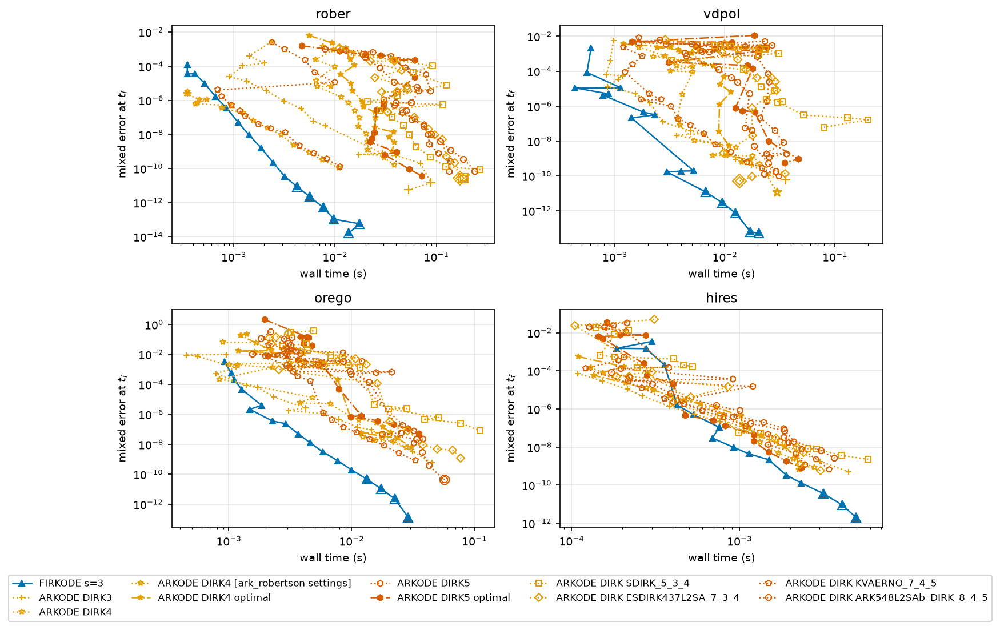

<!-- begin generated: A1_wp -->
[pending]
<!-- end generated -->

**Verdict.** [pending]

### 5.3 A2: stage order and order reduction (candidate 2)

**Purpose.** Measure the order reduction of the DIRK tables (stage order <= 2) against Radau
IIA (stage order 3) in the stiff limit, and whether it decides the time at tight
tolerances.

**Sweep.**
- A2_fixed (untimed): Prothero-Robinson with N = 4 and lambda in {-1, -1e2, -1e4, -1e6,
  -1e8}, SECTOR at theta = 0 with r in [1, 1e6], fixed steps h = 0.5 / 2^k (k = 0..6) on
  [0, 1]; FIRKODE and the seven DIRK tables. 336 cells. FIRKODE's stacked FGMRES gets 5
  restarts here (`--stage-maxrs 5`; Section 7), so that the cells measure the method, not
  its default linear-solver budget.
- A2_adaptive: Prothero-Robinson with N = 1000 (above the timing floor) and lambda in {-1,
  -1e4, -1e8}; SECTOR with m = 100, theta in {0, 80} degrees, r in [1, 1e3] and [1, 1e6];
  rtol 1e-4 ... 1e-10 in half decades; FIRKODE, DIRK3/4/5, SDIRK_5_3_4, KVAERNO_7_4_5.
  546 cells.

**Predictions [predicted].**
- P2.1: in the stiff limit (|lambda| h >> 1) FIRKODE's fixed-step order is >= 3.5; the
  ESDIRK tables, KVAERNO_7_4_5 and ARK548L2SAb fall into [1.8, 3.2]; SDIRK_5_3_4 into
  [1.5, 2.3]; at lambda = -1 every method is within 0.3 of its classical order (or above it
  on these linear problems).
- P2.2: log10 t(best DIRK)/t(FIRKODE) grows by >= 0.3 from mescd 4 to 8 on Prothero-Robinson
  at lambda = -1e8 and on SECTOR at theta = 0, r <= 1e6; it changes by <= 0.2 at
  lambda = -1.
- P2.3: the ratio at theta = 80 degrees is within [0.67, 1.5]x of that at theta = 0 (both
  method families are A-stable; the A(alpha) mechanism of `BENCHMARK_BDF.md` B8 does not
  apply).

**Pass and fail.** Supports candidate 2 if P2.1 and P2.2 hold; refutes it if some DIRK table
keeps its classical order minus 0.5 in the stiff limit or the ratio grows by < 0.1.

**Results [pending].**

<!-- begin generated: A2_fixed -->
[pending]
<!-- end generated -->

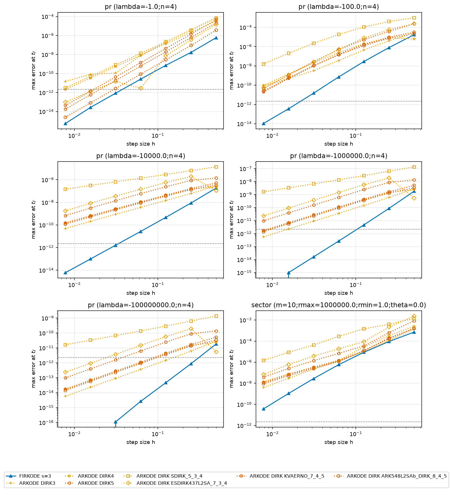

<!-- begin generated: A2_slope -->
[pending]
<!-- end generated -->

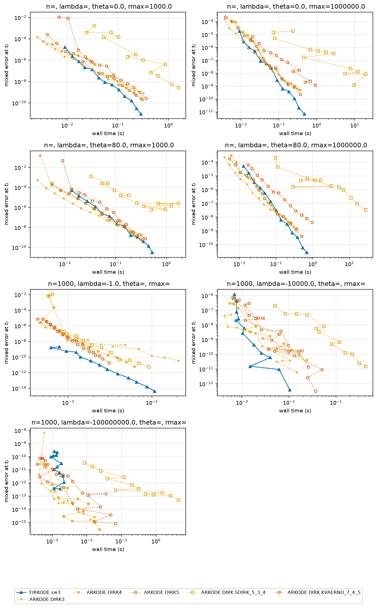

**Verdict.** [pending]

### 5.4 A3: mass matrices (candidate 3)

**Purpose.** Both packages take a constant mass matrix; compare their cost on the
finite-element heat and wave problems.

**Sweep.** `heat1dfem` with n in {101, 401}, rtol 1e-4 ... 1e-10 in decades, FIRKODE and
DIRK3/4/5 (B5's cells); `wave1dfem` with n in {100, 400}, Kelvin-Voigt and mass damping,
lumped and consistent mass, rtol 1e-3 ... 1e-8, FIRKODE and DIRK4/5. 200 cells.

**Predictions [predicted].**
- P3.1: ARKODE's mass solves per attempted step lie in [1, 3], and its consistent-mass time
  is <= 1.5x its lumped-mass time.
- P3.2: the ratio t(best DIRK)/t(FIRKODE) with a consistent mass is within [0.67, 1.5]x of
  the ratio with the lumped mass. If FIRKODE's own consistent/lumped time ratio exceeds 2
  (its slow mass-matrix path, `BENCHMARK_BDF.md` B9), the difference is FIRKODE's and goes
  to Section 7.

**Results [pending].**

<!-- begin generated: A3_mass -->
[pending]
<!-- end generated -->

<!-- begin generated: A3_counters -->
[pending]
<!-- end generated -->

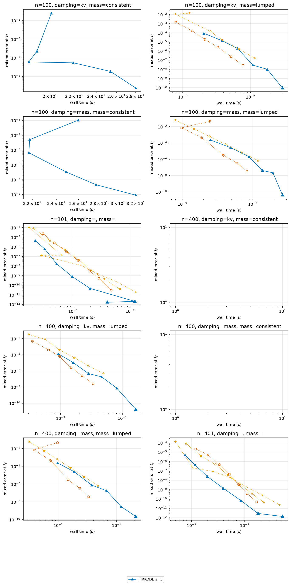

**Verdict.** [pending]

### 5.5 A4: tight tolerances, order 5 against order 5 (candidate 4)

**Purpose.** At tight tolerances the order-5 DIRK tables meet Radau IIA of order 5; where
does each pay?

**Sweep.** ROBER, VDPOL, OREGO, HIRES (references at rtol 1e-16 in extended precision) and
SECTOR at theta = 0 and 80 degrees (exact): rtol 1e-8 ... 1e-13 in half decades, FIRKODE,
DIRK5, DIRK5 optimal, KVAERNO_7_4_5, ARK548L2SAb; `bruss3d` n = 16 at rtol 1e-8 ... 1e-11
with FIRKODE and DIRK5. 344 cells; needs `--ref-bin`.

**Predictions [predicted].**
- P4.1: on the four small problems the ratio changes by < 1.5x between mescd 8 and 12 (equal
  order).
- P4.2: on SECTOR the ratio grows by >= 2x from mescd 8 to 12 (stage order, as in A2); no
  crossover in FIRKODE's disfavour up to the roundoff floor.

**Results [pending].**

<!-- begin generated: A4_crossover -->
[pending]
<!-- end generated -->

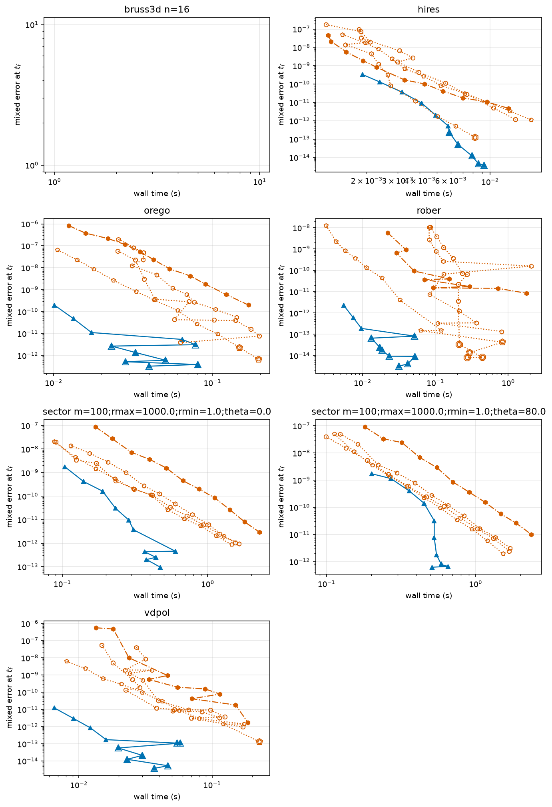

**Verdict.** [pending]

### 5.6 A5: 3-D Brusselator, full implicitness against IMEX and LSRK (candidate 5)

**Purpose.** On a reaction-diffusion problem whose stiffness is the diffusion (linear,
constant Jacobian) and whose reaction is mild, compare FIRKODE with IMEX (implicit linear
diffusion, explicit reaction) and with explicit stabilized RKC/RKL.

**Sweep.** n in {8, 12, 16} (24 with `--include-large`), KLU, rtol 1e-3 ... 1e-8 in decades;
FIRKODE, DIRK4, IMEX3/4/5, RKC2, RKL2, RKC2 power; profiled twins of FIRKODE, DIRK4 and IMEX4
at rtol 1e-6. 153 cells.

**Predictions [predicted].**
- P5.1: IMEX4 / FIRKODE <= 1/2 at mescd 4 and 6 for n >= 12 and <= 1/1.2 at mescd 8, with
  nje <= 2 and about one Newton iteration per implicit stage.
- P5.2: best LSRK / FIRKODE <= 1/3 at mescd 4 for n >= 12 but > 1 at mescd 8; the
  crossover lies in mescd [5, 8]; LSRK's most stages per step is about
  sqrt(h rho / 0.65) within 30 percent.
- P5.3: the power iteration costs <= 5 percent of LSRK's right-hand sides, but RKC2 power is
  >= 2x slower than RKC2 with the bound: with 100 iterations and a relative tolerance of
  5e-3 the iteration underestimates the spectral radius of a diffusion operator whose top
  eigenvalues cluster, and the steps it allows fail the error test [development: 103
  error-test failures against 1 on `heat2d` 40 x 40 at rtol 1e-4].
- P5.4: DIRK4 / FIRKODE >= 1.
- Profiled twins: the factorization share is >= 50 percent for FIRKODE and <= 20 percent for
  IMEX4.

**Results [pending].**

<!-- begin generated: A5_ratio -->
[pending]
<!-- end generated -->

<!-- begin generated: A5_lsrk_crossover -->
[pending]
<!-- end generated -->

<!-- begin generated: A5_counters -->
[pending]
<!-- end generated -->

<!-- begin generated: A5_profile -->
[pending]
<!-- end generated -->

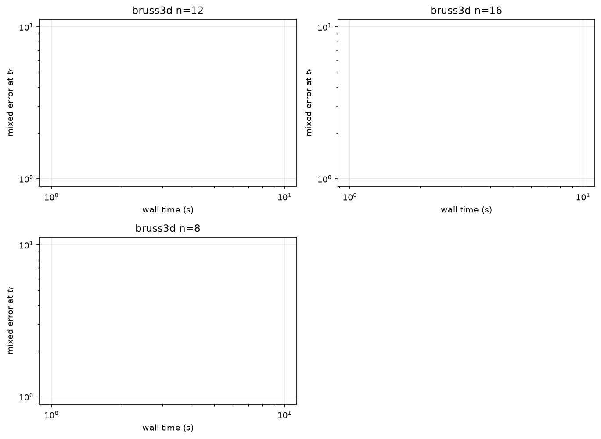


**Verdict.** [pending]

### 5.7 A6: advection-diffusion over the velocity (candidate 6)

**Purpose.** Move a problem from diffusion-dominated to advection-dominated and watch each
structure-exploiting class lose its advantage at a predicted point: IMEX at the advective
CFL limit, LSRK when the spectrum leaves the real axis (cell Peclet number above 1), MRI
not at all.

**Sweep.** `heat2d` on 200 x 100 with velocity v in {0, 0.5, 50, 500} (cell Peclet numbers
0, 0.0012, 0.12, 1.24), rtol 1e-3 ... 1e-8 in decades; FIRKODE, DIRK4, IMEX4, IMEX5, RKC2,
RKL2, RKC2 power, and for v > 0 MRI ESDIRK34a and MRI IMEX-SR32. Control: SECTOR (m = 100,
r in [1, 1e3]) at theta = 0 and 30 degrees with FIRKODE, DIRK4, RKC2 and RKL2. 252 cells.

**Predictions [predicted].**
- P6.1 (IMEX against the CFL limit): IMEX4 / FIRKODE <= 1/1.2 at v <= 0.5, >= 2 at v = 50,
  >= 20 at v = 500; IMEX's step count at v = 500 is >= 10x that at v = 0.5, with
  error-test failures >= 10 percent of the attempts.
- P6.2 (LSRK against complex spectra): best LSRK / FIRKODE <= 1/2 at mescd 4 for v <= 50,
  with a crossover in mescd [5, 7]; at v = 500 LSRK takes >= 3x its v = 50 time. On SECTOR
  at theta = 30 degrees LSRK takes >= 5x its theta = 0 time or fails, while FIRKODE changes
  by <= 1.5x.
- P6.3 (MRI): MRI's slow step count at v = 500 is within 2x of that at v = 0.5 while its fast
  step count grows >= 5x from v = 50 to 500; MRI / IMEX4 <= 1/3 at v = 500. MRI against
  FIRKODE is registered as an inconclusive band [1/3, 3].

**Results [pending].**

<!-- begin generated: A6_map -->
[pending]
<!-- end generated -->

<!-- begin generated: A6_sector -->
[pending]
<!-- end generated -->

<!-- begin generated: A6_counters -->
[pending]
<!-- end generated -->

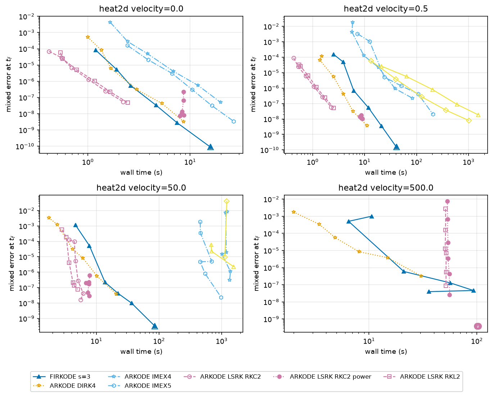

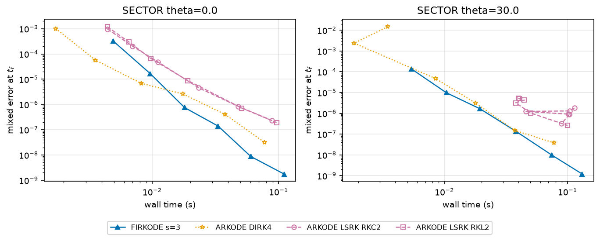

**Verdict.** [pending]

### 5.8 A7: multirate (candidate 7)

**Purpose.** On a problem with a fast and a slow scale, does the single-rate FIRKODE pay for
resolving the fast scale with implicit steps where MRI resolves it explicitly?

**Sweep.** `kprmri` with G = -100, e = 0.5 and w in {10, 100, 1000}, rtol 1e-3 ... 1e-8 in
decades; FIRKODE, DIRK4, MRI ESDIRK34a with decoupled and with MRIHTol control, MRI
IMEX-SR32. 90 cells.

**Predictions [predicted].**
- P7.1: FIRKODE's step count grows >= 20x from w = 10 to 1000 while MRI's slow step count
  grows <= 3x and its fast step count >= 20x.
- P7.2: best MRI / FIRKODE <= 1/1.5 at w = 1000 (mescd 4 and 6) and >= 1 at w = 10.
- P7.3: MRIHTol control equals decoupled control unless the fast error estimate exceeds the
  slow tolerance: its fast-tolerance factor starts at 1 and is capped at 1
  (`INNER_MAX_TOLFAC`, `src/sunadaptcontroller/mrihtol/sunadaptcontroller_mrihtol.c`
  [verified]), so it can only tighten the fast tolerance.

**Pass and fail.** Supports the multirate candidate (an ARKODE win) if P7.1 and P7.2 hold;
refutes it if MRI's slow step count grows in proportion to w or MRI never wins.

**Results [pending].**

<!-- begin generated: A7_w -->
[pending]
<!-- end generated -->

<!-- begin generated: A7_counters -->
[pending]
<!-- end generated -->

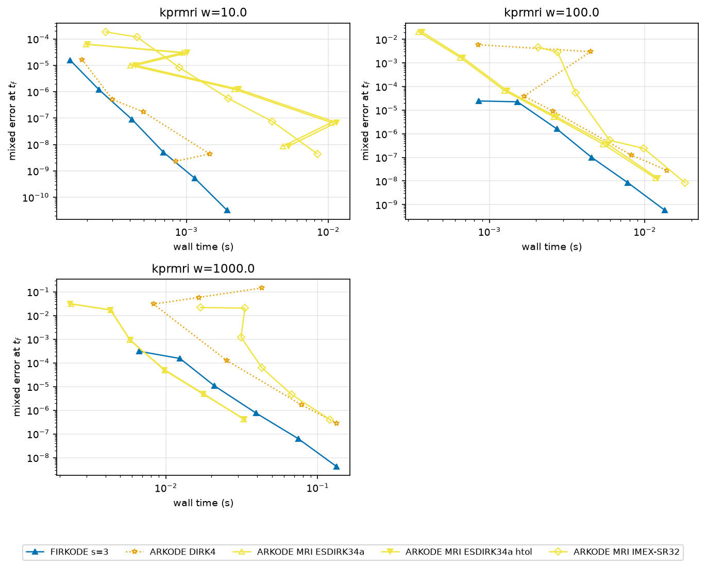

**Verdict.** [pending]

### 5.9 A8: diurnal kinetics, IMEX with exact local preconditioning (candidate 8)

**Purpose.** With the stiff kinetics implicit (2 x 2 blocks, solved exactly by the block
preconditioner) and the transport explicit, IMEX needs no global Krylov iteration; FIRKODE
treats everything implicitly with a stacked Krylov solve. The explicit transport stiffens as
the grid refines.

**Sweep.** `diurnal` on grids 10, 20, 40, 80 (160 with `--include-large`), rtol 1e-4, 1e-6,
1e-8, SPGMR; FIRKODE, DIRK4, IMEX3/4/5. 60 cells.

**Predictions [predicted].**
- P8.1: IMEX's Krylov iterations per Newton iteration are <= 1.1, FIRKODE's stacked FGMRES
  iterations per Newton iteration >= 2.
- P8.2: IMEX4 / FIRKODE rises with the grid at rtol 1e-4 and 1e-6 and is <= 1 at grids 10
  and 20; IMEX's step count doubles or more from grid 40 to 80 at rtol 1e-4 (the explicit
  vertical diffusion: rate about 4 KV0 e^10 / dy^2), FIRKODE's grows by <= 1.3x.

**Results [pending].**

<!-- begin generated: A8_grid -->
[pending]
<!-- end generated -->

<!-- begin generated: A8_counters -->
[pending]
<!-- end generated -->

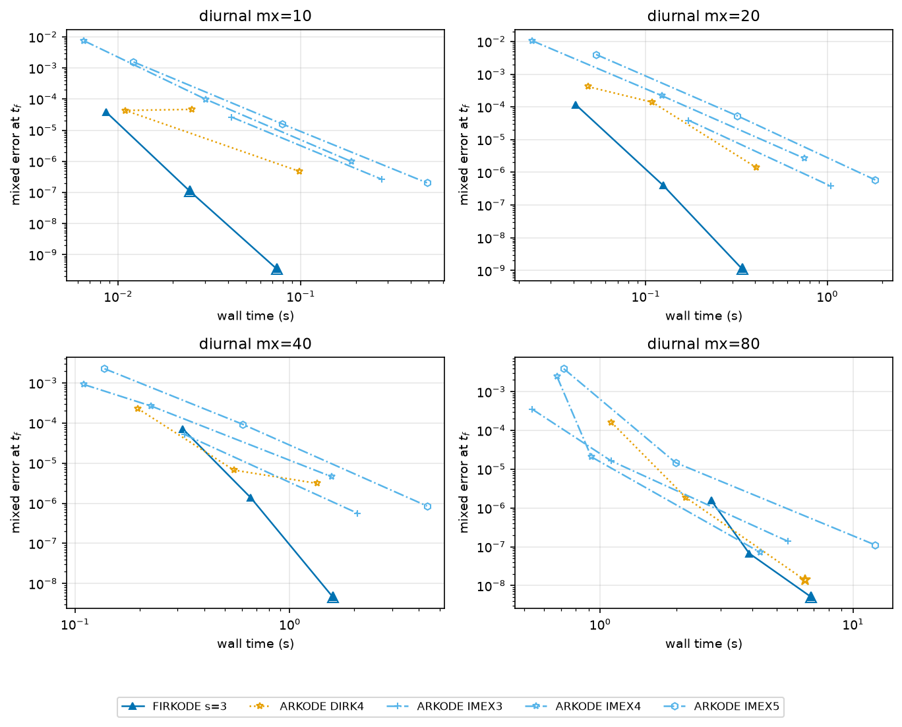

**Verdict.** [pending]

## 6. Summary

| family | candidate | verdict (best default / best of all) |
|---|---|---|
| A0 | method selection | [pending] |
| A1 | small stiff problems | [pending] |
| A2 | stage order | [pending] |
| A3 | mass matrices | [pending] |
| A4 | tight tolerances | [pending] |
| A5 | IMEX and LSRK on the 3-D Brusselator | [pending] |
| A6 | advection-diffusion over the velocity | [pending] |
| A7 | multirate | [pending] |
| A8 | IMEX on diurnal kinetics | [pending] |

## 7. Known issues and observations found by this suite

Nothing under `src/` or `include/` is changed for this suite.

- **ARKODE: `LSRKStepSetDomEigFrequency` with a negative argument** [verified]
  (`src/arkode/arkode_lsrkstep_io.c`, the function's two `if` blocks): for `nsteps < 0` it
  sets the default frequency, then the second block's `else` branch stores the negative
  value, so the dominant eigenvalue is recomputed every step; the guide says a negative
  value restores the default (25). The harness never passes a negative value.
- **ARKODE: `ARKStepSetOptimalParams`** is deprecated without a replacement and its parameter
  sets were tuned for older default tables [verified, `src/arkode/arkode_arkstep_io.c`].
- **ARKODE: answer file of `ark_analytic_lsrk`** was generated on another platform: the
  example built here gives nst 1122, attempts 1125, 3 error-test failures and 200 stages
  against 1120, 1124, 4 and 199 in the file [measured in the validation]; the replica uses
  a relative tolerance of 0.10.
- **FIRKODE: the default stacked FGMRES space on a fixed large step** [development]: on
  SECTOR with ten distinct real stiff modes (m = 10, theta = 0, r in [1, 1e3] or [1, 1e6])
  and fixed steps h >= 0.0078, the stacked FGMRES (6s = 18 iterations, no restart) fails to
  converge on the first step and FIRKODE stops with `FIRK_CONV_FAILURE`; the preconditioned
  stage operator has a distinct eigenvalue per mode and stage, and 15-30 iterations per
  Newton iteration are needed. Adaptive runs recover by reducing the step; the A2_fixed
  cells use 5 restarts.
- [pending: FIRKODE issues found by the sweep]

## 8. Limitations

One machine, one cell at a time per worker; parallel workers add noise. The DIRK class is a
declared list of nine configurations, not every table ARKODE has; the IMEX, LSRK and MRI
classes run ARKODE's defaults plus the stated options, with no per-problem tuning. The
splittings are the natural ones of each problem and are given to ARKODE only. `kprmri` has
N = 2 and equally expensive slow and fast parts, which understates what MRI saves on
problems whose fast part is cheap. FIRKODE's mass-matrix path and its loose-tolerance step
collapse are known weaknesses (`BENCHMARK_BDF.md`, Section 7) that can decide A3 and the
loosest cells. The extended-precision references need a build whose `long double` is wider
than double.

## 9. Reproduction

### 9.1 Commands

```bash
# builds (README: build-benchmark with KLU, build-benchmark-ref with extended precision)
PY=python3   # with numpy and matplotlib
BIN=build-benchmark/benchmarks/firkode/firkode_benchmark
REF=build-benchmark-ref/benchmarks/firkode/firkode_benchmark
RES=benchmarks/firkode/results/<date>-<machine>
# validation (replicas and splitting/eigenvalue checks)
$PY benchmarks/firkode/scripts/run_benchmarks.py --bin $BIN --results $RES --validate-only
# the families A0-A8, serial or with N workers (resumable)
$PY benchmarks/firkode/scripts/run_benchmarks.py --bin $BIN --ref-bin $REF --results $RES \
    --family arkode --workers 8
# report
$PY benchmarks/firkode/scripts/make_report.py --report arkode --results $RES \
    --figdir doc/shared/figs/firkode/benchmarks/arkode --inject benchmarks/firkode/BENCHMARK_ARKODE.md
```

### 9.2 Development runs

The predictions were written after the harness was developed on the author's workstation
(Apple silicon, macOS): single cells of every new integrator and problem, the validation, and
a smoke run of all families with a budget of 5 s per cell (`--fast 5`), stopped at about two
thirds of the cells and discarded; it found the FIRKODE fixed-step issue of Section 7, fixed
in the A2_fixed cell definition before any sweep. Statements informed by those runs carry the tag [development]. No prediction
is changed after the full sweep starts; an amendment before it is a dated commit.

## Appendix: CSV columns added for this report

`split`, `nfe_e`, `nfe_f`, `nst_f`, `nst_f_att`, `netf_f`, `ndomeig`, `nfe_domeig`,
`lsrk_max_stages`, `nst_expstab`, `nst_acc`, `split_residual`, `split_jac_err`,
`domeig_ratio`; the validation adds `exact`. The full dictionary is in README.md.
