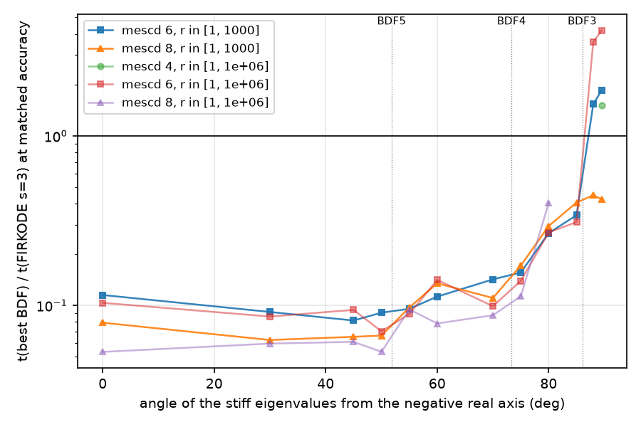
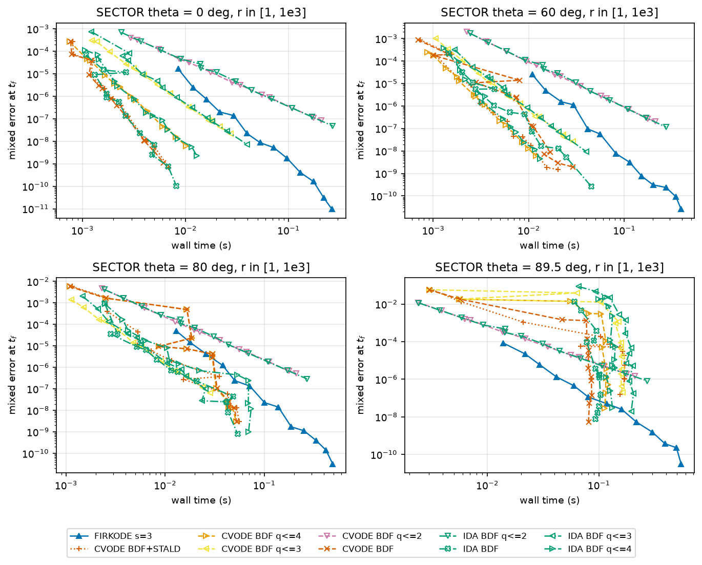
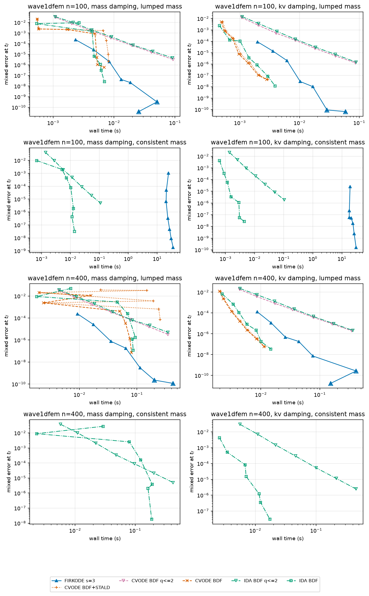
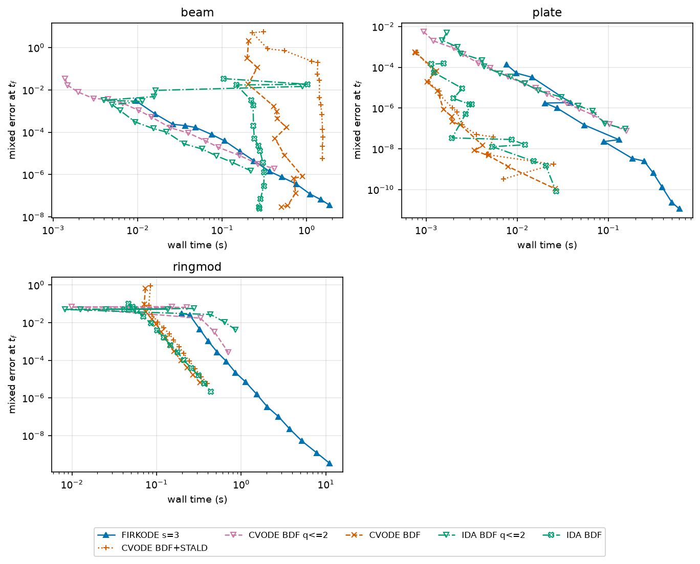
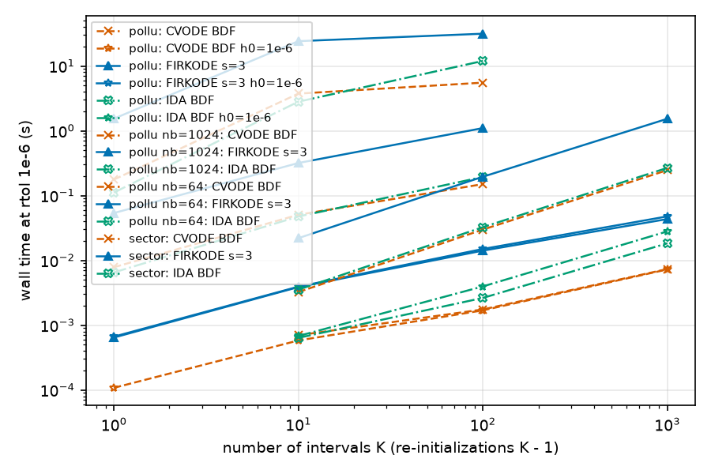
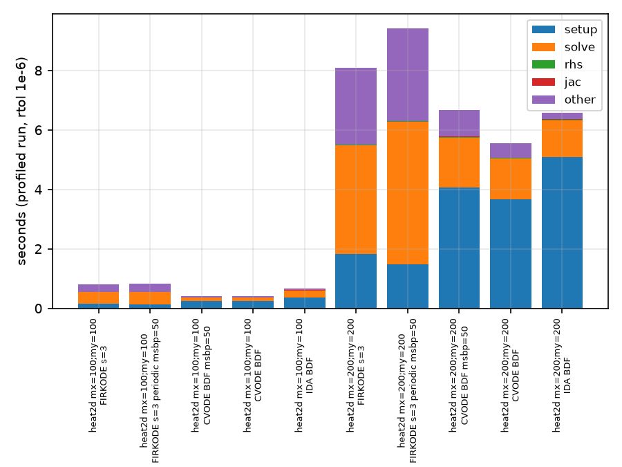
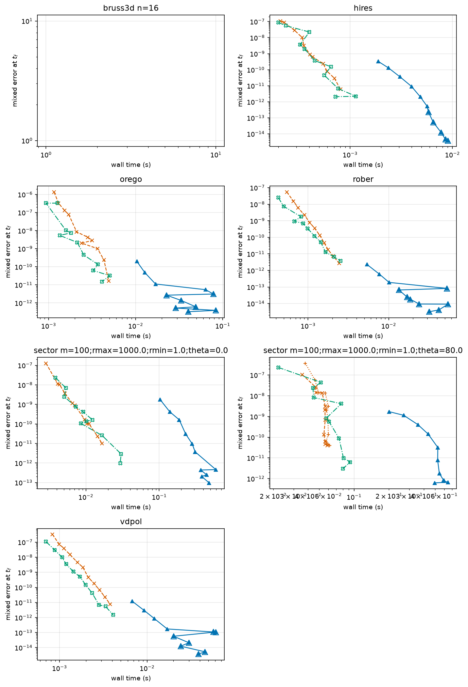

# FIRKODE versus BDF (CVODE and IDA): six candidate regimes

Status: pre-registered. The question, the decision rule, the methodology and the predictions
and pass and fail rules of every family are fixed before the full sweep; the generated
sections are filled by `scripts/make_report.py` from the CSV files of `results/<run-id>/`.
Sections marked **[pending]** have no data yet; Section 9 gives the commands.

Evidence tags: **[measured]** = a row of a CSV file in `results/`, **[predicted]** = written
down before the runs (Section 1.2 and the prediction block of every family), **[verify]** =
to be checked against a primary source before it is used.

## 1. Question and decision rule

### 1.1 Question

At matched accuracy, with symmetrically tuned baselines, is FIRKODE (Radau IIA, s = 3, order
5) faster than the BDF codes of SUNDIALS, CVODE and IDA, on six problem families, and can
every win or loss be attributed to a named mechanism? The report asks where the one-step
fully implicit method pays.

### 1.2 Decision rule

A family **supports** its candidate if FIRKODE s = 3 is faster than the best BDF configuration
(the fastest CVODE or IDA configuration of the cell group) at matched mixed digits (mescd =
-log10 of the mixed error at the final time, interpolated in log time) in at least one regime
**and** the counters show the predicted mechanism. It **refutes** the candidate if the best
BDF configuration stays faster across the whole sweep.
Timing noise is measured by the sentinel spread (Section 3.3); a win is called only at
>= 1.2x and when adjacent tolerance cells agree. Concurrent workers (`--workers N`) add noise;
rows record `nworkers`.

### 1.3 Cost model behind the candidates [predicted]

Each FIRKODE Newton iteration costs 3 right-hand sides plus 3 k_lin block solves and
Jacobian-vector products, where k_lin is the mean number of stacked FGMRES iterations per
Newton iteration; CVODE costs one right-hand side and one solve, IDA one residual (a
right-hand side and, with a mass matrix, a mass-matrix product) and one solve. All three
factorize one N x N matrix per setup. The step-count ratio BDF/FIRKODE needed for FIRKODE to
break even is about 4x when right-hand sides dominate, 10-15x when block solves dominate,
about 1x when factorizations dominate, and about 20x when the fixed per-step overhead of a
small system dominates. The six families push the ratio past the threshold (BDF limited by
stability or by order ramps after restarts) or move the cost into factorizations.

IDA [predicted]: IDA uses the same BDF formulas with the same A(alpha) sectors per order but
its own order and step selection, solves for y' as well as y, has no stability-limit
detection and evaluates the Jacobian at every setup. On the ODE problems its time at matched
accuracy stays within a factor of 2 of CVODE default's. It changes a family's verdict only
where its order selection copes with a spectrum beyond a BDF sector better than CVODE's; it
has no counterpart to STALD.

## 2. Environment and provenance

<!-- begin generated: provenance -->
| item | value |
| --- | --- |
| Machine | AMD Ryzen Threadripper PRO 9985WX 64-Cores, 377 GiB, 128 logical CPUs |
| OS | Ubuntu 24.04.5 LTS (Linux-6.8.0-146-generic-x86_64-with-glibc2.39) |
| Compiler | cc (Ubuntu 13.3.0-6ubuntu2~24.04.1) 13.3.0; CMake C++ compiler `/usr/bin/c++` |
| CMake / generator | cmake version 3.28.3 / Ninja |
| Build type and flags | Release: C `-O3 -DNDEBUG`, C++ `-O3 -DNDEBUG` |
| Precision / index size | DOUBLE / 64 |
| Logging level / error checks / profiling | 2 / OFF / OFF |
| SUNDIALS | SUNDIALS 7.9.0 |
| Git commit | v7.9.0-23-g703a69cbb on feature/firkode |
| Python / numpy / matplotlib | 3.12.3 / 2.5.3 / 3.11.2 |
| Threads | OMP_NUM_THREADS=1, VECLIB_MAXIMUM_THREADS=1 |
| Run started (UTC) | 2026-10-10T03:20:38+00:00 |
| Binary SHA-256 | 77ed377bc248df4c9ea25b4d7a4604e616370370047e43f4883180362168329a |
<!-- end generated -->

## 3. Methodology

### 3.1 Harness

`firkode_benchmark` (this directory) runs one cell per process and prints one CSV row; the
driver `scripts/run_benchmarks.py` sweeps the families, computes references, times the
sentinel cell before and after each family, and runs serially or with `--workers N`
processes claiming cells dynamically (README).

- FIRKODE runs in its BEGINNER mode unless an EXPERT-only option is requested; the `mode`
  column records which step-size rule ran (EXPERT uses a different one). FIRKODE implements
  s = 3 only.
- References are FIRKODE s = 3 at a tight tolerance cross-checked by CVODE (IDA for a
  mass-matrix problem); the mixed disagreement is the floor of every cell (`*` in the
  tables, hollow markers in the figures). Family B13 uses an extended-precision build
  (80-bit, `--ref-bin`) for its references; SECTOR has an exact solution; the published
  problems use the values of the Test Set for IVP Solvers and of E. Hairer's test set
  (`references/`).
- Instruments: CVODE stability-limit detection (`--stald`, `nstab`), BDF order histograms
  (`--order-hist`, untimed twins labelled `[order]`), restarts with re-initialization
  (`--restart-every K`, `nrestarts`), the KLU sparse direct solver (`--ls klu`), a profiling
  shim (`--profile`, untimed twins labelled `[profile]`), Jacobian dumps with the spectrum
  analysis `scripts/spectrum.py`, and the setup-reuse options (`--reuse-policy periodic`,
  `--msbp`, `--dgmax`).

### 3.2 Tolerances and references

| problem | atol / rtol | reference | cross-check |
|---|---|---|---|
| ROBER | 1e-6 | FIRKODE s = 3 at 1e-13 (B13: 1e-16, extended) | CVODE |
| VDPOL, OREGO, HIRES | 1 | FIRKODE s = 3 at 1e-13 (B13: 1e-16, extended) | CVODE |
| SECTOR, rc_pwm | 1 | exact | - |
| wave1dfem | 1e-4 | IDA at 1e-12 | FIRKODE (lumped mass) |
| POLLU | 1 | Test Set `solut` (nb = 1, no restarts); otherwise FIRKODE at 1e-13 with the same restart schedule | CVODE |
| RINGMOD | 1 | Test Set `solut` | - |
| BEAM | 1 | Test Set `solut` | Hairer `res_exact_pic` |
| PLATE | 1e-3 | Hairer `res_exact_pic` | - |
| bruss3d | 1e-2 | FIRKODE s = 3 with KLU at 1e-10 (1e-9 for n = 32) | CVODE |
| heat2d | 1e-4 | FIRKODE s = 3 at 1e-10 | CVODE |

<!-- begin generated: references -->
| problem | params | mixed disagreement s=5 vs s=7 | reference steps |
| --- | --- | --- | --- |
| diurnal | mx=10;my=10 | 1.8e-08 | 3823 |
| diurnal | mx=20;my=20 | 2.9e-08 | 4181 |
| diurnal | mx=40;my=40 | 2.0e-08 | 3857 |
| diurnal | mx=80;my=80 | 5.1e-09 | 3407 |
| heat1dfem | n=101 | 1.8e-12 | 373 |
| heat1dfem | n=1601 | 2.5e-12 | 209 |
| heat1dfem | n=401 | 1.2e-12 | 231 |
| heat2d | mx=100;my=100 | 2.9e-10 | 101 |
| heat2d | mx=200;my=100;velocity=0.5 | 4.2e-11 | 113 |
| heat2d | mx=200;my=100;velocity=50.0 | 3.8e-11 | 198 |
| heat2d | mx=200;my=100;velocity=500.0 | 3.4e-10 | 223 |
| heat2d | mx=316;my=316 | 4.9e-11 | 96 |
| hires |  | 6.0e-12 | 3939 |
| orego |  | 1.6e-11 | 51547 |
| rober |  | 2.8e-12 | 23963 |
| vdpol |  | 7.6e-12 | 49371 |
<!-- end generated -->

### 3.3 Timing protocol

Wall-clock seconds of setup plus evolve, `std::chrono::steady_clock`, repeated in one process
(pilot run, then 5-200 repetitions for about one second, a single repetition above 10 s);
the median is reported, the minimum is in the CSV. One cell at a time per worker,
`OMP_NUM_THREADS=1`. The sentinel cell (ROBER, FIRKODE s = 3, rtol 1e-6, 20 repetitions)
runs before and after every family in every worker; its rows are in
`results/<run-id>/sentinel.csv`, and `make_report.py` writes their spread to
`results/<run-id>/tables/sentinel.md`.

### 3.4 Fairness caveats

1. Baselines run at their defaults; the only tuned variants are the ones the family sweeps
   (STALD, a limited maximum order, the setup frequency, a matched initial step), and the
   matching FIRKODE knob is swept where one exists (periodic reuse policy, initial step).
2. FIRKODE solves the stage systems inexactly with a stacked FGMRES preconditioned by block
   solves; CVODE solves one N x N system directly. Counters are compared on the work they
   measure; the bottom line is wall time at matched accuracy.
3. `nfe` means different things: FIRKODE counts the refilter evaluation and the initial-step
   heuristic, IDA counts residuals.
4. FIRKODE's periodic reuse policy is an EXPERT-mode variant and runs with the EXPERT
   step-size rule; such cells are labelled `periodic`.
5. BEAM has no published Jacobian: every integrator uses dense difference quotients there.
6. IDA solves the residual form `M y' - f(t, y) = 0` of every problem, the ODE problems
   included (`M = I`), and runs every CVODE configuration it has an option for: the maximum
   order and the initial step, but neither STALD nor a setup frequency. It evaluates the
   Jacobian at every setup, because its iteration matrix `cj M - J` changes with `cj`; CVODE
   reuses J across setups.

### 3.5 Harness validation

`--validate` replicates repository examples and tests and compares their counters with the
answer files by the criterion `test/testRunner` applies to them (integers within 10 percent,
floats to 4 digits; Krylov paths within a stated relative tolerance); the table marks the
replicas that match exactly. Where the counters of the Linux workstation that runs the sweep
differ from an answer file in the last bits (a root search, a long run at a tight tolerance),
the replica expects the Linux value, so that the direct-solver replicas match exactly on that
workstation. The sweeps run only if every replica passes.

<!-- begin generated: validation -->
| replica | passed | exact | tolerance | mismatch | note |
| --- | --- | --- | --- | --- | --- |
| firk_robertson | yes | yes | answer | - | examples/firkode/C_serial/firk_robertson.out |
| firk_analytic | yes | yes | answer | - | examples/firkode/C_serial/firk_analytic.out |
| firk_diurnal_kry | yes | yes | 0.05 | - | the counts of the Linux workstation of the sweeps (Krylov path); examples/firkode/C_serial/firk_diurnal_kry.out reports nst=199 nfe=1197 nni=331 nsli=1905 nli=363 njtv=6078 nsetups=117 netf=10 npe=117 nps=6290 |
| firk_heat1D_fem_mass | yes | yes | answer | - | examples/firkode/C_serial/firk_heat1D_fem_mass.out |
| firk_robertson_root | yes | yes | answer | - | 179 g evaluations on the Linux workstation of the sweeps; examples/firkode/C_serial/firk_robertson_root.out reports 180 (the example advances the output time after a root return, the harness continues to the same output time) |
| firk_test_order_kpr_3_h0 | yes | yes | 0.0001 | - | test/unit_tests/firkode/CXX_serial/firk_test_order_kpr_3.out |
| firk_test_order_kpr_3_h1 | yes | yes | 0.0001 | - | test/unit_tests/firkode/CXX_serial/firk_test_order_kpr_3.out |
| firk_test_order_kpr_3_h2 | yes | yes | 0.0001 | - | test/unit_tests/firkode/CXX_serial/firk_test_order_kpr_3.out |
| firk_test_order_kpr_3_h3 | yes | yes | 0.0001 | - | test/unit_tests/firkode/CXX_serial/firk_test_order_kpr_3.out |
| firk_test_order_pr_3_-1e4_h0 | yes | yes | 0.0001 | - | test/unit_tests/firkode/CXX_serial/firk_test_order_pr_3_-1e4.out |
| firk_test_order_pr_3_-1e4_h1 | yes | yes | 0.0001 | - | test/unit_tests/firkode/CXX_serial/firk_test_order_pr_3_-1e4.out |
| firk_test_order_pr_3_-1e4_h2 | yes | yes | 0.0001 | - | test/unit_tests/firkode/CXX_serial/firk_test_order_pr_3_-1e4.out |
| firk_test_order_pr_3_-1e4_h3 | yes | yes | 0.0001 | - | test/unit_tests/firkode/CXX_serial/firk_test_order_pr_3_-1e4.out; it prints 'error < 1e4 u' for this step size |
| firk_test_vdp_1e-6 | yes | yes | answer | - | test/unit_tests/firkode/CXX_serial/firk_test_vdp.cpp: step counts of its former answer file firk_test_vdp.out |
| firk_test_vdp_1e-10 | yes | yes | answer | - | test/unit_tests/firkode/CXX_serial/firk_test_vdp.cpp: step counts of its former answer file firk_test_vdp.out; 9340 steps on the Linux workstation of the sweeps, 9345 in that file |
| firk_test_vdp_1e-4 | yes | yes | answer | - | test/unit_tests/firkode/CXX_serial/firk_test_vdp.cpp: step counts of its former answer file firk_test_vdp.out (the loose-tolerance run of benchmark issue 2) |
| ark_analytic | yes | yes | answer | - | examples/arkode/C_serial/ark_analytic.out (ARKodeSetLinear as in the example) |
| ark_analytic_table_name | yes | yes | answer | - | examples/arkode/C_serial/ark_analytic_arkode.scalar_tolerances_1e-6_1e-8_arkode.table_names_ARKODE_ESDIRK547L2SA_7_4_5_ARKODE_ERK_NONE.out (a table chosen by name) |
| test_logging_arkode_arkstep_1_1_1 | yes | yes | answer | - | test/unit_tests/logging/test_logging_arkode_arkstep_1_1_1.out (three one-step returns towards t = 1) |
| test_logging_arkode_arkstep_2_1_1 | yes | yes | answer | - | test/unit_tests/logging/test_logging_arkode_arkstep_2_1_1.out (ImEx, Newton, dense; the splitting of problems/kpr.hpp) |
| ark_analytic_lsrk | yes | yes | 0.1 | - | examples/arkode/C_serial/ark_analytic_lsrk.out |
| ark_kpr_mri_7_2_0.002 | yes | yes | answer | - | examples/arkode/C_serial/ark_kpr_mri_7_2_0.002.out (slow ARKODE_MRI_GARK_IRK21a, fast ARKODE_HEUN_EULER_2_1_2, fixed steps) |
| ark_kpr_mri_11_2_0.001 | yes | yes | answer | - | examples/arkode/C_serial/ark_kpr_mri_11_2_0.001.out (slow ARKODE_IMEX_MRI_SR21, fast ARKODE_HEUN_EULER_2_1_2, fixed steps) |
| ark_kpr_mri_3_2_0.001 | yes | yes | answer | - | examples/arkode/C_serial/ark_kpr_mri_3_2_0.001.out (slow ARKODE_MERK21, fast ARKODE_HEUN_EULER_2_1_2, fixed steps) |
| check_split_kpr_imex | yes | yes | answer | - | --check-split: |f - (fe + fi + ff)| relative to the pieces' norms, and the implicit Jacobian against central differences of fi |
| check_split_bruss3d_imex | yes | yes | answer | - | --check-split: |f - (fe + fi + ff)| relative to the pieces' norms, and the implicit Jacobian against central differences of fi |
| check_split_heat2d_imex | yes | yes | answer | - | --check-split: |f - (fe + fi + ff)| relative to the pieces' norms, and the implicit Jacobian against central differences of fi |
| check_split_heat2d_mri | yes | yes | answer | - | --check-split: |f - (fe + fi + ff)| relative to the pieces' norms, and the implicit Jacobian against central differences of fi |
| check_split_heat2d_mri-imex | yes | yes | answer | - | --check-split: |f - (fe + fi + ff)| relative to the pieces' norms, and the implicit Jacobian against central differences of fi |
| check_split_diurnal_imex | yes | yes | answer | - | --check-split: |f - (fe + fi + ff)| relative to the pieces' norms, and the implicit Jacobian against central differences of fi |
| check_split_kprmri_mri | yes | yes | answer | - | --check-split: |f - (fe + fi + ff)| relative to the pieces' norms, and the implicit Jacobian against central differences of fi |
| check_split_kprmri_mri-imex | yes | yes | answer | - | --check-split: |f - (fe + fi + ff)| relative to the pieces' norms, and the implicit Jacobian against central differences of fi |
| check_split_kprmri_mri-explicit | yes | yes | answer | - | --check-split: |f - (fe + fi + ff)| relative to the pieces' norms, and the implicit Jacobian against central differences of fi |
| check_domeig_analytic_lambda-1e+06 | yes | yes | answer | - | --check-domeig: the problem's eigenvalue bound over the power iteration's estimate at (t0, y0) |
| check_domeig_pr_lambda-10000 | yes | yes | answer | - | --check-domeig: the problem's eigenvalue bound over the power iteration's estimate at (t0, y0) |
| check_domeig_sector_m10_theta0_rmin1_rmax100 | yes | yes | answer | - | --check-domeig: the problem's eigenvalue bound over the power iteration's estimate at (t0, y0) |
| check_domeig_heat2d_mx12_my10 | yes | yes | answer | - | --check-domeig: the problem's eigenvalue bound over the power iteration's estimate at (t0, y0) |
| check_domeig_heat2d_mx12_my10_velocity0.5 | yes | yes | answer | - | --check-domeig: the problem's eigenvalue bound over the power iteration's estimate at (t0, y0) |
| check_domeig_bruss3d_n6 | yes | yes | answer | - | --check-domeig: the problem's eigenvalue bound over the power iteration's estimate at (t0, y0) |
| cv_kpr | yes | yes | 0.1 | - | examples/cvode/CXX_serial/cv_kpr.out |
| idaRoberts_dns | yes | yes | answer | - | examples/ida/serial/idaRoberts_dns.out (the example poses the DAE with the conservation constraint; the harness poses the ODE in residual form and reproduces every counter) |
| cvRoberts_dns | yes | yes | 0.1 | - | examples/cvode/serial/cvRoberts_dns.out computes the second component as -yd1 - yd3, a different floating-point expression; informational only |
<!-- end generated -->

## 4. Problems

| name | system | N | interval | family |
|---|---|---|---|---|
| `sector` | `y' = A (y - phi) + phi'`, eigenvalues `r_k (-cos theta +- i sin theta)`, `r_k` log-spaced | 2 m | [0, 10] | B8, B11 (square forcing), B13 |
| `wave1dfem` | P1 finite elements of `M u'' + C u' + K u = g(t) b`, damping `alpha M`, `beta K` or both, consistent or lumped mass | 2 n | [0, 4] | B9 |
| `beam`, `plate`, `ringmod` | published stiff problems (Test Set for IVP Solvers, E. Hairer) | 80, 80, 15 | [0, 5], [0, 7], [0, 1e-3] | B10 |
| `pollu` | pollution kinetics, `nb` block-diagonal copies, relaxation towards the initial state at every restart | 20 nb | [0, 60] | B11 |
| `bruss3d` | 3-D Brusselator, 7-point Laplacian, CSR Jacobian for KLU | 2 n^3 | [0, 10] | B12, B13 |
| ROBER, VDPOL, OREGO, HIRES, `heat2d` | small stiff problems and 2-D advection-diffusion (README) | 3, 2, 3, 8, mx my | README | B1, B13, B12 (control) |

## 5. Results

### 5.1 B8: spectral-angle sweep (candidate 1, the A(alpha) mechanism)

**Purpose.** Isolate the A(alpha) mechanism with an exact solution and one parameter, the
angle theta of the stiff eigenvalues from the negative real axis. BDF3/4/5 are
A(alpha)-stable with alpha = 86.03, 73.35 and 51.84 degrees (computed by `spectrum.py` from
the boundary locus and matching Hairer-Wanner II, Section V.2); a spectrum spread over many
magnitudes at an angle beyond alpha_q always puts some h lambda in the unstable lobe of order q.

**Sweep.** theta in {0, 30, 45, 50, 55, 60, 70, 75, 80, 85, 88, 89.5} degrees, r in [1, 1e3]
and [1, 1e6], m = 100 (N = 200), rtol 1e-4 ... 1e-10 in half decades, atol = rtol;
configurations FIRKODE s = 3, CVODE default, CVODE with STALD, and CVODE with the maximum
order limited to 4, 3 and 2 (the A(73.35 degree), A(86.03 degree) and A-stable members of
the family, so that every angle has a BDF configuration whose stability sector covers the
spectrum), IDA default and IDA with the same order limits; order histograms of CVODE, CVODE
with STALD and IDA at six angles; N = 2000 at three angles (FIRKODE, CVODE, CVODE with STALD,
IDA); a coupled (dense) and a perturbed variant at 80 degrees.

**Predictions [predicted].** theta <= 50 degrees: CVODE 3-5x faster. 52-86 degrees: CVODE's
mean order falls as theta passes 52 and 73 degrees, error-test failures rise without STALD,
the ratio moves towards FIRKODE. theta >= 86 degrees: the best BDF configuration is
effectively order 2, FIRKODE s = 3 is faster at rtol <= 1e-6 and the gap grows as rtol
tightens, roughly as tol^(-1/2) against tol^(-1/5) in steps. FIRKODE's k_lin stays bounded
(2.5-5) for all theta. IDA default, without STALD, behaves like CVODE default beyond 73
degrees; its order-limited runs track CVODE's.

**Pass and fail.** Supports candidate 1 if for some theta >= 75 degrees and rtol <= 1e-6
t(best BDF) / t(FIRKODE s = 3) > 1 and the time-weighted BDF order there is <= 2.5. Refutes it
if the best BDF configuration stays faster at 89.5 degrees for every rtol.

**Results [pending].**

<!-- begin generated: B8_ratio_theta -->
| theta (deg) | r range | t(best BDF) / t(FIRKODE) at mescd=4 | t(best BDF) / t(FIRKODE) at mescd=6 | t(best BDF) / t(FIRKODE) at mescd=8 | CVODE order (time-weighted) at rtol 1e-6 | IDA order (time-weighted) at rtol 1e-6 | k_lin at rtol 1e-6 |
| --- | --- | --- | --- | --- | --- | --- | --- |
| 0.0 | [1, 1000] | NA | 0.115 (IDA BDF) | 0.0791 (CVODE BDF) | 4.94 | 4.96 | 11.7 |
| 30.0 | [1, 1000] | NA | 0.0916 (CVODE BDF) | 0.0626 (CVODE BDF) | NA | NA | 13.4 |
| 45.0 | [1, 1000] | NA | 0.0815 (CVODE BDF) | 0.0653 (CVODE BDF) | NA | NA | 14.6 |
| 50.0 | [1, 1000] | NA | 0.0906 (CVODE BDF) | 0.0664 (CVODE BDF) | NA | NA | 15 |
| 55.0 | [1, 1000] | NA | 0.0956 (CVODE BDF) | 0.0972 (CVODE BDF+STALD) | NA | NA | 14.4 |
| 60.0 | [1, 1000] | NA | 0.113 (CVODE BDF+STALD) | 0.135 (CVODE BDF q<=4) | 4.94 | 3.96 | 12.4 |
| 70.0 | [1, 1000] | NA | 0.142 (IDA BDF q<=4) | 0.111 (CVODE BDF q<=4) | NA | NA | 10.4 |
| 75.0 | [1, 1000] | NA | 0.156 (CVODE BDF q<=4) | 0.172 (CVODE BDF q<=4) | 3.98 | 3.66 | 11.1 |
| 80.0 | [1, 1000] | NA | 0.267 (IDA BDF) | 0.294 (IDA BDF) | 3.96 | 3.5 | 11.4 |
| 85.0 | [1, 1000] | NA | 0.341 (CVODE BDF q<=3) | 0.405 (CVODE BDF q<=4) | 3.93 | 3.6 | 12 |
| 88.0 | [1, 1000] | NA | 1.54 (CVODE BDF) | 0.447 (CVODE BDF) | NA | NA | 12.7 |
| 89.5 | [1, 1000] | NA | 1.86 (CVODE BDF) | 0.423 (CVODE BDF) | 4.5 | 4.84 | 12.8 |
| 0.0 | [1, 1e+06] | NA | 0.104 (CVODE BDF) | 0.0532 (CVODE BDF) | NA | NA | 13.4 |
| 30.0 | [1, 1e+06] | NA | 0.086 (CVODE BDF) | 0.0596 (CVODE BDF) | NA | NA | 14.2 |
| 45.0 | [1, 1e+06] | NA | 0.0941 (CVODE BDF) | 0.061 (CVODE BDF) | NA | NA | 15 |
| 50.0 | [1, 1e+06] | NA | 0.0704 (CVODE BDF) | 0.0533 (CVODE BDF) | NA | NA | 14.3 |
| 55.0 | [1, 1e+06] | NA | 0.089 (CVODE BDF) | 0.0948 (CVODE BDF+STALD) | NA | NA | 12.5 |
| 60.0 | [1, 1e+06] | NA | 0.141 (CVODE BDF q<=4) | 0.0783 (CVODE BDF+STALD) | NA | NA | 12.4 |
| 70.0 | [1, 1e+06] | NA | 0.099 (IDA BDF q<=4) | 0.0876 (CVODE BDF q<=4) | NA | NA | 10.5 |
| 75.0 | [1, 1e+06] | NA | 0.14 (CVODE BDF q<=4) | 0.113 (CVODE BDF q<=4) | NA | NA | 11.2 |
| 80.0 | [1, 1e+06] | NA | 0.27 (CVODE BDF q<=3) | 0.401 (IDA BDF) | NA | NA | 11.5 |
| 85.0 | [1, 1e+06] | NA | 0.31 (CVODE BDF q<=3) | NA | NA | NA | 12.2 |
| 88.0 | [1, 1e+06] | NA | 3.57 (CVODE BDF+STALD) | NA | NA | NA | 12.8 |
| 89.5 | [1, 1e+06] | 1.52 (CVODE BDF q<=2) | 4.18 (IDA BDF q<=2) | NA | NA | NA | 12.9 |
<!-- end generated -->





<!-- begin generated: B8_orders -->
| method | params | rtol | steps | q_hist (q=1..5) | mean q (steps) | mean q (time) |
| --- | --- | --- | --- | --- | --- | --- |
| CVODE BDF+STALD | m=100;rmax=1000.0;rmin=1.0;theta=0.0 | 1e-06 | 249 | 2;9;10;9;219 | 4.74 | 4.94 |
| CVODE BDF+STALD | m=100;rmax=1000.0;rmin=1.0;theta=0.0 | 1e-08 | 450 | 2;9;6;13;420 | 4.87 | 4.98 |
| CVODE BDF | m=100;rmax=1000.0;rmin=1.0;theta=0.0 | 1e-06 | 249 | 2;9;10;9;219 | 4.74 | 4.94 |
| CVODE BDF | m=100;rmax=1000.0;rmin=1.0;theta=0.0 | 1e-08 | 450 | 2;9;6;13;420 | 4.87 | 4.98 |
| IDA BDF | m=100;rmax=1000.0;rmin=1.0;theta=0.0 | 1e-06 | 285 | 2;15;9;6;253 | 4.73 | 4.96 |
| IDA BDF | m=100;rmax=1000.0;rmin=1.0;theta=0.0 | 1e-08 | 628 | 2;20;6;17;583 | 4.85 | 4.99 |
| CVODE BDF+STALD | m=100;rmax=1000.0;rmin=1.0;theta=60.0 | 1e-06 | 385 | 2;9;16;57;301 | 4.68 | 4.83 |
| CVODE BDF+STALD | m=100;rmax=1000.0;rmin=1.0;theta=60.0 | 1e-08 | 1060 | 2;9;26;144;879 | 4.78 | 4.88 |
| CVODE BDF | m=100;rmax=1000.0;rmin=1.0;theta=60.0 | 1e-06 | 1336 | 2;9;10;13;1302 | 4.95 | 4.94 |
| CVODE BDF | m=100;rmax=1000.0;rmin=1.0;theta=60.0 | 1e-08 | 1754 | 2;9;28;53;1662 | 4.92 | 4.94 |
| IDA BDF | m=100;rmax=1000.0;rmin=1.0;theta=60.0 | 1e-06 | 687 | 2;27;258;291;109 | 3.7 | 3.96 |
| IDA BDF | m=100;rmax=1000.0;rmin=1.0;theta=60.0 | 1e-08 | 1731 | 2;20;279;1126;304 | 3.99 | 4.17 |
| CVODE BDF+STALD | m=100;rmax=1000.0;rmin=1.0;theta=75.0 | 1e-06 | 600 | 2;11;12;575;0 | 3.93 | 3.98 |
| CVODE BDF+STALD | m=100;rmax=1000.0;rmin=1.0;theta=75.0 | 1e-08 | 2109 | 2;9;32;2066;0 | 3.97 | 3.99 |
| CVODE BDF | m=100;rmax=1000.0;rmin=1.0;theta=75.0 | 1e-06 | 600 | 2;11;12;575;0 | 3.93 | 3.98 |
| CVODE BDF | m=100;rmax=1000.0;rmin=1.0;theta=75.0 | 1e-08 | 2109 | 2;9;32;2066;0 | 3.97 | 3.99 |
| IDA BDF | m=100;rmax=1000.0;rmin=1.0;theta=75.0 | 1e-06 | 863 | 2;20;341;469;31 | 3.59 | 3.66 |
| IDA BDF | m=100;rmax=1000.0;rmin=1.0;theta=75.0 | 1e-08 | 2344 | 2;20;289;1939;94 | 3.9 | 3.94 |
| CVODE BDF+STALD | m=100;rmax=1000.0;rmin=1.0;theta=80.0 | 1e-06 | 844 | 2;11;164;667;0 | 3.77 | 3.88 |
| CVODE BDF+STALD | m=100;rmax=1000.0;rmin=1.0;theta=80.0 | 1e-08 | 7417 | 2;9;128;7278;0 | 3.98 | 3.97 |
| CVODE BDF | m=100;rmax=1000.0;rmin=1.0;theta=80.0 | 1e-06 | 3261 | 2;18;40;3201;0 | 3.97 | 3.96 |
| CVODE BDF | m=100;rmax=1000.0;rmin=1.0;theta=80.0 | 1e-08 | 5820 | 2;9;112;5697;0 | 3.98 | 3.97 |
| IDA BDF | m=100;rmax=1000.0;rmin=1.0;theta=80.0 | 1e-06 | 991 | 2;20;501;467;1 | 3.45 | 3.5 |
| IDA BDF | m=100;rmax=1000.0;rmin=1.0;theta=80.0 | 1e-08 | 3259 | 2;20;1549;1603;85 | 3.54 | 3.53 |
| CVODE BDF+STALD | m=100;rmax=1000.0;rmin=1.0;theta=85.0 | 1e-06 | 1492 | 2;18;796;676;0 | 3.44 | 3.63 |
| CVODE BDF+STALD | m=100;rmax=1000.0;rmin=1.0;theta=85.0 | 1e-08 | 5144 | 2;9;2504;2629;0 | 3.51 | 3.67 |
| CVODE BDF | m=100;rmax=1000.0;rmin=1.0;theta=85.0 | 1e-06 | 9417 | 2;11;50;9354;0 | 3.99 | 3.93 |
| CVODE BDF | m=100;rmax=1000.0;rmin=1.0;theta=85.0 | 1e-08 | 11599 | 2;9;56;11532;0 | 3.99 | 3.98 |
| IDA BDF | m=100;rmax=1000.0;rmin=1.0;theta=85.0 | 1e-06 | 5572 | 2;358;1378;1396;2438 | 4.06 | 3.6 |
| IDA BDF | m=100;rmax=1000.0;rmin=1.0;theta=85.0 | 1e-08 | 12841 | 2;80;3462;5218;4079 | 4.04 | 4.01 |
| CVODE BDF+STALD | m=100;rmax=1000.0;rmin=1.0;theta=89.5 | 1e-06 | 18549 | 2;11062;7485;0;0 | 2.4 | 2.56 |
| CVODE BDF+STALD | m=100;rmax=1000.0;rmin=1.0;theta=89.5 | 1e-08 | 29562 | 2;18;29270;272;0 | 3.01 | 3.01 |
| CVODE BDF | m=100;rmax=1000.0;rmin=1.0;theta=89.5 | 1e-06 | 13912 | 2;13;3161;515;10221 | 4.51 | 4.5 |
| CVODE BDF | m=100;rmax=1000.0;rmin=1.0;theta=89.5 | 1e-08 | 14988 | 2;9;2072;417;12488 | 4.69 | 4.8 |
| IDA BDF | m=100;rmax=1000.0;rmin=1.0;theta=89.5 | 1e-06 | 14314 | 2;43;187;912;13170 | 4.9 | 4.84 |
| IDA BDF | m=100;rmax=1000.0;rmin=1.0;theta=89.5 | 1e-08 | 15188 | 2;20;143;1699;13324 | 4.86 | 4.85 |
<!-- end generated -->

<!-- begin generated: B8_variants -->
| method | rtol | mescd | steps | attempts | Newton | Jac | setups | err fails | NLS fails | params | nsli | time (ms) | status |
| --- | --- | --- | --- | --- | --- | --- | --- | --- | --- | --- | --- | --- | --- |
| FIRKODE s=3 | 1e-06 | 6.47 | 213 | 213 | 389 | 1 | 22 | 0 | 0 | delta=0.01;m=100;rmax=1000.0;rmin=1.0;theta=80.0 | 4402 | 58.3 | ok |
| FIRKODE s=3 | 1e-06 | 6.45 | 178 | 178 | 350 | 1 | 16 | 0 | 0 | m=1000;rmax=1000.0;rmin=1.0;theta=80.0 | 3973 | 515 | ok |
| FIRKODE s=3 | 1e-06 | 6.78 | 169 | 169 | 197 | 1 | 13 | 0 | 0 | m=1000;rmax=1000.0;rmin=1.0;theta=0.0 | 2297 | 293 | ok |
| FIRKODE s=3 | 1e-06 | 6.16 | 181 | 181 | 356 | 1 | 16 | 0 | 0 | m=1000;rmax=1000.0;rmin=1.0;theta=89.5 | 4562 | 590 | ok |
| FIRKODE s=3 | 1e-06 | 6.63 | 177 | 177 | 348 | 1 | 7 | 0 | 0 | coupled=1;m=50;rmax=1000.0;rmin=1.0;theta=80.0 | 3982 | 54.8 | ok |
| FIRKODE s=3 | 1e-08 | 8.19 | 575 | 575 | 1145 | 1 | 37 | 0 | 0 | m=1000;rmax=1000.0;rmin=1.0;theta=89.5 | 17191 | 2.19e+03 | ok |
| FIRKODE s=3 | 1e-08 | 8.6 | 568 | 568 | 1132 | 1 | 7 | 0 | 0 | coupled=1;m=50;rmax=1000.0;rmin=1.0;theta=80.0 | 14589 | 196 | ok |
| FIRKODE s=3 | 1e-08 | 8.76 | 707 | 707 | 1312 | 1 | 27 | 0 | 0 | delta=0.01;m=100;rmax=1000.0;rmin=1.0;theta=80.0 | 16093 | 210 | ok |
| FIRKODE s=3 | 1e-08 | 9.27 | 547 | 547 | 639 | 1 | 13 | 0 | 0 | m=1000;rmax=1000.0;rmin=1.0;theta=0.0 | 7608 | 968 | ok |
| FIRKODE s=3 | 1e-08 | 8.3 | 568 | 568 | 1130 | 1 | 37 | 0 | 0 | m=1000;rmax=1000.0;rmin=1.0;theta=80.0 | 14643 | 1.86e+03 | ok |
| CVODE BDF+STALD | 1e-06 | 5.01 | 892 | NA | 980 | 15 | 62 | 9 | 0 | coupled=1;m=50;rmax=1000.0;rmin=1.0;theta=80.0 | NA | 9.72 | ok |
| CVODE BDF+STALD | 1e-06 | 5.09 | 1323 | NA | 1449 | 23 | 92 | 13 | 0 | delta=0.01;m=100;rmax=1000.0;rmin=1.0;theta=80.0 | NA | 8.32 | ok |
| CVODE BDF+STALD | 1e-06 | 4.27 | 762 | NA | 838 | 14 | 53 | 9 | 0 | m=1000;rmax=1000.0;rmin=1.0;theta=80.0 | NA | 44.6 | ok |
| CVODE BDF+STALD | 1e-06 | 3.89 | 16783 | NA | 17663 | 281 | 853 | 5 | 0 | m=1000;rmax=1000.0;rmin=1.0;theta=89.5 | NA | 893 | ok |
| CVODE BDF+STALD | 1e-06 | 5.42 | 248 | NA | 257 | 5 | 20 | 0 | 0 | m=1000;rmax=1000.0;rmin=1.0;theta=0.0 | NA | 13.9 | ok |
| CVODE BDF+STALD | 1e-08 | 6.15 | 3322 | NA | 3629 | 56 | 209 | 33 | 0 | m=1000;rmax=1000.0;rmin=1.0;theta=80.0 | NA | 193 | ok |
| CVODE BDF+STALD | 1e-08 | 6.01 | 3668 | NA | 3996 | 62 | 225 | 34 | 0 | delta=0.01;m=100;rmax=1000.0;rmin=1.0;theta=80.0 | NA | 23.2 | ok |
| CVODE BDF+STALD | 1e-08 | 6.82 | 459 | NA | 489 | 8 | 37 | 2 | 0 | m=1000;rmax=1000.0;rmin=1.0;theta=0.0 | NA | 26.9 | ok |
| CVODE BDF+STALD | 1e-08 | 6.81 | 3717 | NA | 4067 | 62 | 229 | 36 | 0 | coupled=1;m=50;rmax=1000.0;rmin=1.0;theta=80.0 | NA | 38.1 | ok |
| CVODE BDF+STALD | 1e-08 | 4.26 | 28451 | NA | 29992 | 475 | 1435 | 5 | 0 | m=1000;rmax=1000.0;rmin=1.0;theta=89.5 | NA | 1.56e+03 | ok |
| CVODE BDF q<=4 | 1e-06 | 5.03 | 2443 | NA | 2675 | 42 | 147 | 22 | 0 | coupled=1;m=50;rmax=1000.0;rmin=1.0;theta=80.0 | NA | 24.2 | ok |
| CVODE BDF q<=4 | 1e-06 | 4.02 | 6066 | NA | 6491 | 102 | 341 | 31 | 0 | delta=0.01;m=100;rmax=1000.0;rmin=1.0;theta=80.0 | NA | 35.1 | ok |
| CVODE BDF q<=4 | 1e-08 | 6.45 | 4404 | NA | 4770 | 74 | 265 | 39 | 0 | coupled=1;m=50;rmax=1000.0;rmin=1.0;theta=80.0 | NA | 43.8 | ok |
| CVODE BDF q<=4 | 1e-08 | 6.67 | 6786 | NA | 7254 | 113 | 379 | 34 | 0 | delta=0.01;m=100;rmax=1000.0;rmin=1.0;theta=80.0 | NA | 39.4 | ok |
| CVODE BDF q<=3 | 1e-06 | 4.4 | 668 | NA | 672 | 12 | 41 | 0 | 0 | coupled=1;m=50;rmax=1000.0;rmin=1.0;theta=80.0 | NA | 6.55 | ok |
| CVODE BDF q<=3 | 1e-06 | 4.57 | 870 | NA | 882 | 15 | 50 | 0 | 0 | delta=0.01;m=100;rmax=1000.0;rmin=1.0;theta=80.0 | NA | 4.69 | ok |
| CVODE BDF q<=3 | 1e-08 | 5.95 | 2492 | NA | 2510 | 42 | 136 | 1 | 0 | delta=0.01;m=100;rmax=1000.0;rmin=1.0;theta=80.0 | NA | 13.2 | ok |
| CVODE BDF q<=3 | 1e-08 | 5.73 | 1841 | NA | 1935 | 31 | 101 | 1 | 0 | coupled=1;m=50;rmax=1000.0;rmin=1.0;theta=80.0 | NA | 17.2 | ok |
| CVODE BDF q<=2 | 1e-06 | 3.62 | 2016 | NA | 2114 | 34 | 110 | 0 | 0 | delta=0.01;m=100;rmax=1000.0;rmin=1.0;theta=80.0 | NA | 11 | ok |
| CVODE BDF q<=2 | 1e-06 | 4.02 | 2611 | NA | 2613 | 44 | 135 | 0 | 0 | coupled=1;m=50;rmax=1000.0;rmin=1.0;theta=80.0 | NA | 22.3 | ok |
| CVODE BDF q<=2 | 1e-08 | 4.97 | 9434 | NA | 9876 | 158 | 480 | 1 | 0 | delta=0.01;m=100;rmax=1000.0;rmin=1.0;theta=80.0 | NA | 49.9 | ok |
| CVODE BDF q<=2 | 1e-08 | 5.33 | 11773 | NA | 11777 | 197 | 595 | 1 | 0 | coupled=1;m=50;rmax=1000.0;rmin=1.0;theta=80.0 | NA | 100 | ok |
| CVODE BDF | 1e-06 | 4.02 | 6066 | NA | 6491 | 102 | 341 | 31 | 0 | delta=0.01;m=100;rmax=1000.0;rmin=1.0;theta=80.0 | NA | 36 | ok |
| CVODE BDF | 1e-06 | 5.42 | 248 | NA | 257 | 5 | 20 | 0 | 0 | m=1000;rmax=1000.0;rmin=1.0;theta=0.0 | NA | 13.6 | ok |
| CVODE BDF | 1e-06 | 3.76 | 13148 | NA | 13695 | 220 | 687 | 33 | 0 | m=1000;rmax=1000.0;rmin=1.0;theta=89.5 | NA | 713 | ok |
| CVODE BDF | 1e-06 | 5.03 | 2443 | NA | 2675 | 42 | 147 | 22 | 0 | coupled=1;m=50;rmax=1000.0;rmin=1.0;theta=80.0 | NA | 23.7 | ok |
| CVODE BDF | 1e-06 | 4.51 | 3062 | NA | 3294 | 52 | 178 | 20 | 0 | m=1000;rmax=1000.0;rmin=1.0;theta=80.0 | NA | 169 | ok |
| CVODE BDF | 1e-08 | 6.45 | 4404 | NA | 4770 | 74 | 265 | 39 | 0 | coupled=1;m=50;rmax=1000.0;rmin=1.0;theta=80.0 | NA | 42.6 | ok |
| CVODE BDF | 1e-08 | 6.43 | 6626 | NA | 7001 | 111 | 365 | 27 | 0 | delta=0.01;m=100;rmax=1000.0;rmin=1.0;theta=80.0 | NA | 38.9 | ok |
| CVODE BDF | 1e-08 | 6.82 | 459 | NA | 489 | 8 | 37 | 2 | 0 | m=1000;rmax=1000.0;rmin=1.0;theta=0.0 | NA | 25.8 | ok |
| CVODE BDF | 1e-08 | 6.73 | 7733 | NA | 8268 | 129 | 424 | 28 | 0 | m=1000;rmax=1000.0;rmin=1.0;theta=80.0 | NA | 426 | ok |
| CVODE BDF | 1e-08 | 5.5 | 14776 | NA | 15359 | 246 | 776 | 37 | 0 | m=1000;rmax=1000.0;rmin=1.0;theta=89.5 | NA | 801 | ok |
| IDA BDF q<=2 | 1e-06 | 3.89 | 2258 | NA | 2261 | 14 | 14 | 0 | 0 | coupled=1;m=50;rmax=1000.0;rmin=1.0;theta=80.0 | NA | 10.7 | ok |
| IDA BDF q<=2 | 1e-06 | 3.73 | 2445 | NA | 2457 | 15 | 15 | 0 | 0 | delta=0.01;m=100;rmax=1000.0;rmin=1.0;theta=80.0 | NA | 12.8 | ok |
| IDA BDF q<=2 | 1e-08 | 4.9 | 8634 | NA | 8638 | 19 | 19 | 0 | 0 | coupled=1;m=50;rmax=1000.0;rmin=1.0;theta=80.0 | NA | 37.1 | ok |
| IDA BDF q<=2 | 1e-08 | 4.81 | 8758 | NA | 8773 | 19 | 19 | 0 | 0 | delta=0.01;m=100;rmax=1000.0;rmin=1.0;theta=80.0 | NA | 45.3 | ok |
| IDA BDF | 1e-06 | 5.08 | 925 | NA | 1081 | 19 | 19 | 0 | 0 | coupled=1;m=50;rmax=1000.0;rmin=1.0;theta=80.0 | NA | 6.49 | ok |
| IDA BDF | 1e-06 | 5.09 | 1021 | NA | 1212 | 15 | 15 | 0 | 0 | m=1000;rmax=1000.0;rmin=1.0;theta=80.0 | NA | 63.9 | ok |
| IDA BDF | 1e-06 | 3.81 | 14045 | NA | 14595 | 31 | 31 | 0 | 0 | m=1000;rmax=1000.0;rmin=1.0;theta=89.5 | NA | 786 | ok |
| IDA BDF | 1e-06 | 5.93 | 284 | NA | 303 | 17 | 17 | 0 | 0 | m=1000;rmax=1000.0;rmin=1.0;theta=0.0 | NA | 16.5 | ok |
| IDA BDF | 1e-06 | 5.18 | 1241 | NA | 1498 | 31 | 31 | 1 | 0 | delta=0.01;m=100;rmax=1000.0;rmin=1.0;theta=80.0 | NA | 8.37 | ok |
| IDA BDF | 1e-08 | 7.49 | 627 | NA | 636 | 21 | 21 | 0 | 0 | m=1000;rmax=1000.0;rmin=1.0;theta=0.0 | NA | 34.5 | ok |
| IDA BDF | 1e-08 | 7.13 | 3570 | NA | 4244 | 51 | 51 | 0 | 0 | coupled=1;m=50;rmax=1000.0;rmin=1.0;theta=80.0 | NA | 23 | ok |
| IDA BDF | 1e-08 | 5.73 | 15750 | NA | 19914 | 46 | 46 | 5 | 0 | m=1000;rmax=1000.0;rmin=1.0;theta=89.5 | NA | 1.04e+03 | ok |
| IDA BDF | 1e-08 | 6.32 | 2868 | NA | 3343 | 33 | 33 | 0 | 0 | m=1000;rmax=1000.0;rmin=1.0;theta=80.0 | NA | 177 | ok |
| IDA BDF | 1e-08 | 6.52 | 3931 | NA | 4438 | 37 | 37 | 0 | 0 | delta=0.01;m=100;rmax=1000.0;rmin=1.0;theta=80.0 | NA | 24.6 | ok |
| IDA BDF q<=3 | 1e-06 | 4.76 | 965 | NA | 1000 | 15 | 15 | 0 | 0 | coupled=1;m=50;rmax=1000.0;rmin=1.0;theta=80.0 | NA | 5.81 | ok |
| IDA BDF q<=3 | 1e-06 | 4.29 | 819 | NA | 836 | 15 | 15 | 0 | 0 | delta=0.01;m=100;rmax=1000.0;rmin=1.0;theta=80.0 | NA | 4.64 | ok |
| IDA BDF q<=3 | 1e-08 | 5.9 | 2681 | NA | 2698 | 21 | 21 | 0 | 0 | delta=0.01;m=100;rmax=1000.0;rmin=1.0;theta=80.0 | NA | 14.4 | ok |
| IDA BDF q<=3 | 1e-08 | 6.1 | 2471 | NA | 2482 | 20 | 20 | 0 | 0 | coupled=1;m=50;rmax=1000.0;rmin=1.0;theta=80.0 | NA | 12.5 | ok |
| IDA BDF q<=4 | 1e-06 | 5.42 | 1366 | NA | 1635 | 33 | 33 | 0 | 0 | delta=0.01;m=100;rmax=1000.0;rmin=1.0;theta=80.0 | NA | 9.04 | ok |
| IDA BDF q<=4 | 1e-06 | 5.65 | 1313 | NA | 1583 | 40 | 40 | 0 | 0 | coupled=1;m=50;rmax=1000.0;rmin=1.0;theta=80.0 | NA | 10.7 | ok |
| IDA BDF q<=4 | 1e-08 | 6.68 | 9021 | NA | 10090 | 45 | 45 | 6 | 0 | delta=0.01;m=100;rmax=1000.0;rmin=1.0;theta=80.0 | NA | 54.9 | ok |
| IDA BDF q<=4 | 1e-08 | 7.72 | 9329 | NA | 10147 | 41 | 41 | 0 | 0 | coupled=1;m=50;rmax=1000.0;rmin=1.0;theta=80.0 | NA | 46.4 | ok |
<!-- end generated -->

**Verdict.** [pending]

### 5.2 B9: damped elastodynamics with a consistent mass matrix (candidate 2)

**Purpose.** A physical version of B8 that uses both FIRKODE strengths (oscillatory spectrum,
mass matrix) with a built-in control that moves the spectrum to the real axis: mass damping
`alpha M` leaves the high modes near the imaginary axis, Kelvin-Voigt damping `beta K` makes
them real.

**Sweep.** n in {100, 400, 1600}; lumped mass (ODE form): mass and kv damping with FIRKODE,
CVODE, CVODE STALD, CVODE q <= 2, IDA and IDA q <= 2; consistent mass: mass, kv and Rayleigh
damping with FIRKODE, IDA and IDA q <= 2 (CVODE cannot take a mass matrix); rtol 1e-3 ...
1e-9 in decades, atol = 1e-4 rtol; order histograms of CVODE and IDA under mass damping.

**Predictions [predicted].** Mass damping: the picture of B8 at theta >= 86 degrees, FIRKODE
faster at rtol <= 1e-5 and more so at larger n. Kelvin-Voigt damping: the BDF codes faster by
about the B1 factor (the control). Consistent mass: IDA's advantage on the finite-element
heat equation (B5) disappears or reverses under mass damping only. On the lumped cells IDA
and CVODE give the same verdict.

**Pass and fail.** Supports candidate 2 if FIRKODE wins under mass damping and loses under
Kelvin-Voigt damping at the same n and rtol.

**Results [pending].**

<!-- begin generated: B9_ratio -->
| n | damping | mass | t(best BDF) / t(FIRKODE) at mescd=4 | t(best BDF) / t(FIRKODE) at mescd=6 | t(best BDF) / t(FIRKODE) at mescd=8 |
| --- | --- | --- | --- | --- | --- |
| 100 | kv | consistent | NA | 1.58e-04 (IDA BDF) | NA |
| 100 | kv | lumped | NA | 0.212 (CVODE BDF) | NA |
| 100 | mass | consistent | 4.52e-04 (IDA BDF) | 5.46e-04 (IDA BDF) | NA |
| 100 | mass | lumped | 1.49 (IDA BDF) | 0.599 (CVODE BDF) | NA |
| 100 | rayleigh | consistent | 2.19e-04 (IDA BDF) | 5.21e-04 (IDA BDF) | NA |
| 1600 | kv | consistent | NA | NA | NA |
| 1600 | kv | lumped | 0.413 (CVODE BDF) | 0.37 (CVODE BDF) | NA |
| 1600 | mass | consistent | NA | NA | NA |
| 1600 | mass | lumped | 5.29 (CVODE BDF q<=2) | 8.28 (IDA BDF) | NA |
| 1600 | rayleigh | consistent | NA | NA | NA |
| 400 | kv | consistent | NA | NA | NA |
| 400 | kv | lumped | 0.362 (CVODE BDF) | 0.296 (CVODE BDF) | NA |
| 400 | mass | consistent | NA | NA | NA |
| 400 | mass | lumped | 4.86 (CVODE BDF) | 2.27 (CVODE BDF) | NA |
| 400 | rayleigh | consistent | NA | NA | NA |
<!-- end generated -->



<!-- begin generated: B9_orders -->
| method | params | rtol | steps | q_hist (q=1..5) | mean q (steps) | mean q (time) |
| --- | --- | --- | --- | --- | --- | --- |
| IDA BDF | damping=mass;mass=consistent;n=100 | 1e-06 | 1888 | 4;5;41;370;1468 | 4.74 | 4.8 |
| IDA BDF | damping=mass;mass=consistent;n=100 | 1e-08 | 2219 | 18;4;27;117;2053 | 4.89 | 4.92 |
| IDA BDF | damping=mass;mass=consistent;n=1600 | 1e-06 | 24590 | 24;108;263;2147;22048 | 4.87 | 4.8 |
| IDA BDF | damping=mass;mass=consistent;n=1600 | 1e-08 | 32552 | 18;25;353;767;31389 | 4.95 | 4.94 |
| IDA BDF | damping=mass;mass=consistent;n=400 | 1e-06 | 6189 | 4;22;147;318;5698 | 4.89 | 4.84 |
| IDA BDF | damping=mass;mass=consistent;n=400 | 1e-08 | 9506 | 18;4;146;473;8865 | 4.91 | 4.93 |
| CVODE BDF | damping=mass;mass=lumped;n=100 | 1e-06 | 1155 | 4;3;12;350;786 | 4.65 | 4.74 |
| CVODE BDF | damping=mass;mass=lumped;n=100 | 1e-08 | 1273 | 17;5;16;13;1222 | 4.9 | 4.99 |
| IDA BDF | damping=mass;mass=lumped;n=100 | 1e-06 | 1054 | 4;5;24;133;888 | 4.8 | 4.85 |
| IDA BDF | damping=mass;mass=lumped;n=100 | 1e-08 | 1421 | 18;4;16;66;1317 | 4.87 | 4.95 |
| CVODE BDF | damping=mass;mass=lumped;n=1600 | 1e-06 | 11178 | 4;3;12;9;11150 | 4.99 | 4.98 |
| CVODE BDF | damping=mass;mass=lumped;n=1600 | 1e-08 | 16950 | 17;5;16;13;16899 | 4.99 | 4.99 |
| IDA BDF | damping=mass;mass=lumped;n=1600 | 1e-06 | 13547 | 4;31;123;453;12936 | 4.94 | 4.86 |
| IDA BDF | damping=mass;mass=lumped;n=1600 | 1e-08 | 18809 | 18;41;264;538;17948 | 4.93 | 4.93 |
| CVODE BDF | damping=mass;mass=lumped;n=400 | 1e-06 | 3128 | 4;3;12;9;3100 | 4.98 | 4.98 |
| CVODE BDF | damping=mass;mass=lumped;n=400 | 1e-08 | 4582 | 17;5;16;13;4531 | 4.97 | 4.99 |
| IDA BDF | damping=mass;mass=lumped;n=400 | 1e-06 | 3989 | 4;5;61;293;3626 | 4.89 | 4.87 |
| IDA BDF | damping=mass;mass=lumped;n=400 | 1e-08 | 5017 | 18;4;35;180;4780 | 4.93 | 4.95 |
<!-- end generated -->

<!-- begin generated: B9_wp -->
| method | rtol | mescd | steps | attempts | Newton | Jac | setups | err fails | NLS fails | params | nsli | nmass_solves | time (ms) | status |
| --- | --- | --- | --- | --- | --- | --- | --- | --- | --- | --- | --- | --- | --- | --- |
| FIRKODE s=3 | 1e-04 | NA | 400000 | 602694 | 716182 | 201549 | 407088 | 54638 | 148052 | damping=rayleigh;mass=consistent;n=400 | 6881356 | 2148550 | NA | fail (-1) |
| FIRKODE s=3 | 1e-04 | 4.58 | 61 | 65 | 73 | 5 | 36 | 4 | 0 | damping=mass;mass=lumped;n=100 | 334 | NA | 4.62 | ok |
| FIRKODE s=3 | 1e-04 | NA | 400000 | 528925 | 596134 | 127882 | 403428 | 29161 | 99760 | damping=mass;mass=consistent;n=400 | 4256775 | 1788406 | NA | fail (-1) |
| FIRKODE s=3 | 1e-04 | 4.73 | 61 | 65 | 73 | 5 | 38 | 4 | 0 | damping=kv;mass=lumped;n=1600 | 289 | NA | 66.4 | ok |
| FIRKODE s=3 | 1e-04 | NA | NA | NA | NA | NA | NA | NA | NA | damping=mass;mass=consistent;n=1600 | NA | NA | NA | timeout |
| FIRKODE s=3 | 1e-04 | 4.95 | 58 | 62 | 70 | 5 | 38 | 4 | 0 | damping=kv;mass=lumped;n=400 | 266 | NA | 14.9 | ok |
| FIRKODE s=3 | 1e-04 | NA | 400000 | 543593 | 614730 | 142597 | 404678 | 31770 | 111822 | damping=kv;mass=consistent;n=400 | 4561905 | 1844194 | NA | fail (-1) |
| FIRKODE s=3 | 1e-04 | NA | NA | NA | NA | NA | NA | NA | NA | damping=kv;mass=consistent;n=1600 | NA | NA | NA | timeout |
| FIRKODE s=3 | 1e-04 | NA | NA | NA | NA | NA | NA | NA | NA | damping=rayleigh;mass=consistent;n=1600 | NA | NA | NA | timeout |
| FIRKODE s=3 | 1e-04 | 4.89 | 60556 | 90789 | 112292 | 30215 | 61213 | 12521 | 17712 | damping=rayleigh;mass=consistent;n=100 | 1128090 | 336880 | 2.01e+04 | ok |
| FIRKODE s=3 | 1e-04 | 4.87 | 57 | 62 | 70 | 6 | 34 | 5 | 0 | damping=kv;mass=lumped;n=100 | 254 | NA | 3.58 | ok |
| FIRKODE s=3 | 1e-04 | 4.59 | 60 | 63 | 71 | 4 | 34 | 3 | 0 | damping=mass;mass=lumped;n=400 | 319 | NA | 17.5 | ok |
| FIRKODE s=3 | 1e-04 | 4.59 | 60 | 63 | 71 | 4 | 34 | 3 | 0 | damping=mass;mass=lumped;n=1600 | 321 | NA | 74.8 | ok |
| FIRKODE s=3 | 1e-04 | 4.3 | 61496 | 92301 | 114510 | 30747 | 62153 | 12391 | 18414 | damping=mass;mass=consistent;n=100 | 1167592 | 343534 | 2.08e+04 | ok |
| FIRKODE s=3 | 1e-04 | 6.64 | 53326 | 79871 | 99007 | 26537 | 53863 | 10709 | 15836 | damping=kv;mass=consistent;n=100 | 1011817 | 297025 | 1.8e+04 | ok |
| FIRKODE s=3 | 1e-06 | NA | NA | NA | NA | NA | NA | NA | NA | damping=mass;mass=consistent;n=1600 | NA | NA | NA | timeout |
| FIRKODE s=3 | 1e-06 | NA | 400000 | 661720 | 767721 | 206340 | 472562 | 60585 | 201135 | damping=kv;mass=consistent;n=400 | 6713531 | 2303167 | NA | fail (-1) |
| FIRKODE s=3 | 1e-06 | 6.94 | 184 | 189 | 220 | 6 | 68 | 5 | 0 | damping=mass;mass=lumped;n=1600 | 1223 | NA | 273 | ok |
| FIRKODE s=3 | 1e-06 | 7.38 | 184 | 189 | 216 | 5 | 64 | 5 | 0 | damping=mass;mass=lumped;n=100 | 949 | NA | 13.1 | ok |
| FIRKODE s=3 | 1e-06 | 6.75 | 183 | 187 | 214 | 5 | 69 | 4 | 0 | damping=mass;mass=lumped;n=400 | 1180 | NA | 64.3 | ok |
| FIRKODE s=3 | 1e-06 | 6.74 | 174 | 180 | 206 | 7 | 59 | 6 | 0 | damping=kv;mass=lumped;n=400 | 794 | NA | 44 | ok |
| FIRKODE s=3 | 1e-06 | NA | NA | NA | NA | NA | NA | NA | NA | damping=kv;mass=consistent;n=1600 | NA | NA | NA | timeout |
| FIRKODE s=3 | 1e-06 | 6.47 | 54688 | 87332 | 110567 | 28047 | 62288 | 13922 | 18722 | damping=mass;mass=consistent;n=100 | 1349945 | 331705 | 2.33e+04 | ok |
| FIRKODE s=3 | 1e-06 | NA | 400000 | 661676 | 771661 | 206412 | 472791 | 62594 | 199082 | damping=mass;mass=consistent;n=400 | 6859795 | 2314987 | NA | fail (-1) |
| FIRKODE s=3 | 1e-06 | 7.27 | 47361 | 75385 | 95584 | 24267 | 53719 | 11722 | 16302 | damping=kv;mass=consistent;n=100 | 1190513 | 286756 | 2.07e+04 | ok |
| FIRKODE s=3 | 1e-06 | NA | 400000 | 661484 | 771183 | 206408 | 472523 | 63040 | 198444 | damping=rayleigh;mass=consistent;n=400 | 6861640 | 2313553 | NA | fail (-1) |
| FIRKODE s=3 | 1e-06 | 6.41 | 181 | 185 | 212 | 5 | 67 | 4 | 0 | damping=kv;mass=lumped;n=1600 | 830 | NA | 190 | ok |
| FIRKODE s=3 | 1e-06 | 7.54 | 166 | 174 | 199 | 9 | 53 | 8 | 0 | damping=kv;mass=lumped;n=100 | 740 | NA | 10.3 | ok |
| FIRKODE s=3 | 1e-06 | 6.84 | 53922 | 85935 | 108639 | 27590 | 61215 | 13729 | 18284 | damping=rayleigh;mass=consistent;n=100 | 1327138 | 325921 | 2.32e+04 | ok |
| FIRKODE s=3 | 1e-06 | NA | NA | NA | NA | NA | NA | NA | NA | damping=rayleigh;mass=consistent;n=1600 | NA | NA | NA | timeout |
| FIRKODE s=3 | 1e-08 | 10.8* | 548 | 556 | 735 | 8 | 120 | 8 | 0 | damping=kv;mass=lumped;n=400 | 2836 | NA | 152 | ok |
| FIRKODE s=3 | 1e-08 | NA | NA | NA | NA | NA | NA | NA | NA | damping=mass;mass=consistent;n=1600 | NA | NA | NA | timeout |
| FIRKODE s=3 | 1e-08 | 10.4* | 571 | 578 | 683 | 7 | 93 | 7 | 0 | damping=mass;mass=lumped;n=100 | 1790 | NA | 25.4 | ok |
| FIRKODE s=3 | 1e-08 | NA | 400000 | 681745 | 785023 | 204769 | 488108 | 67747 | 213998 | damping=kv;mass=consistent;n=400 | 6528543 | 2355073 | NA | fail (-1) |
| FIRKODE s=3 | 1e-08 | NA | NA | NA | NA | NA | NA | NA | NA | damping=rayleigh;mass=consistent;n=1600 | NA | NA | NA | timeout |
| FIRKODE s=3 | 1e-08 | NA | NA | NA | NA | NA | NA | NA | NA | damping=kv;mass=consistent;n=1600 | NA | NA | NA | timeout |
| FIRKODE s=3 | 1e-08 | NA | 400000 | 681578 | 792575 | 204469 | 487607 | 68609 | 212969 | damping=mass;mass=consistent;n=400 | 6777234 | 2377729 | NA | fail (-1) |
| FIRKODE s=3 | 1e-08 | 10* | 515 | 521 | 619 | 6 | 93 | 6 | 0 | damping=kv;mass=lumped;n=100 | 2086 | NA | 28.8 | ok |
| FIRKODE s=3 | 1e-08 | 8.04 | 64708 | 106272 | 137355 | 33473 | 76342 | 16355 | 25209 | damping=mass;mass=consistent;n=100 | 1749666 | 412069 | 3.03e+04 | ok |
| FIRKODE s=3 | 1e-08 | 8.33 | 64430 | 105596 | 136425 | 33273 | 75759 | 16199 | 24967 | damping=rayleigh;mass=consistent;n=100 | 1738260 | 409279 | 3e+04 | ok |
| FIRKODE s=3 | 1e-08 | 9.64* | 575 | 579 | 808 | 5 | 120 | 4 | 0 | damping=mass;mass=lumped;n=400 | 3763 | NA | 201 | ok |
| FIRKODE s=3 | 1e-08 | 9.94* | 570 | 577 | 859 | 8 | 134 | 7 | 0 | damping=kv;mass=lumped;n=1600 | 3880 | NA | 818 | ok |
| FIRKODE s=3 | 1e-08 | 8.62 | 56435 | 91656 | 118769 | 29348 | 65823 | 13335 | 21886 | damping=kv;mass=consistent;n=100 | 1543273 | 356311 | 2.63e+04 | ok |
| FIRKODE s=3 | 1e-08 | 8.33* | 581 | 585 | 935 | 5 | 143 | 4 | 0 | damping=mass;mass=lumped;n=1600 | 5874 | NA | 1.29e+03 | ok |
| FIRKODE s=3 | 1e-08 | NA | 400000 | 681744 | 792531 | 204678 | 488018 | 68455 | 213289 | damping=rayleigh;mass=consistent;n=400 | 6773899 | 2377597 | NA | fail (-1) |
| CVODE BDF+STALD | 1e-04 | 2.62 | 119 | NA | 149 | 3 | 23 | 6 | 0 | damping=mass;mass=lumped;n=400 | NA | NA | 2.49 | ok |
| CVODE BDF+STALD | 1e-04 | 2.48 | 111 | NA | 137 | 3 | 17 | 4 | 0 | damping=mass;mass=lumped;n=1600 | NA | NA | 8.85 | ok |
| CVODE BDF+STALD | 1e-04 | 2.65 | 112 | NA | 140 | 3 | 21 | 5 | 0 | damping=kv;mass=lumped;n=400 | NA | NA | 2.37 | ok |
| CVODE BDF+STALD | 1e-04 | 2.61 | 112 | NA | 141 | 3 | 18 | 5 | 0 | damping=mass;mass=lumped;n=100 | NA | NA | <1 | ok |
| CVODE BDF+STALD | 1e-04 | 2.46 | 121 | NA | 153 | 3 | 23 | 6 | 0 | damping=kv;mass=lumped;n=1600 | NA | NA | 10.2 | ok |
| CVODE BDF+STALD | 1e-04 | 3.11 | 106 | NA | 131 | 2 | 22 | 5 | 0 | damping=kv;mass=lumped;n=100 | NA | NA | <1 | ok |
| CVODE BDF+STALD | 1e-06 | 1.49 | 8784 | NA | 9760 | 150 | 728 | 18 | 0 | damping=mass;mass=lumped;n=400 | NA | NA | 149 | ok |
| CVODE BDF+STALD | 1e-06 | 4.7 | 318 | NA | 383 | 6 | 39 | 12 | 0 | damping=kv;mass=lumped;n=1600 | NA | NA | 26.2 | ok |
| CVODE BDF+STALD | 1e-06 | 4.79 | 233 | NA | 275 | 4 | 29 | 7 | 0 | damping=kv;mass=lumped;n=400 | NA | NA | 4.52 | ok |
| CVODE BDF+STALD | 1e-06 | 0.64 | 35813 | NA | 38571 | 602 | 2179 | 31 | 0 | damping=mass;mass=lumped;n=1600 | NA | NA | 2.34e+03 | ok |
| CVODE BDF+STALD | 1e-06 | 5.13 | 204 | NA | 239 | 4 | 22 | 5 | 0 | damping=kv;mass=lumped;n=100 | NA | NA | 1.03 | ok |
| CVODE BDF+STALD | 1e-06 | 2.76 | 1543 | NA | 1699 | 26 | 104 | 13 | 0 | damping=mass;mass=lumped;n=100 | NA | NA | 6.64 | ok |
| CVODE BDF+STALD | 1e-08 | 3.19 | 14218 | NA | 15599 | 239 | 919 | 23 | 0 | damping=mass;mass=lumped;n=400 | NA | NA | 240 | ok |
| CVODE BDF+STALD | 1e-08 | 6.49 | 478 | NA | 529 | 9 | 47 | 10 | 0 | damping=kv;mass=lumped;n=400 | NA | NA | 8.79 | ok |
| CVODE BDF+STALD | 1e-08 | 6.35 | 653 | NA | 740 | 12 | 56 | 14 | 0 | damping=kv;mass=lumped;n=1600 | NA | NA | 48 | ok |
| CVODE BDF+STALD | 1e-08 | 5.01 | 1835 | NA | 2005 | 31 | 121 | 18 | 0 | damping=mass;mass=lumped;n=100 | NA | NA | 8.05 | ok |
| CVODE BDF+STALD | 1e-08 | 6.99 | 444 | NA | 498 | 8 | 46 | 11 | 0 | damping=kv;mass=lumped;n=100 | NA | NA | 2.13 | ok |
| CVODE BDF+STALD | 1e-08 | 3.14 | 62191 | NA | 68334 | 1054 | 4471 | 115 | 0 | damping=mass;mass=lumped;n=1600 | NA | NA | 4.21e+03 | ok |
| CVODE BDF q<=2 | 1e-04 | 2.23 | 543 | NA | 592 | 10 | 46 | 7 | 0 | damping=kv;mass=lumped;n=1600 | NA | NA | 35.8 | ok |
| CVODE BDF q<=2 | 1e-04 | 2.42 | 536 | NA | 584 | 10 | 44 | 7 | 0 | damping=kv;mass=lumped;n=400 | NA | NA | 8.53 | ok |
| CVODE BDF q<=2 | 1e-04 | 2.09 | 521 | NA | 573 | 10 | 44 | 8 | 0 | damping=mass;mass=lumped;n=100 | NA | NA | 2.02 | ok |
| CVODE BDF q<=2 | 1e-04 | 2.13 | 539 | NA | 594 | 10 | 49 | 10 | 0 | damping=mass;mass=lumped;n=1600 | NA | NA | 35 | ok |
| CVODE BDF q<=2 | 1e-04 | 2.12 | 529 | NA | 578 | 10 | 44 | 7 | 0 | damping=mass;mass=lumped;n=400 | NA | NA | 8.27 | ok |
| CVODE BDF q<=2 | 1e-04 | 2.59 | 492 | NA | 545 | 9 | 43 | 7 | 0 | damping=kv;mass=lumped;n=100 | NA | NA | 2.04 | ok |
| CVODE BDF q<=2 | 1e-06 | 3.68 | 2363 | NA | 2463 | 40 | 134 | 9 | 0 | damping=kv;mass=lumped;n=400 | NA | NA | 34.5 | ok |
| CVODE BDF q<=2 | 1e-06 | 3.91 | 2239 | NA | 2336 | 38 | 126 | 8 | 0 | damping=kv;mass=lumped;n=100 | NA | NA | 8.5 | ok |
| CVODE BDF q<=2 | 1e-06 | 3.49 | 2421 | NA | 2534 | 41 | 143 | 10 | 0 | damping=kv;mass=lumped;n=1600 | NA | NA | 148 | ok |
| CVODE BDF q<=2 | 1e-06 | 3.47 | 2464 | NA | 2571 | 42 | 139 | 10 | 0 | damping=mass;mass=lumped;n=400 | NA | NA | 35.9 | ok |
| CVODE BDF q<=2 | 1e-06 | 3.45 | 2429 | NA | 2543 | 41 | 139 | 10 | 0 | damping=mass;mass=lumped;n=1600 | NA | NA | 141 | ok |
| CVODE BDF q<=2 | 1e-06 | 3.46 | 2463 | NA | 2566 | 42 | 143 | 10 | 0 | damping=mass;mass=lumped;n=100 | NA | NA | 8.92 | ok |
| CVODE BDF q<=2 | 1e-08 | 4.8 | 11346 | NA | 11654 | 189 | 587 | 11 | 0 | damping=mass;mass=lumped;n=100 | NA | NA | 41.1 | ok |
| CVODE BDF q<=2 | 1e-08 | 4.81 | 11410 | NA | 11722 | 190 | 591 | 11 | 0 | damping=mass;mass=lumped;n=1600 | NA | NA | 672 | ok |
| CVODE BDF q<=2 | 1e-08 | 5.29 | 10483 | NA | 10795 | 174 | 539 | 8 | 0 | damping=kv;mass=lumped;n=100 | NA | NA | 39.9 | ok |
| CVODE BDF q<=2 | 1e-08 | 4.88 | 11491 | NA | 11780 | 192 | 594 | 11 | 0 | damping=kv;mass=lumped;n=1600 | NA | NA | 651 | ok |
| CVODE BDF q<=2 | 1e-08 | 4.8 | 11334 | NA | 11641 | 189 | 586 | 11 | 0 | damping=mass;mass=lumped;n=400 | NA | NA | 162 | ok |
| CVODE BDF q<=2 | 1e-08 | 5.05 | 11159 | NA | 11464 | 186 | 576 | 11 | 0 | damping=kv;mass=lumped;n=400 | NA | NA | 164 | ok |
| CVODE BDF | 1e-04 | 3.11 | 106 | NA | 131 | 2 | 22 | 5 | 0 | damping=kv;mass=lumped;n=100 | NA | NA | <1 | ok |
| CVODE BDF | 1e-04 | 2.62 | 119 | NA | 149 | 3 | 23 | 6 | 0 | damping=mass;mass=lumped;n=400 | NA | NA | 2.36 | ok |
| CVODE BDF | 1e-04 | 2.65 | 112 | NA | 140 | 3 | 21 | 5 | 0 | damping=kv;mass=lumped;n=400 | NA | NA | 2.31 | ok |
| CVODE BDF | 1e-04 | 2.46 | 121 | NA | 153 | 3 | 23 | 6 | 0 | damping=kv;mass=lumped;n=1600 | NA | NA | 10.4 | ok |
| CVODE BDF | 1e-04 | 2.61 | 112 | NA | 141 | 3 | 18 | 5 | 0 | damping=mass;mass=lumped;n=100 | NA | NA | <1 | ok |
| CVODE BDF | 1e-04 | 2.48 | 111 | NA | 137 | 3 | 17 | 4 | 0 | damping=mass;mass=lumped;n=1600 | NA | NA | 9.18 | ok |
| CVODE BDF | 1e-06 | 4.7 | 318 | NA | 383 | 6 | 39 | 12 | 0 | damping=kv;mass=lumped;n=1600 | NA | NA | 24.2 | ok |
| CVODE BDF | 1e-06 | 3.07 | 1155 | NA | 1274 | 20 | 79 | 15 | 0 | damping=mass;mass=lumped;n=100 | NA | NA | 4.89 | ok |
| CVODE BDF | 1e-06 | 5.13 | 204 | NA | 239 | 4 | 22 | 5 | 0 | damping=kv;mass=lumped;n=100 | NA | NA | <1 | ok |
| CVODE BDF | 1e-06 | 3.39 | 3128 | NA | 3322 | 52 | 179 | 20 | 0 | damping=mass;mass=lumped;n=400 | NA | NA | 50.6 | ok |
| CVODE BDF | 1e-06 | 4.79 | 233 | NA | 275 | 4 | 29 | 7 | 0 | damping=kv;mass=lumped;n=400 | NA | NA | 4.37 | ok |
| CVODE BDF | 1e-06 | 2.73 | 11178 | NA | 11640 | 186 | 584 | 25 | 0 | damping=mass;mass=lumped;n=1600 | NA | NA | 711 | ok |
| CVODE BDF | 1e-08 | 5.99 | 1273 | NA | 1400 | 22 | 88 | 15 | 0 | damping=mass;mass=lumped;n=100 | NA | NA | 5.37 | ok |
| CVODE BDF | 1e-08 | 5.88 | 4582 | NA | 4866 | 77 | 253 | 18 | 0 | damping=mass;mass=lumped;n=400 | NA | NA | 75.4 | ok |
| CVODE BDF | 1e-08 | 6.99 | 444 | NA | 498 | 8 | 46 | 11 | 0 | damping=kv;mass=lumped;n=100 | NA | NA | 2.04 | ok |
| CVODE BDF | 1e-08 | 6.49 | 478 | NA | 529 | 9 | 47 | 10 | 0 | damping=kv;mass=lumped;n=400 | NA | NA | 8.39 | ok |
| CVODE BDF | 1e-08 | 4.97 | 16950 | NA | 17614 | 284 | 876 | 27 | 0 | damping=mass;mass=lumped;n=1600 | NA | NA | 1.09e+03 | ok |
| CVODE BDF | 1e-08 | 6.35 | 653 | NA | 740 | 12 | 56 | 14 | 0 | damping=kv;mass=lumped;n=1600 | NA | NA | 48.3 | ok |
| IDA BDF q<=2 | 1e-04 | 2.02 | 517 | NA | 590 | 25 | 25 | 9 | 0 | damping=mass;mass=consistent;n=100 | NA | 1 | 2.76 | ok |
| IDA BDF q<=2 | 1e-04 | 1.98 | 505 | NA | 577 | 26 | 26 | 8 | 0 | damping=rayleigh;mass=consistent;n=100 | NA | 1 | 2.78 | ok |
| IDA BDF q<=2 | 1e-04 | 2.45 | 470 | NA | 548 | 27 | 27 | 8 | 0 | damping=kv;mass=lumped;n=100 | NA | NA | 2.07 | ok |
| IDA BDF q<=2 | 1e-04 | 2.06 | 529 | NA | 602 | 27 | 27 | 11 | 0 | damping=mass;mass=lumped;n=400 | NA | NA | 8.87 | ok |
| IDA BDF q<=2 | 1e-04 | 2 | 514 | NA | 593 | 28 | 28 | 10 | 0 | damping=mass;mass=consistent;n=400 | NA | 1 | 11 | ok |
| IDA BDF q<=2 | 1e-04 | 2.31 | 480 | NA | 560 | 21 | 21 | 6 | 0 | damping=kv;mass=consistent;n=100 | NA | 1 | 2.58 | ok |
| IDA BDF q<=2 | 1e-04 | 2.05 | 523 | NA | 598 | 21 | 21 | 10 | 0 | damping=kv;mass=consistent;n=1600 | NA | 1 | 43.6 | ok |
| IDA BDF q<=2 | 1e-04 | 1.97 | 501 | NA | 582 | 23 | 23 | 8 | 0 | damping=mass;mass=consistent;n=1600 | NA | 1 | 44.8 | ok |
| IDA BDF q<=2 | 1e-04 | 2 | 511 | NA | 588 | 24 | 24 | 10 | 0 | damping=mass;mass=lumped;n=100 | NA | NA | 2.13 | ok |
| IDA BDF q<=2 | 1e-04 | 1.99 | 507 | NA | 586 | 25 | 25 | 9 | 0 | damping=mass;mass=lumped;n=1600 | NA | NA | 35.4 | ok |
| IDA BDF q<=2 | 1e-04 | 2.08 | 523 | NA | 604 | 23 | 23 | 13 | 0 | damping=kv;mass=lumped;n=1600 | NA | NA | 36.7 | ok |
| IDA BDF q<=2 | 1e-04 | 2.05 | 530 | NA | 606 | 26 | 26 | 9 | 0 | damping=rayleigh;mass=consistent;n=400 | NA | 1 | 11.7 | ok |
| IDA BDF q<=2 | 1e-04 | 2.25 | 504 | NA | 578 | 24 | 24 | 9 | 0 | damping=kv;mass=lumped;n=400 | NA | NA | 8.61 | ok |
| IDA BDF q<=2 | 1e-04 | 1.99 | 510 | NA | 591 | 27 | 27 | 10 | 0 | damping=rayleigh;mass=consistent;n=1600 | NA | 1 | 47.7 | ok |
| IDA BDF q<=2 | 1e-04 | 2.16 | 512 | NA | 586 | 25 | 25 | 10 | 0 | damping=kv;mass=consistent;n=400 | NA | 1 | 11 | ok |
| IDA BDF q<=2 | 1e-06 | 3.81 | 2195 | NA | 2316 | 26 | 26 | 5 | 0 | damping=kv;mass=lumped;n=100 | NA | NA | 8.46 | ok |
| IDA BDF q<=2 | 1e-06 | 3.37 | 2450 | NA | 2584 | 31 | 31 | 7 | 0 | damping=rayleigh;mass=consistent;n=100 | NA | 1 | 11.6 | ok |
| IDA BDF q<=2 | 1e-06 | 3.35 | 2413 | NA | 2551 | 31 | 31 | 9 | 0 | damping=rayleigh;mass=consistent;n=400 | NA | 1 | 48 | ok |
| IDA BDF q<=2 | 1e-06 | 3.48 | 2484 | NA | 2612 | 27 | 27 | 7 | 0 | damping=kv;mass=lumped;n=1600 | NA | NA | 149 | ok |
| IDA BDF q<=2 | 1e-06 | 3.33 | 2401 | NA | 2532 | 32 | 32 | 7 | 0 | damping=mass;mass=consistent;n=100 | NA | 1 | 11.3 | ok |
| IDA BDF q<=2 | 1e-06 | 3.44 | 2524 | NA | 2645 | 28 | 28 | 7 | 0 | damping=mass;mass=lumped;n=400 | NA | NA | 37.9 | ok |
| IDA BDF q<=2 | 1e-06 | 3.35 | 2433 | NA | 2566 | 31 | 31 | 7 | 0 | damping=mass;mass=lumped;n=1600 | NA | NA | 152 | ok |
| IDA BDF q<=2 | 1e-06 | 3.26 | 2282 | NA | 2432 | 32 | 32 | 8 | 0 | damping=rayleigh;mass=consistent;n=1600 | NA | 1 | 189 | ok |
| IDA BDF q<=2 | 1e-06 | 3.46 | 2511 | NA | 2633 | 28 | 28 | 7 | 0 | damping=kv;mass=consistent;n=1600 | NA | 1 | 187 | ok |
| IDA BDF q<=2 | 1e-06 | 3.32 | 2406 | NA | 2534 | 31 | 31 | 7 | 0 | damping=mass;mass=consistent;n=1600 | NA | 1 | 189 | ok |
| IDA BDF q<=2 | 1e-06 | 3.53 | 2410 | NA | 2530 | 26 | 26 | 4 | 0 | damping=kv;mass=consistent;n=400 | NA | 1 | 45.8 | ok |
| IDA BDF q<=2 | 1e-06 | 3.47 | 2585 | NA | 2698 | 28 | 28 | 7 | 0 | damping=mass;mass=consistent;n=400 | NA | 1 | 48.4 | ok |
| IDA BDF q<=2 | 1e-06 | 3.63 | 2389 | NA | 2520 | 26 | 26 | 4 | 0 | damping=kv;mass=lumped;n=400 | NA | NA | 36.8 | ok |
| IDA BDF q<=2 | 1e-06 | 3.35 | 2434 | NA | 2570 | 30 | 30 | 8 | 0 | damping=mass;mass=lumped;n=100 | NA | NA | 9.08 | ok |
| IDA BDF q<=2 | 1e-06 | 3.71 | 2275 | NA | 2395 | 26 | 26 | 4 | 0 | damping=kv;mass=consistent;n=100 | NA | 1 | 10.9 | ok |
| IDA BDF q<=2 | 1e-08 | 4.67 | 11397 | NA | 11701 | 31 | 31 | 3 | 0 | damping=mass;mass=consistent;n=400 | NA | 1 | 206 | ok |
| IDA BDF q<=2 | 1e-08 | 4.94 | 11686 | NA | 11883 | 26 | 26 | 3 | 0 | damping=kv;mass=consistent;n=400 | NA | 1 | 214 | ok |
| IDA BDF q<=2 | 1e-08 | 4.67 | 11397 | NA | 11694 | 31 | 31 | 3 | 0 | damping=mass;mass=lumped;n=400 | NA | NA | 168 | ok |
| IDA BDF q<=2 | 1e-08 | 4.75 | 11616 | NA | 11866 | 29 | 29 | 3 | 0 | damping=kv;mass=consistent;n=1600 | NA | 1 | 847 | ok |
| IDA BDF q<=2 | 1e-08 | 4.75 | 11392 | NA | 11642 | 29 | 29 | 3 | 0 | damping=kv;mass=lumped;n=1600 | NA | NA | 662 | ok |
| IDA BDF q<=2 | 1e-08 | 5.15 | 10292 | NA | 10611 | 26 | 26 | 3 | 0 | damping=kv;mass=lumped;n=100 | NA | NA | 39.6 | ok |
| IDA BDF q<=2 | 1e-08 | 4.67 | 11405 | NA | 11707 | 30 | 30 | 3 | 0 | damping=rayleigh;mass=consistent;n=1600 | NA | 1 | 881 | ok |
| IDA BDF q<=2 | 1e-08 | 4.72 | 11697 | NA | 11984 | 30 | 30 | 3 | 0 | damping=mass;mass=consistent;n=100 | NA | 1 | 53.3 | ok |
| IDA BDF q<=2 | 1e-08 | 5.08 | 10935 | NA | 11191 | 25 | 25 | 3 | 0 | damping=kv;mass=consistent;n=100 | NA | 1 | 49.6 | ok |
| IDA BDF q<=2 | 1e-08 | 4.72 | 11625 | NA | 11874 | 28 | 28 | 3 | 0 | damping=mass;mass=lumped;n=100 | NA | NA | 43.1 | ok |
| IDA BDF q<=2 | 1e-08 | 4.68 | 11405 | NA | 11717 | 30 | 30 | 3 | 0 | damping=rayleigh;mass=consistent;n=400 | NA | 1 | 214 | ok |
| IDA BDF q<=2 | 1e-08 | 4.67 | 11280 | NA | 11577 | 29 | 29 | 3 | 0 | damping=rayleigh;mass=consistent;n=100 | NA | 1 | 51.9 | ok |
| IDA BDF q<=2 | 1e-08 | 5.02 | 11450 | NA | 11662 | 28 | 28 | 3 | 0 | damping=kv;mass=lumped;n=400 | NA | NA | 171 | ok |
| IDA BDF q<=2 | 1e-08 | 4.67 | 11397 | NA | 11695 | 31 | 31 | 3 | 0 | damping=mass;mass=lumped;n=1600 | NA | NA | 672 | ok |
| IDA BDF q<=2 | 1e-08 | 4.67 | 11407 | NA | 11708 | 31 | 31 | 3 | 0 | damping=mass;mass=consistent;n=1600 | NA | 1 | 825 | ok |
| IDA BDF | 1e-04 | 3.17 | 137 | NA | 201 | 26 | 26 | 13 | 0 | damping=kv;mass=lumped;n=400 | NA | NA | 3.42 | ok |
| IDA BDF | 1e-04 | 3.28 | 133 | NA | 171 | 13 | 13 | 6 | 0 | damping=kv;mass=consistent;n=400 | NA | 1 | 3.47 | ok |
| IDA BDF | 1e-04 | 2.7 | 967 | NA | 1058 | 21 | 21 | 13 | 0 | damping=mass;mass=consistent;n=100 | NA | 1 | 5.09 | ok |
| IDA BDF | 1e-04 | 3.48 | 126 | NA | 182 | 10 | 10 | 7 | 0 | damping=kv;mass=consistent;n=100 | NA | 1 | <1 | ok |
| IDA BDF | 1e-04 | 1.08 | 4417 | NA | 4666 | 26 | 26 | 11 | 0 | damping=mass;mass=consistent;n=1600 | NA | 1 | 361 | ok |
| IDA BDF | 1e-04 | 2.5 | 278 | NA | 369 | 15 | 15 | 9 | 1 | damping=rayleigh;mass=consistent;n=400 | NA | 1 | 7.35 | ok |
| IDA BDF | 1e-04 | 1.97 | 373 | NA | 499 | 19 | 19 | 12 | 0 | damping=rayleigh;mass=consistent;n=100 | NA | 1 | 2.41 | ok |
| IDA BDF | 1e-04 | 2.25 | 463 | NA | 630 | 26 | 26 | 15 | 0 | damping=mass;mass=lumped;n=1600 | NA | NA | 39 | ok |
| IDA BDF | 1e-04 | 1.31 | 333 | NA | 469 | 17 | 17 | 9 | 0 | damping=mass;mass=lumped;n=400 | NA | NA | 7.04 | ok |
| IDA BDF | 1e-04 | 3.22 | 210 | NA | 283 | 13 | 13 | 6 | 0 | damping=kv;mass=consistent;n=1600 | NA | 1 | 21.4 | ok |
| IDA BDF | 1e-04 | 2 | 2395 | NA | 3182 | 51 | 51 | 13 | 1 | damping=rayleigh;mass=consistent;n=1600 | NA | 1 | 248 | ok |
| IDA BDF | 1e-04 | 3.89 | 131 | NA | 163 | 10 | 10 | 5 | 0 | damping=kv;mass=lumped;n=100 | NA | NA | <1 | ok |
| IDA BDF | 1e-04 | 2.03 | 585 | NA | 697 | 16 | 16 | 9 | 0 | damping=mass;mass=lumped;n=100 | NA | NA | 2.66 | ok |
| IDA BDF | 1e-04 | 2.69 | 167 | NA | 214 | 13 | 13 | 7 | 0 | damping=kv;mass=lumped;n=1600 | NA | NA | 13.4 | ok |
| IDA BDF | 1e-04 | 1.56 | 1379 | NA | 1560 | 17 | 17 | 7 | 0 | damping=mass;mass=consistent;n=400 | NA | 1 | 29.3 | ok |
| IDA BDF | 1e-06 | 5.47 | 252 | NA | 315 | 20 | 20 | 8 | 0 | damping=kv;mass=consistent;n=100 | NA | 1 | 1.54 | ok |
| IDA BDF | 1e-06 | 5.51 | 3709 | NA | 4386 | 55 | 55 | 20 | 0 | damping=rayleigh;mass=consistent;n=400 | NA | 1 | 84.9 | ok |
| IDA BDF | 1e-06 | 4.81 | 283 | NA | 346 | 30 | 30 | 12 | 0 | damping=kv;mass=consistent;n=400 | NA | 1 | 7.08 | ok |
| IDA BDF | 1e-06 | 3.8 | 6189 | NA | 6553 | 39 | 39 | 18 | 0 | damping=mass;mass=consistent;n=400 | NA | 1 | 124 | ok |
| IDA BDF | 1e-06 | 4.08 | 19046 | NA | 22415 | 44 | 44 | 25 | 0 | damping=rayleigh;mass=consistent;n=1600 | NA | 1 | 1.77e+03 | ok |
| IDA BDF | 1e-06 | 3.42 | 13547 | NA | 14127 | 41 | 41 | 15 | 0 | damping=mass;mass=lumped;n=1600 | NA | NA | 878 | ok |
| IDA BDF | 1e-06 | 4.11 | 1888 | NA | 2176 | 31 | 31 | 20 | 0 | damping=mass;mass=consistent;n=100 | NA | 1 | 10.3 | ok |
| IDA BDF | 1e-06 | 4.9 | 621 | NA | 826 | 33 | 33 | 19 | 0 | damping=kv;mass=consistent;n=1600 | NA | 1 | 62.5 | ok |
| IDA BDF | 1e-06 | 5.18 | 448 | NA | 589 | 29 | 29 | 16 | 0 | damping=kv;mass=lumped;n=1600 | NA | NA | 37.9 | ok |
| IDA BDF | 1e-06 | 3.38 | 24590 | NA | 26414 | 60 | 60 | 28 | 1 | damping=mass;mass=consistent;n=1600 | NA | 1 | 2.06e+03 | ok |
| IDA BDF | 1e-06 | 4.65 | 1374 | NA | 1730 | 26 | 26 | 17 | 0 | damping=rayleigh;mass=consistent;n=100 | NA | 1 | 8.21 | ok |
| IDA BDF | 1e-06 | 3.62 | 3989 | NA | 4424 | 32 | 32 | 13 | 0 | damping=mass;mass=lumped;n=400 | NA | NA | 69 | ok |
| IDA BDF | 1e-06 | 5.18 | 1054 | NA | 1204 | 28 | 28 | 17 | 0 | damping=mass;mass=lumped;n=100 | NA | NA | 4.73 | ok |
| IDA BDF | 1e-06 | 5.09 | 281 | NA | 348 | 30 | 30 | 13 | 0 | damping=kv;mass=lumped;n=400 | NA | NA | 5.81 | ok |
| IDA BDF | 1e-06 | 5.45 | 276 | NA | 345 | 27 | 27 | 13 | 0 | damping=kv;mass=lumped;n=100 | NA | NA | 1.42 | ok |
| IDA BDF | 1e-08 | 7.24 | 541 | NA | 639 | 24 | 24 | 8 | 0 | damping=kv;mass=consistent;n=100 | NA | 1 | 3.03 | ok |
| IDA BDF | 1e-08 | 7.08 | 584 | NA | 708 | 46 | 46 | 17 | 0 | damping=kv;mass=lumped;n=100 | NA | NA | 2.95 | ok |
| IDA BDF | 1e-08 | 6.79 | 1795 | NA | 2127 | 43 | 43 | 15 | 0 | damping=rayleigh;mass=consistent;n=100 | NA | 1 | 10.4 | ok |
| IDA BDF | 1e-08 | 6.52 | 1421 | NA | 1588 | 31 | 31 | 8 | 0 | damping=mass;mass=lumped;n=100 | NA | NA | 6.14 | ok |
| IDA BDF | 1e-08 | 6.46 | 550 | NA | 626 | 23 | 23 | 6 | 0 | damping=kv;mass=consistent;n=400 | NA | 1 | 12.3 | ok |
| IDA BDF | 1e-08 | 6.75 | 545 | NA | 629 | 29 | 29 | 8 | 0 | damping=kv;mass=lumped;n=400 | NA | NA | 10.1 | ok |
| IDA BDF | 1e-08 | 4.82 | 18809 | NA | 19447 | 48 | 48 | 25 | 0 | damping=mass;mass=lumped;n=1600 | NA | NA | 1.18e+03 | ok |
| IDA BDF | 1e-08 | 6.52 | 1144 | NA | 1427 | 37 | 37 | 17 | 0 | damping=kv;mass=consistent;n=1600 | NA | 1 | 108 | ok |
| IDA BDF | 1e-08 | 6.38 | 2219 | NA | 2371 | 36 | 36 | 13 | 0 | damping=mass;mass=consistent;n=100 | NA | 1 | 11.3 | ok |
| IDA BDF | 1e-08 | 5.25 | 32552 | NA | 33410 | 69 | 69 | 16 | 0 | damping=mass;mass=consistent;n=1600 | NA | 1 | 2.63e+03 | ok |
| IDA BDF | 1e-08 | 5.42 | 9506 | NA | 10139 | 45 | 45 | 13 | 0 | damping=mass;mass=consistent;n=400 | NA | 1 | 192 | ok |
| IDA BDF | 1e-08 | 6.57 | 7030 | NA | 8585 | 36 | 36 | 40 | 0 | damping=rayleigh;mass=consistent;n=400 | NA | 1 | 165 | ok |
| IDA BDF | 1e-08 | 6.07 | 24716 | NA | 30092 | 106 | 106 | 49 | 0 | damping=rayleigh;mass=consistent;n=1600 | NA | 1 | 2.33e+03 | ok |
| IDA BDF | 1e-08 | 7.11 | 858 | NA | 1063 | 39 | 39 | 13 | 0 | damping=kv;mass=lumped;n=1600 | NA | NA | 69.3 | ok |
| IDA BDF | 1e-08 | 5.92 | 5017 | NA | 5292 | 29 | 29 | 13 | 0 | damping=mass;mass=lumped;n=400 | NA | NA | 83.3 | ok |
<!-- end generated -->

**Verdict.** [pending]

### 5.3 B10: published stiff-oscillatory problems (candidate 3)

**Purpose.** External validity on problems with published references.

**Gate B10.0.** Each problem is transcribed from its primary source (`scripts/fetch_testset.py`
pins the digests) and must reproduce its published reference at a tight tolerance. The
spectrum of each problem along a tight trajectory:

<!-- begin generated: B10_spectrum -->
| problem | t | rho(J) | max angle (deg) | share > 86 deg (count / modulus) | share > 73 deg | share > 52 deg |
| --- | --- | --- | --- | --- | --- | --- |
| beam | 0.5 | 6.39e+03 | 90.00 | 1.00 / 1.00 | 1.00 / 1.00 | 1.00 / 1.00 |
| beam | 1 | 6.39e+03 | 90.00 | 1.00 / 1.00 | 1.00 / 1.00 | 1.00 / 1.00 |
| beam | 1.5 | 6.39e+03 | 90.00 | 1.00 / 1.00 | 1.00 / 1.00 | 1.00 / 1.00 |
| beam | 2 | 6.39e+03 | 88.68 | 1.00 / 1.00 | 1.00 / 1.00 | 1.00 / 1.00 |
| beam | 2.5 | 6.39e+03 | 90.00 | 1.00 / 1.00 | 1.00 / 1.00 | 1.00 / 1.00 |
| beam | 3 | 6.39e+03 | 89.90 | 1.00 / 1.00 | 1.00 / 1.00 | 1.00 / 1.00 |
| beam | 3.5 | 6.39e+03 | 90.00 | 1.00 / 1.00 | 1.00 / 1.00 | 1.00 / 1.00 |
| beam | 4 | 6.39e+03 | 89.83 | 1.00 / 1.00 | 1.00 / 1.00 | 1.00 / 1.00 |
| beam | 4.5 | 6.39e+03 | 90.00 | 1.00 / 1.00 | 1.00 / 1.00 | 1.00 / 1.00 |
| beam | 5 | 6.39e+03 | 89.86 | 1.00 / 1.00 | 1.00 / 1.00 | 1.00 / 1.00 |
| plate | 0.7 | 1.54e+03 | 71.07 | 0.00 / 0.00 | 0.00 / 0.00 | 0.53 / 0.67 |
| plate | 1.4 | 1.54e+03 | 71.07 | 0.00 / 0.00 | 0.00 / 0.00 | 0.53 / 0.67 |
| plate | 2.1 | 1.54e+03 | 71.07 | 0.00 / 0.00 | 0.00 / 0.00 | 0.53 / 0.67 |
| plate | 2.8 | 1.54e+03 | 71.07 | 0.00 / 0.00 | 0.00 / 0.00 | 0.53 / 0.67 |
| plate | 3.5 | 1.54e+03 | 71.07 | 0.00 / 0.00 | 0.00 / 0.00 | 0.53 / 0.67 |
| plate | 4.2 | 1.54e+03 | 71.07 | 0.00 / 0.00 | 0.00 / 0.00 | 0.53 / 0.67 |
| plate | 4.9 | 1.54e+03 | 71.07 | 0.00 / 0.00 | 0.00 / 0.00 | 0.53 / 0.67 |
| plate | 5.6 | 1.54e+03 | 71.07 | 0.00 / 0.00 | 0.00 / 0.00 | 0.53 / 0.67 |
| plate | 6.3 | 1.54e+03 | 71.07 | 0.00 / 0.00 | 0.00 / 0.00 | 0.53 / 0.67 |
| plate | 7 | 1.54e+03 | 71.07 | 0.00 / 0.00 | 0.00 / 0.00 | 0.53 / 0.67 |
| ringmod | 0.0001 | 1.99e+10 | 89.97 | 0.27 / 0.00 | 0.40 / 0.00 | 0.53 / 0.00 |
| ringmod | 0.0002 | 2.45e+10 | 89.97 | 0.27 / 0.00 | 0.40 / 0.00 | 0.53 / 0.00 |
| ringmod | 0.0003 | 2.48e+10 | 89.97 | 0.27 / 0.00 | 0.40 / 0.00 | 0.53 / 0.00 |
| ringmod | 0.0004 | 2.08e+10 | 89.97 | 0.27 / 0.00 | 0.40 / 0.00 | 0.53 / 0.00 |
| ringmod | 0.0005 | 1.4e+10 | 89.97 | 0.27 / 0.00 | 0.40 / 0.00 | 0.53 / 0.00 |
| ringmod | 0.0006 | 2e+10 | 89.97 | 0.27 / 0.00 | 0.40 / 0.00 | 0.53 / 0.00 |
| ringmod | 0.0007 | 2.46e+10 | 89.97 | 0.27 / 0.00 | 0.40 / 0.00 | 0.53 / 0.00 |
| ringmod | 0.0008 | 2.49e+10 | 89.97 | 0.27 / 0.00 | 0.40 / 0.00 | 0.53 / 0.00 |
| ringmod | 0.0009 | 2.09e+10 | 89.97 | 0.27 / 0.00 | 0.40 / 0.00 | 0.53 / 0.00 |
| ringmod | 0.001 | 1.41e+10 | 89.97 | 0.27 / 0.00 | 0.40 / 0.00 | 0.53 / 0.00 |
<!-- end generated -->

Only problems with a substantial share of the spectrum beyond 73 degrees carry the candidate;
a problem that fails the gate is reported as "not oscillatory-stiff", which is a result.

**Sweep.** FIRKODE s = 3, CVODE default, CVODE STALD, CVODE q <= 2, IDA default and IDA
q <= 2; rtol 1e-3 ... 1e-10 in half decades; order histograms of CVODE and IDA at 1e-6 and
1e-8.

**Predictions [predicted].** Problems that pass the gate behave like B8 at the matching
angle. Supports candidate 3 if at least one published problem shows a FIRKODE win with the B8
attribution (BDF order <= 2.5).

**Results [pending].**

<!-- begin generated: B10_ratio -->
| problem | params | t(best BDF) / t(FIRKODE) at mescd=4 | t(best BDF) / t(FIRKODE) at mescd=6 | t(best BDF) / t(FIRKODE) at mescd=8 |
| --- | --- | --- | --- | --- |
| beam |  | 0.338 (IDA BDF q<=2) | 0.717 (IDA BDF) | NA |
| plate |  | 0.134 (CVODE BDF+STALD) | 0.0562 (CVODE BDF) | 0.0299 (CVODE BDF) |
| ringmod |  | 0.299 (CVODE BDF) | NA | NA |
<!-- end generated -->



<!-- begin generated: B10_orders -->
| method | params | rtol | steps | q_hist (q=1..5) | mean q (steps) | mean q (time) |
| --- | --- | --- | --- | --- | --- | --- |
| CVODE BDF |  | 1e-06 | 153735 | 5;218;3319;27943;122250 | 4.77 | 4.74 |
| CVODE BDF |  | 1e-06 | 291 | 14;33;10;29;205 | 4.3 | 4.34 |
| CVODE BDF |  | 1e-06 | 60953 | 5;5;2294;11647;47002 | 4.73 | 4.64 |
| CVODE BDF |  | 1e-08 | 99535 | 8;5;4063;29046;66413 | 4.63 | 4.69 |
| CVODE BDF |  | 1e-08 | 807 | 20;34;10;144;599 | 4.57 | 4.47 |
| CVODE BDF |  | 1e-08 | 272374 | 2;24;908;12174;259266 | 4.95 | 4.94 |
| IDA BDF |  | 1e-06 | 172422 | 67;315;6484;22699;142857 | 4.79 | 4.82 |
| IDA BDF |  | 1e-06 | 51972 | 238;599;1722;3388;46025 | 4.82 | 4.74 |
| IDA BDF |  | 1e-06 | 672 | 23;6;149;380;114 | 3.83 | 3.69 |
| IDA BDF |  | 1e-08 | 363114 | 3;116;4705;20203;338087 | 4.92 | 4.93 |
| IDA BDF |  | 1e-08 | 55867 | 14;139;1758;5031;48925 | 4.84 | 4.85 |
| IDA BDF |  | 1e-08 | 2239 | 20;6;645;1287;281 | 3.81 | 3.77 |
<!-- end generated -->

<!-- begin generated: B10_wp -->
| method | rtol | mescd | steps | attempts | Newton | Jac | setups | err fails | NLS fails | nsli | time (ms) | status |
| --- | --- | --- | --- | --- | --- | --- | --- | --- | --- | --- | --- | --- |
| FIRKODE s=3 | 1e-04 | 3.63 | 73 | 86 | 171 | 59 | 81 | 13 | 0 | 1876 | 26.1 | ok |
| FIRKODE s=3 | 1e-04 | 2.34 | 36638 | 45248 | 57044 | 10452 | 38148 | 8503 | 107 | 227631 | 322 | ok |
| FIRKODE s=3 | 1e-04 | 4.49 | 81 | 86 | 97 | 6 | 50 | 5 | 0 | 1364 | 14.6 | ok |
| FIRKODE s=3 | 1e-06 | 4.66 | 110831 | 120431 | 160525 | 12452 | 59807 | 9551 | 49 | 615009 | 857 | ok |
| FIRKODE s=3 | 1e-06 | 4.41 | 341 | 366 | 732 | 145 | 279 | 25 | 0 | 8786 | 107 | ok |
| FIRKODE s=3 | 1e-06 | 6.83 | 288 | 289 | 400 | 2 | 105 | 1 | 0 | 5409 | 54.7 | ok |
| FIRKODE s=3 | 1e-08 | 6.12 | 2134 | 2208 | 4397 | 160 | 854 | 74 | 0 | 47710 | 508 | ok |
| FIRKODE s=3 | 1e-08 | 8.6 | 1063 | 1064 | 2119 | 2 | 300 | 1 | 0 | 24933 | 247 | ok |
| FIRKODE s=3 | 1e-08 | 7 | 335959 | 345554 | 540250 | 13007 | 168211 | 9569 | 26 | 2005034 | 2.76e+03 | ok |
| FIRKODE s=3 | 1e-10 | 7.45 | 12956 | 12989 | 25846 | 77 | 1290 | 33 | 0 | 182494 | 1.86e+03 | ok |
| FIRKODE s=3 | 1e-10 | 10.9 | 3308 | 3309 | 6567 | 7 | 946 | 1 | 0 | 59723 | 603 | ok |
| FIRKODE s=3 | 1e-10 | 9.47 | 1057832 | 1066912 | 1971351 | 12031 | 482194 | 9071 | 9 | 8426478 | 1.1e+04 | ok |
| CVODE BDF+STALD | 1e-04 | 4.24 | 176 | NA | 225 | 4 | 22 | 7 | 0 | NA | 1.25 | ok |
| CVODE BDF+STALD | 1e-04 | 1.07 | 105083 | NA | 148951 | 1957 | 16882 | 8542 | 256 | NA | 80.8 | ok |
| CVODE BDF+STALD | 1e-04 | 0.0585 | 50756 | NA | 54135 | 847 | 2586 | 16 | 0 | NA | 347 | ok |
| CVODE BDF+STALD | 1e-06 | 2.29 | 161755 | NA | 220982 | 2884 | 25218 | 12341 | 79 | NA | 121 | ok |
| CVODE BDF+STALD | 1e-06 | 1.26 | 159756 | NA | 175388 | 2694 | 11685 | 156 | 0 | NA | 1.34e+03 | ok |
| CVODE BDF+STALD | 1e-06 | 5.99 | 331 | NA | 386 | 6 | 30 | 10 | 0 | NA | 1.94 | ok |
| CVODE BDF+STALD | 1e-08 | 3.65 | 297316 | NA | 372284 | 5180 | 36045 | 14863 | 17 | NA | 210 | ok |
| CVODE BDF+STALD | 1e-08 | 7.41 | 995 | NA | 1128 | 17 | 80 | 21 | 0 | NA | 5.48 | ok |
| CVODE BDF+STALD | 1e-08 | 3.18 | 184254 | NA | 202110 | 3113 | 13362 | 93 | 0 | NA | 1.51e+03 | ok |
| CVODE BDF+STALD | 1e-10 | 5.23 | 595245 | NA | 698742 | 10187 | 54279 | 17989 | 9 | NA | 399 | ok |
| CVODE BDF+STALD | 1e-10 | 8.77 | 4447 | NA | 5201 | 77 | 372 | 139 | 0 | NA | 25.2 | ok |
| CVODE BDF+STALD | 1e-10 | 5.24 | 184726 | NA | 202513 | 3133 | 13305 | 142 | 0 | NA | 1.53e+03 | ok |
| CVODE BDF q<=2 | 1e-04 | 2.1 | 258 | NA | 283 | 5 | 18 | 2 | 0 | NA | 1.97 | ok |
| CVODE BDF q<=2 | 1e-04 | 3.06 | 386 | NA | 442 | 7 | 32 | 7 | 0 | NA | 2.01 | ok |
| CVODE BDF q<=2 | 1e-04 | 1.28 | 54490 | NA | 69674 | 1070 | 7604 | 2960 | 222 | NA | 30.5 | ok |
| CVODE BDF q<=2 | 1e-06 | 4.46 | 1899 | NA | 2027 | 32 | 103 | 6 | 0 | NA | 7.89 | ok |
| CVODE BDF q<=2 | 1e-06 | 1.76 | 680438 | NA | 774487 | 11443 | 58267 | 14672 | 20 | NA | 329 | ok |
| CVODE BDF q<=2 | 1e-06 | 2.96 | 1442 | NA | 1555 | 25 | 78 | 3 | 0 | NA | 10.2 | ok |
| CVODE BDF q<=2 | 1e-08 | NA | 2000000 | NA | 2172787 | 33460 | 120754 | 12978 | 12 | NA | NA | fail (-1) |
| CVODE BDF q<=2 | 1e-08 | 5.77 | 8697 | NA | 9195 | 146 | 445 | 8 | 0 | NA | 35 | ok |
| CVODE BDF q<=2 | 1e-08 | 4.41 | 9327 | NA | 9893 | 156 | 470 | 1 | 0 | NA | 64 | ok |
| CVODE BDF q<=2 | 1e-10 | 7.11 | 39439 | NA | 41688 | 658 | 1984 | 9 | 0 | NA | 158 | ok |
| CVODE BDF q<=2 | 1e-10 | 5.72 | 60357 | NA | 63260 | 1007 | 3022 | 1 | 0 | NA | 411 | ok |
| CVODE BDF q<=2 | 1e-10 | NA | 2000000 | NA | 2137550 | 33359 | 104813 | 3231 | 0 | NA | NA | fail (-1) |
| CVODE BDF | 1e-04 | 4.24 | 176 | NA | 225 | 4 | 22 | 7 | 0 | NA | 1.23 | ok |
| CVODE BDF | 1e-04 | 1.01 | 104842 | NA | 148077 | 1991 | 16688 | 8394 | 312 | NA | 71.4 | ok |
| CVODE BDF | 1e-04 | 0.948 | 38744 | NA | 40588 | 646 | 1956 | 20 | 0 | NA | 260 | ok |
| CVODE BDF | 1e-06 | 6.06 | 291 | NA | 322 | 5 | 24 | 5 | 0 | NA | 1.55 | ok |
| CVODE BDF | 1e-06 | 3.37 | 60953 | NA | 65018 | 1018 | 3408 | 266 | 0 | NA | 449 | ok |
| CVODE BDF | 1e-06 | 2.08 | 153735 | NA | 203240 | 2710 | 20153 | 9613 | 87 | NA | 99.3 | ok |
| CVODE BDF | 1e-08 | 6.18 | 99535 | NA | 103761 | 1659 | 5000 | 23 | 0 | NA | 705 | ok |
| CVODE BDF | 1e-08 | 7.84 | 807 | NA | 896 | 14 | 63 | 15 | 0 | NA | 4.18 | ok |
| CVODE BDF | 1e-08 | 3.52 | 272374 | NA | 325452 | 4639 | 23797 | 8176 | 19 | NA | 160 | ok |
| CVODE BDF | 1e-10 | 5.19 | 568650 | NA | 662266 | 9688 | 46671 | 15967 | 10 | NA | 325 | ok |
| CVODE BDF | 1e-10 | 9.97 | 4650 | NA | 5461 | 80 | 406 | 154 | 0 | NA | 26.1 | ok |
| CVODE BDF | 1e-10 | 7.54 | 66229 | NA | 71435 | 1109 | 4011 | 510 | 0 | NA | 503 | ok |
| IDA BDF q<=2 | 1e-04 | 3.01 | 466 | NA | 577 | 27 | 27 | 8 | 7 | NA | 2.21 | ok |
| IDA BDF q<=2 | 1e-04 | 1.28 | 34321 | NA | 56376 | 5727 | 5727 | 2408 | 349 | NA | 25.4 | ok |
| IDA BDF q<=2 | 1e-04 | 2.32 | 422 | NA | 649 | 100 | 100 | 3 | 33 | NA | 15.5 | ok |
| IDA BDF q<=2 | 1e-06 | 4.3 | 2286 | NA | 2408 | 22 | 22 | 5 | 7 | NA | 6.43 | ok |
| IDA BDF q<=2 | 1e-06 | 2.97 | 1736 | NA | 1775 | 5 | 5 | 1 | 0 | NA | 6.18 | ok |
| IDA BDF q<=2 | 1e-06 | 1.57 | 770636 | NA | 1032558 | 58774 | 58774 | 17752 | 2422 | NA | 434 | ok |
| IDA BDF q<=2 | 1e-08 | NA | 2000000 | NA | 2309386 | 36839 | 36839 | 9047 | 1258 | NA | NA | fail (-1) |
| IDA BDF q<=2 | 1e-08 | 4.55 | 10978 | NA | 11002 | 6 | 6 | 3 | 0 | NA | 35.4 | ok |
| IDA BDF q<=2 | 1e-08 | 5.47 | 9242 | NA | 12857 | 21 | 21 | 4 | 11 | NA | 30.6 | ok |
| IDA BDF q<=2 | 1e-10 | 5.83 | 67930 | NA | 67958 | 9 | 9 | 4 | 0 | NA | 219 | ok |
| IDA BDF q<=2 | 1e-10 | NA | 2000000 | NA | 2156718 | 8593 | 8593 | 1644 | 208 | NA | NA | fail (-1) |
| IDA BDF q<=2 | 1e-10 | 7.03 | 41300 | NA | 69500 | 20 | 20 | 1 | 8 | NA | 154 | ok |
| IDA BDF | 1e-04 | 1.77 | 27140 | NA | 30100 | 453 | 453 | 340 | 38 | NA | 147 | ok |
| IDA BDF | 1e-04 | 1.17 | 84361 | NA | 113989 | 3503 | 3503 | 2448 | 400 | NA | 51.9 | ok |
| IDA BDF | 1e-04 | 3.81 | 244 | NA | 358 | 22 | 22 | 7 | 2 | NA | 1.56 | ok |
| IDA BDF | 1e-06 | 5.81 | 672 | NA | 905 | 29 | 29 | 9 | 3 | NA | 3.15 | ok |
| IDA BDF | 1e-06 | 4.29 | 51972 | NA | 55660 | 477 | 477 | 361 | 27 | NA | 240 | ok |
| IDA BDF | 1e-06 | 2.4 | 172422 | NA | 218193 | 6188 | 6188 | 3051 | 155 | NA | 101 | ok |
| IDA BDF | 1e-08 | 3.99 | 363114 | NA | 462087 | 10006 | 10006 | 4533 | 95 | NA | 208 | ok |
| IDA BDF | 1e-08 | 5.89 | 55867 | NA | 61094 | 922 | 922 | 736 | 70 | NA | 313 | ok |
| IDA BDF | 1e-08 | 7.55 | 2239 | NA | 2956 | 47 | 47 | 16 | 7 | NA | 8.63 | ok |
| IDA BDF | 1e-10 | 10.1 | 7062 | NA | 8924 | 141 | 141 | 66 | 22 | NA | 26.6 | ok |
| IDA BDF | 1e-10 | 7.62 | 55029 | NA | 59609 | 656 | 656 | 603 | 49 | NA | 274 | ok |
| IDA BDF | 1e-10 | 5.66 | 756435 | NA | 965972 | 17359 | 17359 | 6135 | 91 | NA | 435 | ok |
<!-- end generated -->

**Verdict.** [pending]

### 5.4 B11: restart-heavy workloads (candidate 4)

**Purpose.** Measure the BDF order ramp after each re-initialization against a one-step
method that restarts at full order.

**Workloads.** `pollu` with Lie splitting: chemistry over an interval, then the exact
relaxation `y <- y + (1 - exp(-dt/tau)) (y_bg - y)` towards the initial state (tau = 10),
then a re-initialization; K in {1, 10, 100, 1000} intervals over [0, 60]; `nb` in {1, 64,
1024} independent copies (band solver, mu = ml = 19). `rc_pwm`: the square-wave forcing of
SECTOR (theta = 0, m = 25, rates in [1, 1e6], period 10/K) with a re-initialization at every
switch, where the forcing is discontinuous; at the restart time the forcing takes its right
limit, so every interval is an initial value problem with its own forcing. FIRKODE, CVODE and
IDA run every workload with their own initial-step heuristics; on the single POLLU system a
variant passes the same initial step 1e-6 to each. Order histograms of CVODE and IDA at
K >= 100.

**Predictions [predicted].** CVODE's steps per interval approach a floor of 10-20 as the
intervals shrink (the order ramp from q = 1), FIRKODE's floor is a few steps. At N = 20 the
per-step overhead hides the gain; with nb >= 64 it is amortized and FIRKODE wins once CVODE's
steps per interval exceed about 4x FIRKODE's. IDA restarts at order 1 like CVODE and shows the
same floor.

**Pass and fail.** Supports candidate 4 if at some K and nb FIRKODE is faster at matched
final accuracy and the best BDF configuration's steps per interval sit at the ramp floor
(most intervals end before q reaches 5 in the order histograms).

**Results [pending].**

<!-- begin generated: B11_ratio -->
| problem | params | t(best BDF) / t(FIRKODE) at mescd=4 | t(best BDF) / t(FIRKODE) at mescd=6 | t(best BDF) / t(FIRKODE) at mescd=8 |
| --- | --- | --- | --- | --- |
| pollu | nb=1024;restart-every=100;tau=10.0 | NA | 0.251 (CVODE BDF) | NA |
| pollu | nb=1024;restart-every=10;tau=10.0 | 0.142 (CVODE BDF) | 0.144 (IDA BDF) | NA |
| pollu | nb=1024;restart-every=1;tau=10.0 | 0.0803 (IDA BDF) | 0.0832 (IDA BDF) | NA |
| pollu | nb=64;restart-every=100;tau=10.0 | NA | 0.163 (CVODE BDF) | NA |
| pollu | nb=64;restart-every=10;tau=10.0 | 0.144 (CVODE BDF) | 0.172 (IDA BDF) | NA |
| pollu | nb=64;restart-every=1;tau=10.0 | 0.0834 (IDA BDF) | 0.135 (IDA BDF) | NA |
| pollu | restart-every=1000;tau=10.0 | NA | NA | NA |
| pollu | restart-every=100;tau=10.0 | NA | 0.161 (CVODE BDF h0=1e-6) | NA |
| pollu | restart-every=10;tau=10.0 | 0.137 (CVODE BDF h0=1e-6) | 0.151 (IDA BDF h0=1e-6) | NA |
| pollu | restart-every=1;tau=10.0 | NA | 0.176 (CVODE BDF h0=1e-6) | NA |
| sector | forcing=square;m=25;period=0.01;restart-every=1000;rmax=1000000.0;rmin=1.0;theta=0.0 | NA | 0.381 (IDA BDF) | NA |
| sector | forcing=square;m=25;period=0.1;restart-every=100;rmax=1000000.0;rmin=1.0;theta=0.0 | NA | 0.31 (CVODE BDF) | NA |
| sector | forcing=square;m=25;period=1.0;restart-every=10;rmax=1000000.0;rmin=1.0;theta=0.0 | NA | 0.309 (CVODE BDF) | NA |
<!-- end generated -->



<!-- begin generated: B11_restarts -->
| problem | params | method | rtol | steps | steps / interval | Newton | setups | mescd | time (ms) | status |
| --- | --- | --- | --- | --- | --- | --- | --- | --- | --- | --- |
| pollu | nb=1024;restart-every=100;tau=10.0 | FIRKODE s=3 | 1e-04 | 117 | 1.17 | 288 | 128 | NA | NA | fail (-3) |
| pollu | nb=1024;restart-every=100;tau=10.0 | FIRKODE s=3 | 1e-05 | 713 | 7.13 | 1205 | 713 | 5.83 | 2.17e+04 | ok |
| pollu | nb=1024;restart-every=100;tau=10.0 | FIRKODE s=3 | 1e-06 | 1007 | 10.1 | 1525 | 910 | 4.19 | 3.15e+04 | ok |
| pollu | nb=1024;restart-every=100;tau=10.0 | FIRKODE s=3 | 1e-07 | 1312 | 13.1 | 2132 | 1109 | 6.4 | 6.27e+04 | ok |
| pollu | nb=1024;restart-every=100;tau=10.0 | FIRKODE s=3 | 1e-08 | 1921 | 19.2 | 3530 | 1308 | 7.82 | 5.96e+04 | ok |
| pollu | nb=1024;restart-every=100;tau=10.0 | CVODE BDF | 1e-04 | 714 | 7.14 | 1018 | 505 | 3.85 | 4.79e+03 | ok |
| pollu | nb=1024;restart-every=100;tau=10.0 | CVODE BDF | 1e-05 | 1116 | 11.2 | 1529 | 605 | 4.7 | 3.58e+03 | ok |
| pollu | nb=1024;restart-every=100;tau=10.0 | CVODE BDF | 1e-06 | 1847 | 18.5 | 2473 | 821 | 5.32 | 5.53e+03 | ok |
| pollu | nb=1024;restart-every=100;tau=10.0 | CVODE BDF | 1e-07 | 2933 | 29.3 | 3661 | 1203 | 7.47 | 1.39e+04 | ok |
| pollu | nb=1024;restart-every=100;tau=10.0 | CVODE BDF | 1e-08 | 4256 | 42.6 | 5108 | 1205 | 8.03 | 1.89e+04 | ok |
| pollu | nb=1024;restart-every=100;tau=10.0 | IDA BDF | 1e-04 | 1307 | 13.1 | 1713 | 898 | 4.21 | 6.37e+03 | ok |
| pollu | nb=1024;restart-every=100;tau=10.0 | IDA BDF | 1e-05 | 1714 | 17.1 | 2415 | 803 | 5 | 5.17e+03 | ok |
| pollu | nb=1024;restart-every=100;tau=10.0 | IDA BDF | 1e-06 | 2433 | 24.3 | 3251 | 806 | 6.18 | 1.2e+04 | ok |
| pollu | nb=1024;restart-every=100;tau=10.0 | IDA BDF | 1e-07 | 3442 | 34.4 | 4753 | 1341 | 6.72 | 1.97e+04 | ok |
| pollu | nb=1024;restart-every=100;tau=10.0 | IDA BDF | 1e-08 | 4853 | 48.5 | 6197 | 1601 | 7.75 | 1.96e+04 | ok |
| pollu | nb=1024;restart-every=10;tau=10.0 | FIRKODE s=3 | 1e-04 | 99 | 9.9 | 284 | 113 | NA | NA | fail (-3) |
| pollu | nb=1024;restart-every=10;tau=10.0 | FIRKODE s=3 | 1e-05 | 173 | 17.3 | 359 | 192 | 3.64 | 1.97e+04 | ok |
| pollu | nb=1024;restart-every=10;tau=10.0 | FIRKODE s=3 | 1e-06 | 224 | 22.4 | 441 | 235 | 4.65 | 2.42e+04 | ok |
| pollu | nb=1024;restart-every=10;tau=10.0 | FIRKODE s=3 | 1e-07 | 317 | 31.7 | 618 | 254 | 6.9 | 2.72e+04 | ok |
| pollu | nb=1024;restart-every=10;tau=10.0 | FIRKODE s=3 | 1e-08 | 512 | 51.2 | 1006 | 304 | 8.76 | 3.27e+04 | ok |
| pollu | nb=1024;restart-every=10;tau=10.0 | CVODE BDF | 1e-04 | 272 | 27.2 | 430 | 120 | 3.14 | 1.98e+03 | ok |
| pollu | nb=1024;restart-every=10;tau=10.0 | CVODE BDF | 1e-05 | 395 | 39.5 | 514 | 149 | 3.67 | 2.36e+03 | ok |
| pollu | nb=1024;restart-every=10;tau=10.0 | CVODE BDF | 1e-06 | 688 | 68.8 | 1257 | 176 | 4.31 | 3.75e+03 | ok |
| pollu | nb=1024;restart-every=10;tau=10.0 | CVODE BDF | 1e-07 | 874 | 87.4 | 1390 | 216 | 5.52 | 3.73e+03 | ok |
| pollu | nb=1024;restart-every=10;tau=10.0 | CVODE BDF | 1e-08 | 1381 | 138 | 1909 | 255 | 6.08 | 4.4e+03 | ok |
| pollu | nb=1024;restart-every=10;tau=10.0 | IDA BDF | 1e-04 | 247 | 24.7 | 369 | 93 | 4.32 | 1.36e+03 | ok |
| pollu | nb=1024;restart-every=10;tau=10.0 | IDA BDF | 1e-05 | 410 | 41 | 612 | 167 | 4.48 | 2.23e+03 | ok |
| pollu | nb=1024;restart-every=10;tau=10.0 | IDA BDF | 1e-06 | 661 | 66.1 | 900 | 157 | 4.83 | 2.81e+03 | ok |
| pollu | nb=1024;restart-every=10;tau=10.0 | IDA BDF | 1e-07 | 934 | 93.4 | 1347 | 186 | 5.9 | 3.66e+03 | ok |
| pollu | nb=1024;restart-every=10;tau=10.0 | IDA BDF | 1e-08 | 1400 | 140 | 1841 | 211 | 6.87 | 4.56e+03 | ok |
| pollu | nb=1024;restart-every=1;tau=10.0 | FIRKODE s=3 | 1e-04 | 24 | 24 | 58 | 31 | 2.57 | 1.08e+03 | ok |
| pollu | nb=1024;restart-every=1;tau=10.0 | FIRKODE s=3 | 1e-05 | 24 | 24 | 57 | 26 | 3.82 | 960 | ok |
| pollu | nb=1024;restart-every=1;tau=10.0 | FIRKODE s=3 | 1e-06 | 31 | 31 | 71 | 34 | 5.56 | 1.54e+03 | ok |
| pollu | nb=1024;restart-every=1;tau=10.0 | FIRKODE s=3 | 1e-07 | 45 | 45 | 99 | 36 | 6.58 | 2.13e+03 | ok |
| pollu | nb=1024;restart-every=1;tau=10.0 | FIRKODE s=3 | 1e-08 | 74 | 74 | 152 | 47 | 9.36 | 3.25e+03 | ok |
| pollu | nb=1024;restart-every=1;tau=10.0 | CVODE BDF | 1e-04 | 41 | 41 | 61 | 18 | 3.6 | 186 | ok |
| pollu | nb=1024;restart-every=1;tau=10.0 | CVODE BDF | 1e-05 | 57 | 57 | 86 | 18 | 4.14 | 122 | ok |
| pollu | nb=1024;restart-every=1;tau=10.0 | CVODE BDF | 1e-06 | 112 | 112 | 185 | 26 | 4.5 | 177 | ok |
| pollu | nb=1024;restart-every=1;tau=10.0 | CVODE BDF | 1e-07 | 147 | 147 | 212 | 26 | 5.4 | 173 | ok |
| pollu | nb=1024;restart-every=1;tau=10.0 | CVODE BDF | 1e-08 | 234 | 234 | 355 | 36 | 6.22 | 669 | ok |
| pollu | nb=1024;restart-every=1;tau=10.0 | IDA BDF | 1e-04 | 37 | 37 | 54 | 13 | 3.52 | 76.4 | ok |
| pollu | nb=1024;restart-every=1;tau=10.0 | IDA BDF | 1e-05 | 60 | 60 | 88 | 17 | 5.3 | 94.5 | ok |
| pollu | nb=1024;restart-every=1;tau=10.0 | IDA BDF | 1e-06 | 99 | 99 | 147 | 21 | 5.37 | 111 | ok |
| pollu | nb=1024;restart-every=1;tau=10.0 | IDA BDF | 1e-07 | 147 | 147 | 227 | 23 | 6.07 | 152 | ok |
| pollu | nb=1024;restart-every=1;tau=10.0 | IDA BDF | 1e-08 | 218 | 218 | 311 | 27 | 6.2 | 225 | ok |
| pollu | nb=64;restart-every=100;tau=10.0 | FIRKODE s=3 | 1e-04 | 140 | 1.4 | 298 | 157 | NA | NA | fail (-3) |
| pollu | nb=64;restart-every=100;tau=10.0 | FIRKODE s=3 | 1e-05 | 718 | 7.18 | 1195 | 718 | 5.47 | 693 | ok |
| pollu | nb=64;restart-every=100;tau=10.0 | FIRKODE s=3 | 1e-06 | 1007 | 10.1 | 1525 | 910 | 4.19 | 1.1e+03 | ok |
| pollu | nb=64;restart-every=100;tau=10.0 | FIRKODE s=3 | 1e-07 | 1312 | 13.1 | 2132 | 1109 | 6.4 | 1.42e+03 | ok |
| pollu | nb=64;restart-every=100;tau=10.0 | FIRKODE s=3 | 1e-08 | 1921 | 19.2 | 3531 | 1308 | 7.82 | 2.06e+03 | ok |
| pollu | nb=64;restart-every=100;tau=10.0 | CVODE BDF | 1e-04 | 714 | 7.14 | 1018 | 505 | 3.85 | 80.3 | ok |
| pollu | nb=64;restart-every=100;tau=10.0 | CVODE BDF | 1e-05 | 1116 | 11.2 | 1529 | 605 | 4.7 | 104 | ok |
| pollu | nb=64;restart-every=100;tau=10.0 | CVODE BDF | 1e-06 | 1849 | 18.5 | 2475 | 823 | 5.32 | 150 | ok |
| pollu | nb=64;restart-every=100;tau=10.0 | CVODE BDF | 1e-07 | 2934 | 29.3 | 3664 | 1204 | 7.47 | 220 | ok |
| pollu | nb=64;restart-every=100;tau=10.0 | CVODE BDF | 1e-08 | 4249 | 42.5 | 5099 | 1206 | 8.04 | 255 | ok |
| pollu | nb=64;restart-every=100;tau=10.0 | IDA BDF | 1e-04 | 1307 | 13.1 | 1713 | 898 | 4.21 | 169 | ok |
| pollu | nb=64;restart-every=100;tau=10.0 | IDA BDF | 1e-05 | 1714 | 17.1 | 2415 | 803 | 5.01 | 173 | ok |
| pollu | nb=64;restart-every=100;tau=10.0 | IDA BDF | 1e-06 | 2433 | 24.3 | 3251 | 806 | 6.19 | 194 | ok |
| pollu | nb=64;restart-every=100;tau=10.0 | IDA BDF | 1e-07 | 3443 | 34.4 | 4754 | 1294 | 6.72 | 324 | ok |
| pollu | nb=64;restart-every=100;tau=10.0 | IDA BDF | 1e-08 | 4853 | 48.5 | 6203 | 1600 | 7.76 | 376 | ok |
| pollu | nb=64;restart-every=10;tau=10.0 | FIRKODE s=3 | 1e-04 | 135 | 13.5 | 293 | 149 | NA | NA | fail (-3) |
| pollu | nb=64;restart-every=10;tau=10.0 | FIRKODE s=3 | 1e-05 | 173 | 17.3 | 359 | 192 | 3.65 | 239 | ok |
| pollu | nb=64;restart-every=10;tau=10.0 | FIRKODE s=3 | 1e-06 | 224 | 22.4 | 441 | 235 | 4.65 | 318 | ok |
| pollu | nb=64;restart-every=10;tau=10.0 | FIRKODE s=3 | 1e-07 | 317 | 31.7 | 618 | 255 | 6.9 | 402 | ok |
| pollu | nb=64;restart-every=10;tau=10.0 | FIRKODE s=3 | 1e-08 | 512 | 51.2 | 1006 | 304 | 8.76 | 589 | ok |
| pollu | nb=64;restart-every=10;tau=10.0 | CVODE BDF | 1e-04 | 268 | 26.8 | 427 | 122 | 3.15 | 23.5 | ok |
| pollu | nb=64;restart-every=10;tau=10.0 | CVODE BDF | 1e-05 | 395 | 39.5 | 514 | 149 | 3.67 | 28.5 | ok |
| pollu | nb=64;restart-every=10;tau=10.0 | CVODE BDF | 1e-06 | 692 | 69.2 | 1281 | 175 | 4.32 | 50.6 | ok |
| pollu | nb=64;restart-every=10;tau=10.0 | CVODE BDF | 1e-07 | 858 | 85.8 | 1370 | 215 | 5.53 | 57.3 | ok |
| pollu | nb=64;restart-every=10;tau=10.0 | CVODE BDF | 1e-08 | 1414 | 141 | 1952 | 250 | 6.01 | 78.6 | ok |
| pollu | nb=64;restart-every=10;tau=10.0 | IDA BDF | 1e-04 | 247 | 24.7 | 369 | 93 | 4.32 | 22.2 | ok |
| pollu | nb=64;restart-every=10;tau=10.0 | IDA BDF | 1e-05 | 410 | 41 | 612 | 167 | 4.48 | 38.8 | ok |
| pollu | nb=64;restart-every=10;tau=10.0 | IDA BDF | 1e-06 | 643 | 64.3 | 864 | 169 | 5.42 | 47.5 | ok |
| pollu | nb=64;restart-every=10;tau=10.0 | IDA BDF | 1e-07 | 929 | 92.9 | 1331 | 185 | 5.9 | 61.3 | ok |
| pollu | nb=64;restart-every=10;tau=10.0 | IDA BDF | 1e-08 | 1425 | 142 | 1892 | 212 | 6.88 | 80 | ok |
| pollu | nb=64;restart-every=1;tau=10.0 | FIRKODE s=3 | 1e-04 | 26 | 26 | 64 | 33 | 2.64 | 42.2 | ok |
| pollu | nb=64;restart-every=1;tau=10.0 | FIRKODE s=3 | 1e-05 | 24 | 24 | 57 | 26 | 3.82 | 42.6 | ok |
| pollu | nb=64;restart-every=1;tau=10.0 | FIRKODE s=3 | 1e-06 | 31 | 31 | 70 | 34 | 5.57 | 53.8 | ok |
| pollu | nb=64;restart-every=1;tau=10.0 | FIRKODE s=3 | 1e-07 | 45 | 45 | 98 | 37 | 6.58 | 73.1 | ok |
| pollu | nb=64;restart-every=1;tau=10.0 | FIRKODE s=3 | 1e-08 | 74 | 74 | 152 | 47 | 9.36 | 115 | ok |
| pollu | nb=64;restart-every=1;tau=10.0 | CVODE BDF | 1e-04 | 41 | 41 | 61 | 18 | 3.6 | 3.61 | ok |
| pollu | nb=64;restart-every=1;tau=10.0 | CVODE BDF | 1e-05 | 59 | 59 | 92 | 17 | 3.88 | 4.39 | ok |
| pollu | nb=64;restart-every=1;tau=10.0 | CVODE BDF | 1e-06 | 111 | 111 | 204 | 24 | 4.81 | 7.83 | ok |
| pollu | nb=64;restart-every=1;tau=10.0 | CVODE BDF | 1e-07 | 132 | 132 | 187 | 26 | 5.53 | 7.45 | ok |
| pollu | nb=64;restart-every=1;tau=10.0 | CVODE BDF | 1e-08 | 203 | 203 | 306 | 30 | 6.31 | 11.3 | ok |
| pollu | nb=64;restart-every=1;tau=10.0 | IDA BDF | 1e-04 | 38 | 38 | 54 | 14 | 3.52 | 3.32 | ok |
| pollu | nb=64;restart-every=1;tau=10.0 | IDA BDF | 1e-05 | 60 | 60 | 88 | 16 | 5.29 | 4.64 | ok |
| pollu | nb=64;restart-every=1;tau=10.0 | IDA BDF | 1e-06 | 99 | 99 | 147 | 21 | 5.37 | 6.51 | ok |
| pollu | nb=64;restart-every=1;tau=10.0 | IDA BDF | 1e-07 | 142 | 142 | 210 | 22 | 6.07 | 8.49 | ok |
| pollu | nb=64;restart-every=1;tau=10.0 | IDA BDF | 1e-08 | 263 | 263 | 392 | 26 | 7.12 | 13.8 | ok |
| pollu | restart-every=1000;tau=10.0 | FIRKODE s=3 | 1e-04 | 4192 | 4.19 | 4639 | 4193 | 6.15 | 23 | ok |
| pollu | restart-every=1000;tau=10.0 | FIRKODE s=3 | 1e-05 | 4023 | 4.02 | 5023 | 4023 | 6.14 | 32.9 | ok |
| pollu | restart-every=1000;tau=10.0 | FIRKODE s=3 | 1e-06 | 5011 | 5.01 | 6019 | 5012 | 6.28 | 43.4 | ok |
| pollu | restart-every=1000;tau=10.0 | FIRKODE s=3 | 1e-07 | 6008 | 6.01 | 7019 | 6009 | 6.08 | 63.7 | ok |
| pollu | restart-every=1000;tau=10.0 | FIRKODE s=3 | 1e-08 | 7013 | 7.01 | 8057 | 7010 | 6.86 | 85.1 | ok |
| pollu | restart-every=1000;tau=10.0 | FIRKODE s=3 h0=1e-6 | 1e-04 | 6011 | 6.01 | 6830 | 6012 | 6.23 | 25.4 | ok |
| pollu | restart-every=1000;tau=10.0 | FIRKODE s=3 h0=1e-6 | 1e-05 | 6989 | 6.99 | 7991 | 6988 | 4.51 | 40.2 | ok |
| pollu | restart-every=1000;tau=10.0 | FIRKODE s=3 h0=1e-6 | 1e-06 | 6005 | 6 | 7013 | 6006 | 6.08 | 47.7 | ok |
| pollu | restart-every=1000;tau=10.0 | FIRKODE s=3 h0=1e-6 | 1e-07 | 6009 | 6.01 | 7022 | 6010 | 5.74 | 65.2 | ok |
| pollu | restart-every=1000;tau=10.0 | FIRKODE s=3 h0=1e-6 | 1e-08 | 7010 | 7.01 | 8046 | 7007 | 6.76 | 89.2 | ok |
| pollu | restart-every=1000;tau=10.0 | CVODE BDF h0=1e-6 | 1e-04 | 3025 | 3.02 | 3050 | 3014 | 4.07 | 4.37 | ok |
| pollu | restart-every=1000;tau=10.0 | CVODE BDF h0=1e-6 | 1e-05 | 5019 | 5.02 | 5503 | 3021 | 4.63 | 5.41 | ok |
| pollu | restart-every=1000;tau=10.0 | CVODE BDF h0=1e-6 | 1e-06 | 6055 | 6.05 | 8088 | 4044 | 5.04 | 7.24 | ok |
| pollu | restart-every=1000;tau=10.0 | CVODE BDF h0=1e-6 | 1e-07 | 9079 | 9.08 | 12136 | 6046 | 6.29 | 10.4 | ok |
| pollu | restart-every=1000;tau=10.0 | CVODE BDF h0=1e-6 | 1e-08 | 14071 | 14.1 | 18142 | 7044 | 6.58 | 13.8 | ok |
| pollu | restart-every=1000;tau=10.0 | CVODE BDF | 1e-04 | 3009 | 3.01 | 3023 | 2996 | 4.26 | 4.53 | ok |
| pollu | restart-every=1000;tau=10.0 | CVODE BDF | 1e-05 | 5017 | 5.02 | 6026 | 4001 | 4.53 | 6.43 | ok |
| pollu | restart-every=1000;tau=10.0 | CVODE BDF | 1e-06 | 6052 | 6.05 | 8083 | 4038 | 4.99 | 7.34 | ok |
| pollu | restart-every=1000;tau=10.0 | CVODE BDF | 1e-07 | 9100 | 9.1 | 12164 | 5091 | 6.07 | 9.97 | ok |
| pollu | restart-every=1000;tau=10.0 | CVODE BDF | 1e-08 | 14074 | 14.1 | 17387 | 7272 | 6.5 | 13.9 | ok |
| pollu | restart-every=1000;tau=10.0 | IDA BDF | 1e-04 | 11000 | 11 | 11012 | 9000 | 5.73 | 17.3 | ok |
| pollu | restart-every=1000;tau=10.0 | IDA BDF | 1e-05 | 11005 | 11 | 12020 | 8995 | 5.73 | 17.8 | ok |
| pollu | restart-every=1000;tau=10.0 | IDA BDF | 1e-06 | 11045 | 11 | 13062 | 8991 | 5.73 | 18.3 | ok |
| pollu | restart-every=1000;tau=10.0 | IDA BDF | 1e-07 | 13105 | 13.1 | 16120 | 9034 | 6.09 | 19.6 | ok |
| pollu | restart-every=1000;tau=10.0 | IDA BDF | 1e-08 | 22142 | 22.1 | 30168 | 10062 | 7.5 | 27.5 | ok |
| pollu | restart-every=1000;tau=10.0 | IDA BDF h0=1e-6 | 1e-04 | 17004 | 17 | 19016 | 13999 | 4.53 | 27.3 | ok |
| pollu | restart-every=1000;tau=10.0 | IDA BDF h0=1e-6 | 1e-05 | 17034 | 17 | 20056 | 13997 | 4.53 | 27.5 | ok |
| pollu | restart-every=1000;tau=10.0 | IDA BDF h0=1e-6 | 1e-06 | 19035 | 19 | 24042 | 13006 | 5.11 | 28 | ok |
| pollu | restart-every=1000;tau=10.0 | IDA BDF h0=1e-6 | 1e-07 | 22032 | 22 | 28052 | 13972 | 6.99 | 31.5 | ok |
| pollu | restart-every=1000;tau=10.0 | IDA BDF h0=1e-6 | 1e-08 | 24081 | 24.1 | 32113 | 12000 | 7 | 30.5 | ok |
| pollu | restart-every=100;tau=10.0 | FIRKODE s=3 | 1e-04 | 714 | 7.14 | 1206 | 795 | 4 | 8.57 | ok |
| pollu | restart-every=100;tau=10.0 | FIRKODE s=3 | 1e-05 | 709 | 7.09 | 1222 | 710 | 6.32 | 9.05 | ok |
| pollu | restart-every=100;tau=10.0 | FIRKODE s=3 | 1e-06 | 1007 | 10.1 | 1525 | 911 | 4.29 | 14.1 | ok |
| pollu | restart-every=100;tau=10.0 | FIRKODE s=3 | 1e-07 | 1312 | 13.1 | 2054 | 1188 | 6.48 | 18.3 | ok |
| pollu | restart-every=100;tau=10.0 | FIRKODE s=3 | 1e-08 | 1921 | 19.2 | 3532 | 1308 | 7.89 | 27.7 | ok |
| pollu | restart-every=100;tau=10.0 | FIRKODE s=3 h0=1e-6 | 1e-04 | 811 | 8.11 | 1157 | 816 | 5.59 | 6.62 | ok |
| pollu | restart-every=100;tau=10.0 | FIRKODE s=3 h0=1e-6 | 1e-05 | 875 | 8.75 | 999 | 872 | 3.03 | 9.24 | ok |
| pollu | restart-every=100;tau=10.0 | FIRKODE s=3 h0=1e-6 | 1e-06 | 1008 | 10.1 | 1623 | 1011 | 5.22 | 15 | ok |
| pollu | restart-every=100;tau=10.0 | FIRKODE s=3 h0=1e-6 | 1e-07 | 1310 | 13.1 | 2128 | 1108 | 6.37 | 18.5 | ok |
| pollu | restart-every=100;tau=10.0 | FIRKODE s=3 h0=1e-6 | 1e-08 | 1918 | 19.2 | 3441 | 1306 | 7.94 | 27.9 | ok |
| pollu | restart-every=100;tau=10.0 | CVODE BDF h0=1e-6 | 1e-04 | 713 | 7.13 | 1017 | 602 | 3.8 | <1 | ok |
| pollu | restart-every=100;tau=10.0 | CVODE BDF h0=1e-6 | 1e-05 | 1116 | 11.2 | 1525 | 704 | 4.69 | 1.23 | ok |
| pollu | restart-every=100;tau=10.0 | CVODE BDF h0=1e-6 | 1e-06 | 2031 | 20.3 | 2446 | 719 | 6.42 | 1.69 | ok |
| pollu | restart-every=100;tau=10.0 | CVODE BDF h0=1e-6 | 1e-07 | 2927 | 29.3 | 3647 | 1202 | 7.86 | 2.6 | ok |
| pollu | restart-every=100;tau=10.0 | CVODE BDF h0=1e-6 | 1e-08 | 4187 | 41.9 | 5015 | 1151 | 7.27 | 3.21 | ok |
| pollu | restart-every=100;tau=10.0 | CVODE BDF | 1e-04 | 714 | 7.14 | 1019 | 505 | 3.91 | <1 | ok |
| pollu | restart-every=100;tau=10.0 | CVODE BDF | 1e-05 | 1116 | 11.2 | 1627 | 703 | 4.71 | 1.29 | ok |
| pollu | restart-every=100;tau=10.0 | CVODE BDF | 1e-06 | 1843 | 18.4 | 2448 | 820 | 5.41 | 1.75 | ok |
| pollu | restart-every=100;tau=10.0 | CVODE BDF | 1e-07 | 2925 | 29.2 | 3635 | 1202 | 8.01 | 2.62 | ok |
| pollu | restart-every=100;tau=10.0 | CVODE BDF | 1e-08 | 4258 | 42.6 | 5101 | 1207 | 8.38 | 3.32 | ok |
| pollu | restart-every=100;tau=10.0 | IDA BDF | 1e-04 | 1307 | 13.1 | 1712 | 898 | 4.26 | 1.97 | ok |
| pollu | restart-every=100;tau=10.0 | IDA BDF | 1e-05 | 1714 | 17.1 | 2415 | 803 | 5.04 | 2.22 | ok |
| pollu | restart-every=100;tau=10.0 | IDA BDF | 1e-06 | 2428 | 24.3 | 3239 | 806 | 6.21 | 2.63 | ok |
| pollu | restart-every=100;tau=10.0 | IDA BDF | 1e-07 | 3441 | 34.4 | 4750 | 1374 | 6.78 | 4.06 | ok |
| pollu | restart-every=100;tau=10.0 | IDA BDF | 1e-08 | 4853 | 48.5 | 6183 | 1602 | 7.85 | 5.14 | ok |
| pollu | restart-every=100;tau=10.0 | IDA BDF h0=1e-6 | 1e-04 | 2308 | 23.1 | 2814 | 1601 | 5.01 | 3.38 | ok |
| pollu | restart-every=100;tau=10.0 | IDA BDF h0=1e-6 | 1e-05 | 2713 | 27.1 | 3421 | 1502 | 5.4 | 3.55 | ok |
| pollu | restart-every=100;tau=10.0 | IDA BDF h0=1e-6 | 1e-06 | 3319 | 33.2 | 4465 | 1441 | 6.49 | 3.96 | ok |
| pollu | restart-every=100;tau=10.0 | IDA BDF h0=1e-6 | 1e-07 | 4217 | 42.2 | 5436 | 1580 | 8 | 4.66 | ok |
| pollu | restart-every=100;tau=10.0 | IDA BDF h0=1e-6 | 1e-08 | 4748 | 47.5 | 6599 | 1498 | 7.54 | 5.16 | ok |
| pollu | restart-every=10;tau=10.0 | FIRKODE s=3 | 1e-04 | 163 | 16.3 | 309 | 176 | 2.29 | 2.83 | ok |
| pollu | restart-every=10;tau=10.0 | FIRKODE s=3 | 1e-05 | 173 | 17.3 | 359 | 192 | 3.88 | 2.96 | ok |
| pollu | restart-every=10;tau=10.0 | FIRKODE s=3 | 1e-06 | 224 | 22.4 | 442 | 234 | 4.88 | 3.87 | ok |
| pollu | restart-every=10;tau=10.0 | FIRKODE s=3 | 1e-07 | 317 | 31.7 | 618 | 255 | 7.01 | 4.94 | ok |
| pollu | restart-every=10;tau=10.0 | FIRKODE s=3 | 1e-08 | 512 | 51.2 | 1010 | 304 | 8.99 | 7.75 | ok |
| pollu | restart-every=10;tau=10.0 | FIRKODE s=3 h0=1e-6 | 1e-04 | 183 | 18.3 | 325 | 201 | 2.16 | 2.93 | ok |
| pollu | restart-every=10;tau=10.0 | FIRKODE s=3 h0=1e-6 | 1e-05 | 192 | 19.2 | 377 | 201 | 3.99 | 3.15 | ok |
| pollu | restart-every=10;tau=10.0 | FIRKODE s=3 h0=1e-6 | 1e-06 | 224 | 22.4 | 441 | 235 | 4.81 | 3.93 | ok |
| pollu | restart-every=10;tau=10.0 | FIRKODE s=3 h0=1e-6 | 1e-07 | 316 | 31.6 | 604 | 235 | 6.83 | 5.01 | ok |
| pollu | restart-every=10;tau=10.0 | FIRKODE s=3 h0=1e-6 | 1e-08 | 501 | 50.1 | 993 | 294 | 8.24 | 7.76 | ok |
| pollu | restart-every=10;tau=10.0 | CVODE BDF h0=1e-6 | 1e-04 | 263 | 26.3 | 422 | 123 | 3.24 | <1 | ok |
| pollu | restart-every=10;tau=10.0 | CVODE BDF h0=1e-6 | 1e-05 | 398 | 39.8 | 590 | 135 | 5.35 | <1 | ok |
| pollu | restart-every=10;tau=10.0 | CVODE BDF h0=1e-6 | 1e-06 | 663 | 66.3 | 992 | 174 | 4.64 | <1 | ok |
| pollu | restart-every=10;tau=10.0 | CVODE BDF h0=1e-6 | 1e-07 | 1158 | 116 | 1572 | 252 | 5 | <1 | ok |
| pollu | restart-every=10;tau=10.0 | CVODE BDF h0=1e-6 | 1e-08 | 1450 | 145 | 2068 | 267 | 6.35 | 1.18 | ok |
| pollu | restart-every=10;tau=10.0 | CVODE BDF | 1e-04 | 287 | 28.7 | 449 | 110 | 3.25 | <1 | ok |
| pollu | restart-every=10;tau=10.0 | CVODE BDF | 1e-05 | 422 | 42.2 | 552 | 139 | 3.83 | <1 | ok |
| pollu | restart-every=10;tau=10.0 | CVODE BDF | 1e-06 | 711 | 71.1 | 1325 | 179 | 4.19 | <1 | ok |
| pollu | restart-every=10;tau=10.0 | CVODE BDF | 1e-07 | 897 | 89.7 | 1445 | 203 | 6.22 | <1 | ok |
| pollu | restart-every=10;tau=10.0 | CVODE BDF | 1e-08 | 1367 | 137 | 1886 | 257 | 6.69 | 1.09 | ok |
| pollu | restart-every=10;tau=10.0 | IDA BDF | 1e-04 | 247 | 24.7 | 369 | 93 | 4.49 | <1 | ok |
| pollu | restart-every=10;tau=10.0 | IDA BDF | 1e-05 | 412 | 41.2 | 611 | 169 | 4.62 | <1 | ok |
| pollu | restart-every=10;tau=10.0 | IDA BDF | 1e-06 | 640 | 64 | 852 | 169 | 5.78 | <1 | ok |
| pollu | restart-every=10;tau=10.0 | IDA BDF | 1e-07 | 932 | 93.2 | 1215 | 178 | 6.22 | <1 | ok |
| pollu | restart-every=10;tau=10.0 | IDA BDF | 1e-08 | 1421 | 142 | 1851 | 211 | 6.69 | 1.18 | ok |
| pollu | restart-every=10;tau=10.0 | IDA BDF h0=1e-6 | 1e-04 | 375 | 37.5 | 501 | 210 | 4.35 | <1 | ok |
| pollu | restart-every=10;tau=10.0 | IDA BDF h0=1e-6 | 1e-05 | 496 | 49.6 | 719 | 193 | 4.57 | <1 | ok |
| pollu | restart-every=10;tau=10.0 | IDA BDF h0=1e-6 | 1e-06 | 655 | 65.5 | 889 | 190 | 6.25 | <1 | ok |
| pollu | restart-every=10;tau=10.0 | IDA BDF h0=1e-6 | 1e-07 | 858 | 85.8 | 1112 | 199 | 6.6 | <1 | ok |
| pollu | restart-every=10;tau=10.0 | IDA BDF h0=1e-6 | 1e-08 | 1350 | 135 | 1903 | 206 | 6.57 | 1.22 | ok |
| pollu | restart-every=1;tau=10.0 | FIRKODE s=3 | 1e-04 | 24 | 24 | 53 | 30 | 3.12 | <1 | ok |
| pollu | restart-every=1;tau=10.0 | FIRKODE s=3 | 1e-05 | 24 | 24 | 57 | 26 | 3.92 | <1 | ok |
| pollu | restart-every=1;tau=10.0 | FIRKODE s=3 | 1e-06 | 30 | 30 | 68 | 31 | 5.76 | <1 | ok |
| pollu | restart-every=1;tau=10.0 | FIRKODE s=3 | 1e-07 | 45 | 45 | 96 | 37 | 6.71 | <1 | ok |
| pollu | restart-every=1;tau=10.0 | FIRKODE s=3 | 1e-08 | 74 | 74 | 150 | 47 | 9.67 | 1.4 | ok |
| pollu | restart-every=1;tau=10.0 | FIRKODE s=3 h0=1e-6 | 1e-04 | 24 | 24 | 50 | 26 | 3.57 | <1 | ok |
| pollu | restart-every=1;tau=10.0 | FIRKODE s=3 h0=1e-6 | 1e-05 | 25 | 25 | 59 | 26 | 3.6 | <1 | ok |
| pollu | restart-every=1;tau=10.0 | FIRKODE s=3 h0=1e-6 | 1e-06 | 31 | 31 | 70 | 34 | 5.47 | <1 | ok |
| pollu | restart-every=1;tau=10.0 | FIRKODE s=3 h0=1e-6 | 1e-07 | 44 | 44 | 93 | 35 | 7.18 | <1 | ok |
| pollu | restart-every=1;tau=10.0 | FIRKODE s=3 h0=1e-6 | 1e-08 | 72 | 72 | 147 | 45 | 8.04 | 1.39 | ok |
| pollu | restart-every=1;tau=10.0 | CVODE BDF h0=1e-6 | 1e-04 | 47 | 47 | 67 | 19 | 4.21 | NA | ok |
| pollu | restart-every=1;tau=10.0 | CVODE BDF h0=1e-6 | 1e-05 | 52 | 52 | 72 | 16 | 4.17 | NA | ok |
| pollu | restart-every=1;tau=10.0 | CVODE BDF h0=1e-6 | 1e-06 | 118 | 118 | 202 | 26 | 4.77 | <1 | ok |
| pollu | restart-every=1;tau=10.0 | CVODE BDF h0=1e-6 | 1e-07 | 146 | 146 | 208 | 29 | 5.89 | <1 | ok |
| pollu | restart-every=1;tau=10.0 | CVODE BDF h0=1e-6 | 1e-08 | 242 | 242 | 351 | 39 | 7.62 | <1 | ok |
| pollu | restart-every=1;tau=10.0 | CVODE BDF | 1e-04 | 55 | 55 | 99 | 15 | 3.6 | NA | ok |
| pollu | restart-every=1;tau=10.0 | CVODE BDF | 1e-05 | 103 | 103 | 140 | 19 | 3.95 | NA | ok |
| pollu | restart-every=1;tau=10.0 | CVODE BDF | 1e-06 | 104 | 104 | 188 | 23 | 5.93 | NA | ok |
| pollu | restart-every=1;tau=10.0 | CVODE BDF | 1e-07 | 149 | 149 | 205 | 27 | 6.61 | <1 | ok |
| pollu | restart-every=1;tau=10.0 | CVODE BDF | 1e-08 | 247 | 247 | 359 | 38 | 6.51 | <1 | ok |
| pollu | restart-every=1;tau=10.0 | IDA BDF | 1e-04 | 37 | 37 | 54 | 13 | 3.91 | NA | ok |
| pollu | restart-every=1;tau=10.0 | IDA BDF | 1e-05 | 64 | 64 | 88 | 16 | 4.73 | NA | ok |
| pollu | restart-every=1;tau=10.0 | IDA BDF | 1e-06 | 94 | 94 | 133 | 20 | 6.33 | NA | ok |
| pollu | restart-every=1;tau=10.0 | IDA BDF | 1e-07 | 136 | 136 | 188 | 23 | 5.94 | <1 | ok |
| pollu | restart-every=1;tau=10.0 | IDA BDF | 1e-08 | 249 | 249 | 343 | 26 | 6.65 | <1 | ok |
| pollu | restart-every=1;tau=10.0 | IDA BDF h0=1e-6 | 1e-04 | 48 | 48 | 69 | 23 | 3.97 | NA | ok |
| pollu | restart-every=1;tau=10.0 | IDA BDF h0=1e-6 | 1e-05 | 65 | 65 | 95 | 23 | 5.4 | NA | ok |
| pollu | restart-every=1;tau=10.0 | IDA BDF h0=1e-6 | 1e-06 | 92 | 92 | 129 | 21 | 5.89 | NA | ok |
| pollu | restart-every=1;tau=10.0 | IDA BDF h0=1e-6 | 1e-07 | 119 | 119 | 154 | 22 | 6.73 | <1 | ok |
| pollu | restart-every=1;tau=10.0 | IDA BDF h0=1e-6 | 1e-08 | 206 | 206 | 280 | 25 | 7.46 | <1 | ok |
| sector | forcing=square;m=25;period=0.01;restart-every=1000;rmax=1000000.0;rmin=1.0;theta=0.0 | FIRKODE s=3 | 1e-04 | 36968 | 37 | 41963 | 34970 | 5.81 | 668 | ok |
| sector | forcing=square;m=25;period=0.01;restart-every=1000;rmax=1000000.0;rmin=1.0;theta=0.0 | FIRKODE s=3 | 1e-05 | 62942 | 62.9 | 71933 | 31973 | 6.76 | 972 | ok |
| sector | forcing=square;m=25;period=0.01;restart-every=1000;rmax=1000000.0;rmin=1.0;theta=0.0 | FIRKODE s=3 | 1e-06 | 105899 | 106 | 120884 | 42962 | 7.79 | 1.53e+03 | ok |
| sector | forcing=square;m=25;period=0.01;restart-every=1000;rmax=1000000.0;rmin=1.0;theta=0.0 | FIRKODE s=3 | 1e-07 | 184820 | 185 | 215789 | 59945 | 8.99 | 2.51e+03 | ok |
| sector | forcing=square;m=25;period=0.01;restart-every=1000;rmax=1000000.0;rmin=1.0;theta=0.0 | FIRKODE s=3 | 1e-08 | 324670 | 325 | 378628 | 87892 | 10.2 | 4.37e+03 | ok |
| sector | forcing=square;m=25;period=0.01;restart-every=1000;rmax=1000000.0;rmin=1.0;theta=0.0 | CVODE BDF | 1e-04 | 112890 | 113 | 136866 | 23979 | 3.89 | 137 | ok |
| sector | forcing=square;m=25;period=0.01;restart-every=1000;rmax=1000000.0;rmin=1.0;theta=0.0 | CVODE BDF | 1e-05 | 154848 | 155 | 178824 | 24978 | 4.52 | 181 | ok |
| sector | forcing=square;m=25;period=0.01;restart-every=1000;rmax=1000000.0;rmin=1.0;theta=0.0 | CVODE BDF | 1e-06 | 208794 | 209 | 245757 | 31971 | 5.74 | 247 | ok |
| sector | forcing=square;m=25;period=0.01;restart-every=1000;rmax=1000000.0;rmin=1.0;theta=0.0 | CVODE BDF | 1e-07 | 287715 | 288 | 336666 | 37965 | 6.51 | 336 | ok |
| sector | forcing=square;m=25;period=0.01;restart-every=1000;rmax=1000000.0;rmin=1.0;theta=0.0 | CVODE BDF | 1e-08 | 399603 | 400 | 466536 | 47955 | 7.59 | 462 | ok |
| sector | forcing=square;m=25;period=0.01;restart-every=1000;rmax=1000000.0;rmin=1.0;theta=0.0 | IDA BDF | 1e-04 | 130880 | 131 | 167843 | 22986 | 4.83 | 172 | ok |
| sector | forcing=square;m=25;period=0.01;restart-every=1000;rmax=1000000.0;rmin=1.0;theta=0.0 | IDA BDF | 1e-05 | 173837 | 174 | 201809 | 24984 | 5.04 | 209 | ok |
| sector | forcing=square;m=25;period=0.01;restart-every=1000;rmax=1000000.0;rmin=1.0;theta=0.0 | IDA BDF | 1e-06 | 235775 | 236 | 259751 | 29979 | 5.96 | 267 | ok |
| sector | forcing=square;m=25;period=0.01;restart-every=1000;rmax=1000000.0;rmin=1.0;theta=0.0 | IDA BDF | 1e-07 | 339671 | 340 | 407603 | 54954 | 6.8 | 420 | ok |
| sector | forcing=square;m=25;period=0.01;restart-every=1000;rmax=1000000.0;rmin=1.0;theta=0.0 | IDA BDF | 1e-08 | 501315 | 501 | 558513 | 34762 | 7.51 | 562 | ok |
| sector | forcing=square;m=25;period=0.1;restart-every=100;rmax=1000000.0;rmin=1.0;theta=0.0 | FIRKODE s=3 | 1e-04 | 4559 | 45.6 | 5153 | 4361 | 5.59 | 84.9 | ok |
| sector | forcing=square;m=25;period=0.1;restart-every=100;rmax=1000000.0;rmin=1.0;theta=0.0 | FIRKODE s=3 | 1e-05 | 7727 | 77.3 | 8717 | 3965 | 6.77 | 126 | ok |
| sector | forcing=square;m=25;period=0.1;restart-every=100;rmax=1000000.0;rmin=1.0;theta=0.0 | FIRKODE s=3 | 1e-06 | 12974 | 130 | 14855 | 5252 | 7.87 | 195 | ok |
| sector | forcing=square;m=25;period=0.1;restart-every=100;rmax=1000000.0;rmin=1.0;theta=0.0 | FIRKODE s=3 | 1e-07 | 22676 | 227 | 26439 | 7332 | 9 | 321 | ok |
| sector | forcing=square;m=25;period=0.1;restart-every=100;rmax=1000000.0;rmin=1.0;theta=0.0 | FIRKODE s=3 | 1e-08 | 39899 | 399 | 46545 | 11173 | 10.2 | 564 | ok |
| sector | forcing=square;m=25;period=0.1;restart-every=100;rmax=1000000.0;rmin=1.0;theta=0.0 | CVODE BDF | 1e-04 | 13863 | 139 | 16635 | 2775 | 4.24 | 16.7 | ok |
| sector | forcing=square;m=25;period=0.1;restart-every=100;rmax=1000000.0;rmin=1.0;theta=0.0 | CVODE BDF | 1e-05 | 19110 | 191 | 21585 | 2874 | 5.7 | 22 | ok |
| sector | forcing=square;m=25;period=0.1;restart-every=100;rmax=1000000.0;rmin=1.0;theta=0.0 | CVODE BDF | 1e-06 | 25446 | 254 | 29604 | 3567 | 5.98 | 29.9 | ok |
| sector | forcing=square;m=25;period=0.1;restart-every=100;rmax=1000000.0;rmin=1.0;theta=0.0 | CVODE BDF | 1e-07 | 35247 | 352 | 40593 | 4161 | 6.69 | 40.5 | ok |
| sector | forcing=square;m=25;period=0.1;restart-every=100;rmax=1000000.0;rmin=1.0;theta=0.0 | CVODE BDF | 1e-08 | 49305 | 493 | 56532 | 5448 | 7.34 | 56.7 | ok |
| sector | forcing=square;m=25;period=0.1;restart-every=100;rmax=1000000.0;rmin=1.0;theta=0.0 | IDA BDF | 1e-04 | 15950 | 160 | 20108 | 2682 | 4.49 | 20.9 | ok |
| sector | forcing=square;m=25;period=0.1;restart-every=100;rmax=1000000.0;rmin=1.0;theta=0.0 | IDA BDF | 1e-05 | 21197 | 212 | 24266 | 2880 | 5.4 | 26.1 | ok |
| sector | forcing=square;m=25;period=0.1;restart-every=100;rmax=1000000.0;rmin=1.0;theta=0.0 | IDA BDF | 1e-06 | 28721 | 287 | 31394 | 3276 | 6.02 | 32.5 | ok |
| sector | forcing=square;m=25;period=0.1;restart-every=100;rmax=1000000.0;rmin=1.0;theta=0.0 | IDA BDF | 1e-07 | 41492 | 415 | 50204 | 6543 | 6.84 | 52 | ok |
| sector | forcing=square;m=25;period=0.1;restart-every=100;rmax=1000000.0;rmin=1.0;theta=0.0 | IDA BDF | 1e-08 | 65465 | 655 | 73773 | 3974 | 7.45 | 75.2 | ok |
| sector | forcing=square;m=25;period=1.0;restart-every=10;rmax=1000000.0;rmin=1.0;theta=0.0 | FIRKODE s=3 | 1e-04 | 491 | 49.1 | 554 | 473 | 5.74 | 9.56 | ok |
| sector | forcing=square;m=25;period=1.0;restart-every=10;rmax=1000000.0;rmin=1.0;theta=0.0 | FIRKODE s=3 | 1e-05 | 842 | 84.2 | 950 | 428 | 6.84 | 14.3 | ok |
| sector | forcing=square;m=25;period=1.0;restart-every=10;rmax=1000000.0;rmin=1.0;theta=0.0 | FIRKODE s=3 | 1e-06 | 1418 | 142 | 1625 | 581 | 7.84 | 22 | ok |
| sector | forcing=square;m=25;period=1.0;restart-every=10;rmax=1000000.0;rmin=1.0;theta=0.0 | FIRKODE s=3 | 1e-07 | 2462 | 246 | 2876 | 806 | 9.05 | 35.6 | ok |
| sector | forcing=square;m=25;period=1.0;restart-every=10;rmax=1000000.0;rmin=1.0;theta=0.0 | FIRKODE s=3 | 1e-08 | 4338 | 434 | 5074 | 1237 | 10.2 | 63.9 | ok |
| sector | forcing=square;m=25;period=1.0;restart-every=10;rmax=1000000.0;rmin=1.0;theta=0.0 | CVODE BDF | 1e-04 | 1497 | 150 | 1794 | 300 | 3.84 | 1.81 | ok |
| sector | forcing=square;m=25;period=1.0;restart-every=10;rmax=1000000.0;rmin=1.0;theta=0.0 | CVODE BDF | 1e-05 | 2055 | 206 | 2298 | 309 | 5.01 | 2.34 | ok |
| sector | forcing=square;m=25;period=1.0;restart-every=10;rmax=1000000.0;rmin=1.0;theta=0.0 | CVODE BDF | 1e-06 | 2766 | 277 | 3189 | 372 | 6 | 3.24 | ok |
| sector | forcing=square;m=25;period=1.0;restart-every=10;rmax=1000000.0;rmin=1.0;theta=0.0 | CVODE BDF | 1e-07 | 3819 | 382 | 4359 | 444 | 6.39 | 4.37 | ok |
| sector | forcing=square;m=25;period=1.0;restart-every=10;rmax=1000000.0;rmin=1.0;theta=0.0 | CVODE BDF | 1e-08 | 5367 | 537 | 6069 | 543 | 7.47 | 6.09 | ok |
| sector | forcing=square;m=25;period=1.0;restart-every=10;rmax=1000000.0;rmin=1.0;theta=0.0 | IDA BDF | 1e-04 | 1721 | 172 | 2162 | 279 | 4.76 | 2.22 | ok |
| sector | forcing=square;m=25;period=1.0;restart-every=10;rmax=1000000.0;rmin=1.0;theta=0.0 | IDA BDF | 1e-05 | 2279 | 228 | 2621 | 306 | 5.12 | 2.72 | ok |
| sector | forcing=square;m=25;period=1.0;restart-every=10;rmax=1000000.0;rmin=1.0;theta=0.0 | IDA BDF | 1e-06 | 3116 | 312 | 3386 | 333 | 6.37 | 3.53 | ok |
| sector | forcing=square;m=25;period=1.0;restart-every=10;rmax=1000000.0;rmin=1.0;theta=0.0 | IDA BDF | 1e-07 | 4502 | 450 | 5429 | 702 | 6.69 | 5.71 | ok |
| sector | forcing=square;m=25;period=1.0;restart-every=10;rmax=1000000.0;rmin=1.0;theta=0.0 | IDA BDF | 1e-08 | 7288 | 729 | 8276 | 393 | 7.86 | 8.39 | ok |
<!-- end generated -->

<!-- begin generated: B11_orders -->
| method | params | rtol | steps | q_hist (q=1..5) | mean q (steps) | mean q (time) |
| --- | --- | --- | --- | --- | --- | --- |
| CVODE BDF | forcing=square;m=25;period=0.01;restart-every=1000;rmax=1000000.0;rmin=1.0;theta=0.0 | 1e-06 | 208794 | 2001;8991;7992;18981;170829 | 4.67 | 5 |
| IDA BDF | forcing=square;m=25;period=0.01;restart-every=1000;rmax=1000000.0;rmin=1.0;theta=0.0 | 1e-06 | 235775 | 2008;14986;8991;5994;203796 | 4.67 | 5 |
| CVODE BDF | forcing=square;m=25;period=0.1;restart-every=100;rmax=1000000.0;rmin=1.0;theta=0.0 | 1e-06 | 25446 | 201;891;792;1881;21681 | 4.73 | 4.96 |
| IDA BDF | forcing=square;m=25;period=0.1;restart-every=100;rmax=1000000.0;rmin=1.0;theta=0.0 | 1e-06 | 28721 | 208;1486;891;594;25542 | 4.73 | 4.96 |
| CVODE BDF | restart-every=1000;tau=10.0 | 1e-06 | 6052 | 3998;2049;5;0;0 | 1.34 | 1.75 |
| IDA BDF | restart-every=1000;tau=10.0 | 1e-06 | 11045 | 2008;8027;1010;0;0 | 1.91 | 2 |
| CVODE BDF | restart-every=100;tau=10.0 | 1e-06 | 1843 | 400;702;737;4;0 | 2.19 | 2.76 |
| IDA BDF | restart-every=100;tau=10.0 | 1e-06 | 2428 | 208;901;808;511;0 | 2.67 | 3.26 |
<!-- end generated -->

**Verdict.** [pending]

### 5.5 B12: factorization-dominated 3-D reaction-diffusion (candidate 5)

**Purpose.** The regime where setups dominate and FIRKODE's fewer setups might pay, even on a
real spectrum.

**Problem.** `bruss3d` with alpha = 1 (h rho(J) grows like n^2), n in {8, 12, 16, 24} (N up
to 27648; n = 32 with `--include-large`), KLU on the fixed CSR pattern; rtol 1e-4 ... 1e-8;
FIRKODE default (RADAU5 reuse policy), FIRKODE with the periodic policy at msbp 20 and 50,
CVODE default (msbp 20), CVODE msbp 50, IDA default (KLU on `cj I - J`; IDA has no
setup-frequency option); a profiled twin of every configuration at rtol 1e-6. Control:
`heat2d` with a band solver at 100 x 100 and 200 x 200, where a factorization costs only
about the bandwidth more than a solve, with the same configurations but FIRKODE periodic at
msbp 20.

**Predictions [predicted].** The share of time in factorization grows with n and exceeds 80
percent for n >= 16. Where it exceeds about 90 percent, the time ratio tracks the setup
ratio; FIRKODE wins by 1.1-1.5x if its setup count stays lower. Refuted if the setup counts
converge once both use the same periodic frequency. IDA's setup count is close to CVODE
default's; its Jacobian at every setup costs little next to a KLU factorization.

**Results [pending].**

<!-- begin generated: B12_ratio -->
| problem | params | t(best BDF) / t(FIRKODE) at mescd=4 | t(best BDF) / t(FIRKODE) at mescd=6 | t(best BDF) / t(FIRKODE) at mescd=8 |
| --- | --- | --- | --- | --- |
| bruss3d | n=12 | NA | NA | NA |
| bruss3d | n=16 | NA | NA | NA |
| bruss3d | n=24 | NA | NA | NA |
| bruss3d | n=8 | NA | NA | NA |
| heat2d | mx=100;my=100 | NA | 0.684 (CVODE BDF msbp=50) | 0.509 (CVODE BDF msbp=50) |
| heat2d | mx=200;my=200 | NA | 1.23 (CVODE BDF msbp=50) | 0.692 (CVODE BDF) |
<!-- end generated -->

<!-- begin generated: B12_profile -->
| problem | params | method | rtol | steps | setups | Jac | t_setup (s) | t_solve (s) | t_rhs (s) | t_jac (s) | wall (s) | setup share |
| --- | --- | --- | --- | --- | --- | --- | --- | --- | --- | --- | --- | --- |
| heat2d | mx=100;my=100 | FIRKODE s=3 | 1e-06 | 10 | 9 | 1 | 0.167 | 0.38 | 0.00505 | 5.30e-04 | 0.809 | 0.207 |
| heat2d | mx=100;my=100 | FIRKODE s=3 periodic msbp=50 | 1e-06 | 10 | 7 | 1 | 0.125 | 0.423 | 0.00565 | 6.13e-04 | 0.838 | 0.15 |
| heat2d | mx=100;my=100 | CVODE BDF msbp=50 | 1e-06 | 33 | 14 | 1 | 0.26 | 0.104 | 0.00555 | 2.69e-04 | 0.427 | 0.609 |
| heat2d | mx=100;my=100 | CVODE BDF | 1e-06 | 33 | 14 | 1 | 0.262 | 0.0974 | 0.0056 | 7.98e-04 | 0.426 | 0.616 |
| heat2d | mx=100;my=100 | IDA BDF | 1e-06 | 42 | 17 | 17 | 0.361 | 0.239 | 0.00613 | 0.0184 | 0.674 | 0.535 |
| heat2d | mx=200;my=200 | FIRKODE s=3 | 1e-06 | 9 | 6 | 1 | 1.84 | 3.64 | 0.0194 | 0.00259 | 8.09 | 0.227 |
| heat2d | mx=200;my=200 | FIRKODE s=3 periodic msbp=50 | 1e-06 | 9 | 5 | 1 | 1.49 | 4.78 | 0.0222 | 0.00253 | 9.43 | 0.158 |
| heat2d | mx=200;my=200 | CVODE BDF msbp=50 | 1e-06 | 35 | 13 | 1 | 4.07 | 1.68 | 0.0244 | 0.00751 | 6.67 | 0.61 |
| heat2d | mx=200;my=200 | CVODE BDF | 1e-06 | 35 | 13 | 1 | 3.68 | 1.37 | 0.0237 | 0.00279 | 5.57 | 0.661 |
| heat2d | mx=200;my=200 | IDA BDF | 1e-06 | 42 | 16 | 16 | 5.1 | 1.22 | 0.022 | 0.0389 | 6.59 | 0.774 |
<!-- end generated -->



<!-- begin generated: B12_wp -->
| method | rtol | mescd | steps | attempts | Newton | Jac | setups | err fails | NLS fails | params | nsli | time (ms) | status |
| --- | --- | --- | --- | --- | --- | --- | --- | --- | --- | --- | --- | --- | --- |
| FIRKODE s=3 | 1e-04 | NA | NA | NA | NA | NA | NA | NA | NA | n=24 | NA | NA | n/a |
| FIRKODE s=3 | 1e-04 | NA | NA | NA | NA | NA | NA | NA | NA | n=16 | NA | NA | n/a |
| FIRKODE s=3 | 1e-04 | 4.62 | 4 | 4 | 5 | 1 | 4 | 0 | 0 | mx=100;my=100 | 16 | 315 | ok |
| FIRKODE s=3 | 1e-04 | 4.83 | 4 | 4 | 5 | 1 | 4 | 0 | 0 | mx=200;my=200 | 14 | 2.86e+03 | ok |
| FIRKODE s=3 | 1e-04 | NA | NA | NA | NA | NA | NA | NA | NA | n=12 | NA | NA | n/a |
| FIRKODE s=3 | 1e-04 | NA | NA | NA | NA | NA | NA | NA | NA | n=8 | NA | NA | n/a |
| FIRKODE s=3 | 1e-05 | NA | NA | NA | NA | NA | NA | NA | NA | n=24 | NA | NA | n/a |
| FIRKODE s=3 | 1e-05 | NA | NA | NA | NA | NA | NA | NA | NA | n=16 | NA | NA | n/a |
| FIRKODE s=3 | 1e-05 | NA | NA | NA | NA | NA | NA | NA | NA | n=12 | NA | NA | n/a |
| FIRKODE s=3 | 1e-05 | NA | NA | NA | NA | NA | NA | NA | NA | n=8 | NA | NA | n/a |
| FIRKODE s=3 | 1e-06 | NA | NA | NA | NA | NA | NA | NA | NA | n=24 | NA | NA | n/a |
| FIRKODE s=3 | 1e-06 | NA | NA | NA | NA | NA | NA | NA | NA | n=16 | NA | NA | n/a |
| FIRKODE s=3 | 1e-06 | 7.46 | 10 | 10 | 12 | 1 | 9 | 0 | 0 | mx=100;my=100 | 40 | 829 | ok |
| FIRKODE s=3 | 1e-06 | 7.18 | 9 | 9 | 11 | 1 | 6 | 0 | 0 | mx=200;my=200 | 37 | 7.37e+03 | ok |
| FIRKODE s=3 | 1e-06 | NA | NA | NA | NA | NA | NA | NA | NA | n=12 | NA | NA | n/a |
| FIRKODE s=3 | 1e-06 | NA | NA | NA | NA | NA | NA | NA | NA | n=8 | NA | NA | n/a |
| FIRKODE s=3 | 1e-07 | NA | NA | NA | NA | NA | NA | NA | NA | n=24 | NA | NA | n/a |
| FIRKODE s=3 | 1e-07 | NA | NA | NA | NA | NA | NA | NA | NA | n=16 | NA | NA | n/a |
| FIRKODE s=3 | 1e-07 | NA | NA | NA | NA | NA | NA | NA | NA | n=12 | NA | NA | n/a |
| FIRKODE s=3 | 1e-07 | NA | NA | NA | NA | NA | NA | NA | NA | n=8 | NA | NA | n/a |
| FIRKODE s=3 | 1e-08 | NA | NA | NA | NA | NA | NA | NA | NA | n=24 | NA | NA | n/a |
| FIRKODE s=3 | 1e-08 | NA | NA | NA | NA | NA | NA | NA | NA | n=16 | NA | NA | n/a |
| FIRKODE s=3 | 1e-08 | 9.95* | 32 | 33 | 43 | 2 | 7 | 1 | 0 | mx=200;my=200 | 185 | 2.81e+04 | ok |
| FIRKODE s=3 | 1e-08 | 9.8* | 32 | 33 | 41 | 2 | 16 | 1 | 0 | mx=100;my=100 | 168 | 2.53e+03 | ok |
| FIRKODE s=3 | 1e-08 | NA | NA | NA | NA | NA | NA | NA | NA | n=12 | NA | NA | n/a |
| FIRKODE s=3 | 1e-08 | NA | NA | NA | NA | NA | NA | NA | NA | n=8 | NA | NA | n/a |
| FIRKODE s=3 periodic msbp=20 | 1e-04 | NA | NA | NA | NA | NA | NA | NA | NA | n=24 | NA | NA | n/a |
| FIRKODE s=3 periodic msbp=20 | 1e-04 | NA | NA | NA | NA | NA | NA | NA | NA | n=16 | NA | NA | n/a |
| FIRKODE s=3 periodic msbp=20 | 1e-04 | NA | NA | NA | NA | NA | NA | NA | NA | n=12 | NA | NA | n/a |
| FIRKODE s=3 periodic msbp=20 | 1e-04 | NA | NA | NA | NA | NA | NA | NA | NA | n=8 | NA | NA | n/a |
| FIRKODE s=3 periodic msbp=20 | 1e-05 | NA | NA | NA | NA | NA | NA | NA | NA | n=24 | NA | NA | n/a |
| FIRKODE s=3 periodic msbp=20 | 1e-05 | NA | NA | NA | NA | NA | NA | NA | NA | n=16 | NA | NA | n/a |
| FIRKODE s=3 periodic msbp=20 | 1e-05 | NA | NA | NA | NA | NA | NA | NA | NA | n=12 | NA | NA | n/a |
| FIRKODE s=3 periodic msbp=20 | 1e-05 | NA | NA | NA | NA | NA | NA | NA | NA | n=8 | NA | NA | n/a |
| FIRKODE s=3 periodic msbp=20 | 1e-06 | NA | NA | NA | NA | NA | NA | NA | NA | n=24 | NA | NA | n/a |
| FIRKODE s=3 periodic msbp=20 | 1e-06 | NA | NA | NA | NA | NA | NA | NA | NA | n=16 | NA | NA | n/a |
| FIRKODE s=3 periodic msbp=20 | 1e-06 | NA | NA | NA | NA | NA | NA | NA | NA | n=12 | NA | NA | n/a |
| FIRKODE s=3 periodic msbp=20 | 1e-06 | NA | NA | NA | NA | NA | NA | NA | NA | n=8 | NA | NA | n/a |
| FIRKODE s=3 periodic msbp=20 | 1e-07 | NA | NA | NA | NA | NA | NA | NA | NA | n=24 | NA | NA | n/a |
| FIRKODE s=3 periodic msbp=20 | 1e-07 | NA | NA | NA | NA | NA | NA | NA | NA | n=16 | NA | NA | n/a |
| FIRKODE s=3 periodic msbp=20 | 1e-07 | NA | NA | NA | NA | NA | NA | NA | NA | n=12 | NA | NA | n/a |
| FIRKODE s=3 periodic msbp=20 | 1e-07 | NA | NA | NA | NA | NA | NA | NA | NA | n=8 | NA | NA | n/a |
| FIRKODE s=3 periodic msbp=20 | 1e-08 | NA | NA | NA | NA | NA | NA | NA | NA | n=24 | NA | NA | n/a |
| FIRKODE s=3 periodic msbp=20 | 1e-08 | NA | NA | NA | NA | NA | NA | NA | NA | n=16 | NA | NA | n/a |
| FIRKODE s=3 periodic msbp=20 | 1e-08 | NA | NA | NA | NA | NA | NA | NA | NA | n=12 | NA | NA | n/a |
| FIRKODE s=3 periodic msbp=20 | 1e-08 | NA | NA | NA | NA | NA | NA | NA | NA | n=8 | NA | NA | n/a |
| FIRKODE s=3 periodic msbp=50 | 1e-04 | 3.76 | 3 | 3 | 4 | 1 | 3 | 0 | 0 | mx=200;my=200 | 11 | 2.77e+03 | ok |
| FIRKODE s=3 periodic msbp=50 | 1e-04 | NA | NA | NA | NA | NA | NA | NA | NA | n=24 | NA | NA | n/a |
| FIRKODE s=3 periodic msbp=50 | 1e-04 | NA | NA | NA | NA | NA | NA | NA | NA | n=16 | NA | NA | n/a |
| FIRKODE s=3 periodic msbp=50 | 1e-04 | 4.21 | 4 | 4 | 5 | 1 | 4 | 0 | 0 | mx=100;my=100 | 14 | 296 | ok |
| FIRKODE s=3 periodic msbp=50 | 1e-04 | NA | NA | NA | NA | NA | NA | NA | NA | n=12 | NA | NA | n/a |
| FIRKODE s=3 periodic msbp=50 | 1e-04 | NA | NA | NA | NA | NA | NA | NA | NA | n=8 | NA | NA | n/a |
| FIRKODE s=3 periodic msbp=50 | 1e-05 | NA | NA | NA | NA | NA | NA | NA | NA | n=24 | NA | NA | n/a |
| FIRKODE s=3 periodic msbp=50 | 1e-05 | NA | NA | NA | NA | NA | NA | NA | NA | n=16 | NA | NA | n/a |
| FIRKODE s=3 periodic msbp=50 | 1e-05 | NA | NA | NA | NA | NA | NA | NA | NA | n=12 | NA | NA | n/a |
| FIRKODE s=3 periodic msbp=50 | 1e-05 | NA | NA | NA | NA | NA | NA | NA | NA | n=8 | NA | NA | n/a |
| FIRKODE s=3 periodic msbp=50 | 1e-06 | 7.15 | 9 | 11 | 13 | 1 | 5 | 2 | 0 | mx=200;my=200 | 49 | 7.61e+03 | ok |
| FIRKODE s=3 periodic msbp=50 | 1e-06 | NA | NA | NA | NA | NA | NA | NA | NA | n=24 | NA | NA | n/a |
| FIRKODE s=3 periodic msbp=50 | 1e-06 | NA | NA | NA | NA | NA | NA | NA | NA | n=16 | NA | NA | n/a |
| FIRKODE s=3 periodic msbp=50 | 1e-06 | 7.54 | 10 | 12 | 14 | 1 | 7 | 2 | 0 | mx=100;my=100 | 48 | 829 | ok |
| FIRKODE s=3 periodic msbp=50 | 1e-06 | NA | NA | NA | NA | NA | NA | NA | NA | n=12 | NA | NA | n/a |
| FIRKODE s=3 periodic msbp=50 | 1e-06 | NA | NA | NA | NA | NA | NA | NA | NA | n=8 | NA | NA | n/a |
| FIRKODE s=3 periodic msbp=50 | 1e-07 | NA | NA | NA | NA | NA | NA | NA | NA | n=24 | NA | NA | n/a |
| FIRKODE s=3 periodic msbp=50 | 1e-07 | NA | NA | NA | NA | NA | NA | NA | NA | n=16 | NA | NA | n/a |
| FIRKODE s=3 periodic msbp=50 | 1e-07 | NA | NA | NA | NA | NA | NA | NA | NA | n=12 | NA | NA | n/a |
| FIRKODE s=3 periodic msbp=50 | 1e-07 | NA | NA | NA | NA | NA | NA | NA | NA | n=8 | NA | NA | n/a |
| FIRKODE s=3 periodic msbp=50 | 1e-08 | NA | NA | NA | NA | NA | NA | NA | NA | n=24 | NA | NA | n/a |
| FIRKODE s=3 periodic msbp=50 | 1e-08 | NA | NA | NA | NA | NA | NA | NA | NA | n=16 | NA | NA | n/a |
| FIRKODE s=3 periodic msbp=50 | 1e-08 | 9.86* | 31 | 33 | 44 | 1 | 6 | 2 | 0 | mx=200;my=200 | 191 | 2.97e+04 | ok |
| FIRKODE s=3 periodic msbp=50 | 1e-08 | 9.95* | 33 | 35 | 42 | 1 | 8 | 2 | 0 | mx=100;my=100 | 176 | 2.55e+03 | ok |
| FIRKODE s=3 periodic msbp=50 | 1e-08 | NA | NA | NA | NA | NA | NA | NA | NA | n=12 | NA | NA | n/a |
| FIRKODE s=3 periodic msbp=50 | 1e-08 | NA | NA | NA | NA | NA | NA | NA | NA | n=8 | NA | NA | n/a |
| CVODE BDF msbp=50 | 1e-04 | 4.84 | 19 | NA | 26 | 1 | 6 | 1 | 0 | mx=200;my=200 | NA | 3.04e+03 | ok |
| CVODE BDF msbp=50 | 1e-04 | NA | NA | NA | NA | NA | NA | NA | NA | n=24 | NA | NA | n/a |
| CVODE BDF msbp=50 | 1e-04 | NA | NA | NA | NA | NA | NA | NA | NA | n=16 | NA | NA | n/a |
| CVODE BDF msbp=50 | 1e-04 | 5.19 | 19 | NA | 26 | 1 | 7 | 1 | 0 | mx=100;my=100 | NA | 215 | ok |
| CVODE BDF msbp=50 | 1e-04 | NA | NA | NA | NA | NA | NA | NA | NA | n=12 | NA | NA | n/a |
| CVODE BDF msbp=50 | 1e-04 | NA | NA | NA | NA | NA | NA | NA | NA | n=8 | NA | NA | n/a |
| CVODE BDF msbp=50 | 1e-05 | NA | NA | NA | NA | NA | NA | NA | NA | n=24 | NA | NA | n/a |
| CVODE BDF msbp=50 | 1e-05 | NA | NA | NA | NA | NA | NA | NA | NA | n=16 | NA | NA | n/a |
| CVODE BDF msbp=50 | 1e-05 | NA | NA | NA | NA | NA | NA | NA | NA | n=12 | NA | NA | n/a |
| CVODE BDF msbp=50 | 1e-05 | NA | NA | NA | NA | NA | NA | NA | NA | n=8 | NA | NA | n/a |
| CVODE BDF msbp=50 | 1e-06 | NA | NA | NA | NA | NA | NA | NA | NA | n=24 | NA | NA | n/a |
| CVODE BDF msbp=50 | 1e-06 | NA | NA | NA | NA | NA | NA | NA | NA | n=16 | NA | NA | n/a |
| CVODE BDF msbp=50 | 1e-06 | 6.37 | 33 | NA | 50 | 1 | 14 | 4 | 0 | mx=100;my=100 | NA | 429 | ok |
| CVODE BDF msbp=50 | 1e-06 | 6.11 | 35 | NA | 52 | 1 | 13 | 3 | 0 | mx=200;my=200 | NA | 5.97e+03 | ok |
| CVODE BDF msbp=50 | 1e-06 | NA | NA | NA | NA | NA | NA | NA | NA | n=12 | NA | NA | n/a |
| CVODE BDF msbp=50 | 1e-06 | NA | NA | NA | NA | NA | NA | NA | NA | n=8 | NA | NA | n/a |
| CVODE BDF msbp=50 | 1e-07 | NA | NA | NA | NA | NA | NA | NA | NA | n=24 | NA | NA | n/a |
| CVODE BDF msbp=50 | 1e-07 | NA | NA | NA | NA | NA | NA | NA | NA | n=16 | NA | NA | n/a |
| CVODE BDF msbp=50 | 1e-07 | NA | NA | NA | NA | NA | NA | NA | NA | n=12 | NA | NA | n/a |
| CVODE BDF msbp=50 | 1e-07 | NA | NA | NA | NA | NA | NA | NA | NA | n=8 | NA | NA | n/a |
| CVODE BDF msbp=50 | 1e-08 | NA | NA | NA | NA | NA | NA | NA | NA | n=24 | NA | NA | n/a |
| CVODE BDF msbp=50 | 1e-08 | NA | NA | NA | NA | NA | NA | NA | NA | n=16 | NA | NA | n/a |
| CVODE BDF msbp=50 | 1e-08 | 8.39 | 59 | NA | 84 | 2 | 18 | 5 | 0 | mx=100;my=100 | NA | 578 | ok |
| CVODE BDF msbp=50 | 1e-08 | 8.16 | 55 | NA | 73 | 2 | 17 | 3 | 0 | mx=200;my=200 | NA | 7.79e+03 | ok |
| CVODE BDF msbp=50 | 1e-08 | NA | NA | NA | NA | NA | NA | NA | NA | n=12 | NA | NA | n/a |
| CVODE BDF msbp=50 | 1e-08 | NA | NA | NA | NA | NA | NA | NA | NA | n=8 | NA | NA | n/a |
| CVODE BDF | 1e-04 | 4.84 | 19 | NA | 26 | 1 | 6 | 1 | 0 | mx=200;my=200 | NA | 2.6e+03 | ok |
| CVODE BDF | 1e-04 | NA | NA | NA | NA | NA | NA | NA | NA | n=24 | NA | NA | n/a |
| CVODE BDF | 1e-04 | NA | NA | NA | NA | NA | NA | NA | NA | n=16 | NA | NA | n/a |
| CVODE BDF | 1e-04 | 5.19 | 19 | NA | 26 | 1 | 7 | 1 | 0 | mx=100;my=100 | NA | 238 | ok |
| CVODE BDF | 1e-04 | NA | NA | NA | NA | NA | NA | NA | NA | n=12 | NA | NA | n/a |
| CVODE BDF | 1e-04 | NA | NA | NA | NA | NA | NA | NA | NA | n=8 | NA | NA | n/a |
| CVODE BDF | 1e-05 | NA | NA | NA | NA | NA | NA | NA | NA | n=24 | NA | NA | n/a |
| CVODE BDF | 1e-05 | NA | NA | NA | NA | NA | NA | NA | NA | n=16 | NA | NA | n/a |
| CVODE BDF | 1e-05 | NA | NA | NA | NA | NA | NA | NA | NA | n=12 | NA | NA | n/a |
| CVODE BDF | 1e-05 | NA | NA | NA | NA | NA | NA | NA | NA | n=8 | NA | NA | n/a |
| CVODE BDF | 1e-06 | NA | NA | NA | NA | NA | NA | NA | NA | n=24 | NA | NA | n/a |
| CVODE BDF | 1e-06 | NA | NA | NA | NA | NA | NA | NA | NA | n=16 | NA | NA | n/a |
| CVODE BDF | 1e-06 | 6.37 | 33 | NA | 50 | 1 | 14 | 4 | 0 | mx=100;my=100 | NA | 465 | ok |
| CVODE BDF | 1e-06 | 6.11 | 35 | NA | 52 | 1 | 13 | 3 | 0 | mx=200;my=200 | NA | 6.12e+03 | ok |
| CVODE BDF | 1e-06 | NA | NA | NA | NA | NA | NA | NA | NA | n=12 | NA | NA | n/a |
| CVODE BDF | 1e-06 | NA | NA | NA | NA | NA | NA | NA | NA | n=8 | NA | NA | n/a |
| CVODE BDF | 1e-07 | NA | NA | NA | NA | NA | NA | NA | NA | n=24 | NA | NA | n/a |
| CVODE BDF | 1e-07 | NA | NA | NA | NA | NA | NA | NA | NA | n=16 | NA | NA | n/a |
| CVODE BDF | 1e-07 | NA | NA | NA | NA | NA | NA | NA | NA | n=12 | NA | NA | n/a |
| CVODE BDF | 1e-07 | NA | NA | NA | NA | NA | NA | NA | NA | n=8 | NA | NA | n/a |
| CVODE BDF | 1e-08 | NA | NA | NA | NA | NA | NA | NA | NA | n=24 | NA | NA | n/a |
| CVODE BDF | 1e-08 | NA | NA | NA | NA | NA | NA | NA | NA | n=16 | NA | NA | n/a |
| CVODE BDF | 1e-08 | 8.39 | 59 | NA | 84 | 2 | 18 | 5 | 0 | mx=100;my=100 | NA | 574 | ok |
| CVODE BDF | 1e-08 | 8.16 | 55 | NA | 73 | 2 | 17 | 3 | 0 | mx=200;my=200 | NA | 7.72e+03 | ok |
| CVODE BDF | 1e-08 | NA | NA | NA | NA | NA | NA | NA | NA | n=12 | NA | NA | n/a |
| CVODE BDF | 1e-08 | NA | NA | NA | NA | NA | NA | NA | NA | n=8 | NA | NA | n/a |
| IDA BDF | 1e-04 | NA | NA | NA | NA | NA | NA | NA | NA | n=24 | NA | NA | n/a |
| IDA BDF | 1e-04 | NA | NA | NA | NA | NA | NA | NA | NA | n=16 | NA | NA | n/a |
| IDA BDF | 1e-04 | 7.1 | 23 | NA | 27 | 11 | 11 | 0 | 0 | mx=100;my=100 | NA | 275 | ok |
| IDA BDF | 1e-04 | 7.28 | 23 | NA | 27 | 11 | 11 | 0 | 0 | mx=200;my=200 | NA | 4.51e+03 | ok |
| IDA BDF | 1e-04 | NA | NA | NA | NA | NA | NA | NA | NA | n=12 | NA | NA | n/a |
| IDA BDF | 1e-04 | NA | NA | NA | NA | NA | NA | NA | NA | n=8 | NA | NA | n/a |
| IDA BDF | 1e-05 | NA | NA | NA | NA | NA | NA | NA | NA | n=24 | NA | NA | n/a |
| IDA BDF | 1e-05 | NA | NA | NA | NA | NA | NA | NA | NA | n=16 | NA | NA | n/a |
| IDA BDF | 1e-05 | NA | NA | NA | NA | NA | NA | NA | NA | n=12 | NA | NA | n/a |
| IDA BDF | 1e-05 | NA | NA | NA | NA | NA | NA | NA | NA | n=8 | NA | NA | n/a |
| IDA BDF | 1e-06 | 7.32 | 42 | NA | 49 | 16 | 16 | 0 | 0 | mx=200;my=200 | NA | 6.36e+03 | ok |
| IDA BDF | 1e-06 | NA | NA | NA | NA | NA | NA | NA | NA | n=24 | NA | NA | n/a |
| IDA BDF | 1e-06 | NA | NA | NA | NA | NA | NA | NA | NA | n=16 | NA | NA | n/a |
| IDA BDF | 1e-06 | 6.76 | 42 | NA | 53 | 17 | 17 | 2 | 0 | mx=100;my=100 | NA | 702 | ok |
| IDA BDF | 1e-06 | NA | NA | NA | NA | NA | NA | NA | NA | n=12 | NA | NA | n/a |
| IDA BDF | 1e-06 | NA | NA | NA | NA | NA | NA | NA | NA | n=8 | NA | NA | n/a |
| IDA BDF | 1e-07 | NA | NA | NA | NA | NA | NA | NA | NA | n=24 | NA | NA | n/a |
| IDA BDF | 1e-07 | NA | NA | NA | NA | NA | NA | NA | NA | n=16 | NA | NA | n/a |
| IDA BDF | 1e-07 | NA | NA | NA | NA | NA | NA | NA | NA | n=12 | NA | NA | n/a |
| IDA BDF | 1e-07 | NA | NA | NA | NA | NA | NA | NA | NA | n=8 | NA | NA | n/a |
| IDA BDF | 1e-08 | 8.61 | 66 | NA | 81 | 23 | 23 | 0 | 0 | mx=200;my=200 | NA | 1.08e+04 | ok |
| IDA BDF | 1e-08 | NA | NA | NA | NA | NA | NA | NA | NA | n=24 | NA | NA | n/a |
| IDA BDF | 1e-08 | NA | NA | NA | NA | NA | NA | NA | NA | n=16 | NA | NA | n/a |
| IDA BDF | 1e-08 | 8.55* | 66 | NA | 82 | 26 | 26 | 1 | 0 | mx=100;my=100 | NA | 1.21e+03 | ok |
| IDA BDF | 1e-08 | NA | NA | NA | NA | NA | NA | NA | NA | n=12 | NA | NA | n/a |
| IDA BDF | 1e-08 | NA | NA | NA | NA | NA | NA | NA | NA | n=8 | NA | NA | n/a |
<!-- end generated -->

**Verdict.** [pending]

### 5.6 B13: tight tolerances (candidate 6)

**Purpose.** Where does the order-5 one-step method pay against BDF at tight tolerances?
FIRKODE implements s = 3 only, so the family compares methods of equal order with different
error constants and order selection.

**Sweep.** ROBER, VDPOL, OREGO, HIRES, SECTOR at 0 and 80 degrees, `bruss3d` n = 16; rtol
1e-8 ... 1e-13 in half decades (`bruss3d` 1e-8 ... 1e-11); FIRKODE s = 3, CVODE default,
IDA default, CVODE STALD (SECTOR 80 degrees). References: FIRKODE s = 3 at rtol 1e-16 in
80-bit extended precision cross-checked by CVODE at the same tolerance (ODE problems), exact
(SECTOR), double precision with KLU at 1e-10 (`bruss3d`, floor marked).

**Predictions [predicted].** Both methods are order 5, so the step ratio does not grow as the
tolerance tightens; the ratio stays near its mescd-8 value unless BDF's order selection falls
below 5 or STALD reductions appear. A crossover exists only where the B8 or B12 mechanisms act
(SECTOR at 80 degrees, `bruss3d`). The report gives the crossover mescd per problem, or "none
up to the roundoff floor".

**Results [pending].**

<!-- begin generated: B13_crossover -->
| problem | params | ratio at mescd=8 | ratio at mescd=10 | ratio at mescd=12 | crossover mescd | floor (ref disagreement) |
| --- | --- | --- | --- | --- | --- | --- |
| bruss3d | n=16 | NA | NA | NA | none | NA |
| hires |  | NA | 0.234 (CVODE BDF) | NA | none | 13.5 |
| orego |  | NA | 0.308 (IDA BDF) | NA | none | 12.5 |
| rober |  | NA | NA | NA | none | 14.0 |
| sector | m=100;rmax=1000.0;rmin=1.0;theta=0.0 | NA | 0.0441 (IDA BDF) | 0.0634 (IDA BDF) | none | exact |
| sector | m=100;rmax=1000.0;rmin=1.0;theta=80.0 | NA | 0.122 (CVODE BDF) | NA | none | exact |
| vdpol |  | NA | NA | NA | none | 13.8 |
<!-- end generated -->



<!-- begin generated: B13_wp -->
| method | rtol | mescd | steps | attempts | Newton | Jac | setups | err fails | NLS fails | params | time (ms) | status |
| --- | --- | --- | --- | --- | --- | --- | --- | --- | --- | --- | --- | --- |
| FIRKODE s=3 | 1e-08 | 9.7 | 2893 | 2915 | 6576 | 1020 | 1943 | 2 | 20 |  | 10.3 | ok |
| FIRKODE s=3 | 1e-08 | 10.9 | 2752 | 2754 | 6037 | 652 | 2065 | 2 | 0 |  | 6.75 | ok |
| FIRKODE s=3 | 1e-08 | 9.48 | 236 | 237 | 558 | 70 | 105 | 1 | 0 |  | 1.88 | ok |
| FIRKODE s=3 | 1e-08 | 8.75 | 548 | 548 | 640 | 1 | 13 | 0 | 0 | m=100;rmax=1000.0;rmin=1.0;theta=0.0 | 103 | ok |
| FIRKODE s=3 | 1e-08 | 8.77 | 568 | 568 | 1131 | 1 | 32 | 0 | 0 | m=100;rmax=1000.0;rmin=1.0;theta=80.0 | 200 | ok |
| FIRKODE s=3 | 1e-08 | NA | NA | NA | NA | NA | NA | NA | NA | n=16 | NA | n/a |
| FIRKODE s=3 | 1e-08 | 11.6 | 1393 | 1395 | 3046 | 499 | 545 | 2 | 0 |  | 5.39 | ok |
| FIRKODE s=3 | 1e-10 | 13.6* | 4416 | 4417 | 9565 | 1016 | 1205 | 1 | 0 |  | 16.9 | ok |
| FIRKODE s=3 | 1e-10 | 12.3* | 9195 | 9198 | 19689 | 1695 | 5556 | 2 | 1 |  | 28.9 | ok |
| FIRKODE s=3 | 1e-10 | 11 | 1812 | 1812 | 2181 | 1 | 4 | 0 | 0 | m=100;rmax=1000.0;rmin=1.0;theta=0.0 | 281 | ok |
| FIRKODE s=3 | 1e-10 | 13.2* | 8774 | 8775 | 18708 | 1371 | 6364 | 0 | 1 |  | 20 | ok |
| FIRKODE s=3 | 1e-10 | 11.7 | 728 | 728 | 1553 | 152 | 197 | 0 | 0 |  | 4.86 | ok |
| FIRKODE s=3 | 1e-10 | 10.5 | 1831 | 1831 | 3657 | 1 | 91 | 0 | 0 | m=100;rmax=1000.0;rmin=1.0;theta=80.0 | 529 | ok |
| FIRKODE s=3 | 1e-10 | NA | NA | NA | NA | NA | NA | NA | NA | n=16 | NA | n/a |
| FIRKODE s=3 | 1e-12 | 12.6 | 5762 | 5762 | 6585 | 1 | 45 | 0 | 0 | m=100;rmax=1000.0;rmin=1.0;theta=0.0 | 441 | ok |
| FIRKODE s=3 | 1e-12 | 12.1 | 5862 | 5862 | 6702 | 1 | 46 | 0 | 0 | m=100;rmax=1000.0;rmin=1.0;theta=80.0 | 594 | ok |
| FIRKODE s=3 | 1e-12 | 14.4* | 13772 | 13773 | 27135 | 1340 | 1744 | 1 | 0 |  | 42 | ok |
| FIRKODE s=3 | 1e-12 | 13.9* | 2252 | 2252 | 4015 | 350 | 489 | 0 | 0 |  | 7.76 | ok |
| FIRKODE s=3 | 1e-12 | 11.3 | 29086 | 29088 | 55983 | 2517 | 16322 | 2 | 0 |  | 63.7 | ok |
| FIRKODE s=3 | 1e-12 | 14.3* | 27727 | 27727 | 53984 | 2902 | 19581 | 0 | 0 |  | 45.9 | ok |
| FIRKODE s=3 | 1e-13 | 14.4* | 3939 | 3939 | 5237 | 289 | 728 | 0 | 0 |  | 9.06 | ok |
| FIRKODE s=3 | 1e-13 | 12.2 | 10443 | 10443 | 11604 | 1 | 64 | 0 | 0 | m=100;rmax=1000.0;rmin=1.0;theta=80.0 | 648 | ok |
| FIRKODE s=3 | 1e-13 | 12.3 | 10327 | 10327 | 11486 | 1 | 69 | 0 | 0 | m=100;rmax=1000.0;rmin=1.0;theta=0.0 | 592 | ok |
| FIRKODE s=3 | 1e-13 | 12.4* | 51547 | 51549 | 81092 | 2941 | 19941 | 2 | 0 |  | 83.4 | ok |
| FIRKODE s=3 | 1e-13 | 13* | 49371 | 49372 | 72071 | 4084 | 19445 | 1 | 0 |  | 61 | ok |
| FIRKODE s=3 | 1e-13 | 13.1* | 23963 | 23965 | 38815 | 1518 | 1975 | 2 | 0 |  | 53 | ok |
| CVODE BDF+STALD | 1e-08 | 7.23 | 7417 | NA | 7558 | 124 | 395 | 13 | 0 | m=100;rmax=1000.0;rmin=1.0;theta=80.0 | 45.8 | ok |
| CVODE BDF+STALD | 1e-10 | 8.52 | 9279 | NA | 9922 | 155 | 496 | 25 | 0 | m=100;rmax=1000.0;rmin=1.0;theta=80.0 | 59.9 | ok |
| CVODE BDF+STALD | 1e-12 | 10.3 | 9355 | NA | 9857 | 157 | 506 | 26 | 0 | m=100;rmax=1000.0;rmin=1.0;theta=80.0 | 59.4 | ok |
| CVODE BDF+STALD | 1e-13 | 10.4 | 9470 | NA | 10232 | 160 | 542 | 67 | 0 | m=100;rmax=1000.0;rmin=1.0;theta=80.0 | 61.7 | ok |
| CVODE BDF | 1e-08 | 6.49 | 3086 | NA | 4270 | 56 | 500 | 256 | 1 |  | <1 | ok |
| CVODE BDF | 1e-08 | 7.27 | 2106 | NA | 2615 | 39 | 280 | 100 | 0 |  | <1 | ok |
| CVODE BDF | 1e-08 | 6.89 | 450 | NA | 482 | 8 | 37 | 2 | 0 | m=100;rmax=1000.0;rmin=1.0;theta=0.0 | 2.87 | ok |
| CVODE BDF | 1e-08 | 6.98 | 5820 | NA | 6233 | 97 | 327 | 29 | 0 | m=100;rmax=1000.0;rmin=1.0;theta=80.0 | 35.7 | ok |
| CVODE BDF | 1e-08 | NA | NA | NA | NA | NA | NA | NA | NA | n=16 | NA | n/a |
| CVODE BDF | 1e-08 | 5.87 | 4148 | NA | 6056 | 83 | 658 | 336 | 20 |  | 1.16 | ok |
| CVODE BDF | 1e-08 | 7.06 | 539 | NA | 838 | 10 | 86 | 35 | 2 |  | <1 | ok |
| CVODE BDF | 1e-10 | 8.07 | 7572 | NA | 10291 | 134 | 1030 | 500 | 12 |  | 2.1 | ok |
| CVODE BDF | 1e-10 | 8.95 | 1106 | NA | 1119 | 19 | 69 | 2 | 0 | m=100;rmax=1000.0;rmin=1.0;theta=0.0 | 6.58 | ok |
| CVODE BDF | 1e-10 | 8.52 | 9279 | NA | 9922 | 155 | 496 | 25 | 0 | m=100;rmax=1000.0;rmin=1.0;theta=80.0 | 56.4 | ok |
| CVODE BDF | 1e-10 | 9.11 | 3963 | NA | 4860 | 72 | 497 | 209 | 0 |  | 1.05 | ok |
| CVODE BDF | 1e-10 | 8.34 | 6069 | NA | 7793 | 106 | 788 | 363 | 0 |  | 1.61 | ok |
| CVODE BDF | 1e-10 | NA | NA | NA | NA | NA | NA | NA | NA | n=16 | NA | n/a |
| CVODE BDF | 1e-10 | 8.49 | 878 | NA | 1234 | 16 | 142 | 61 | 0 |  | <1 | ok |
| CVODE BDF | 1e-12 | 10.2 | 11538 | NA | 13791 | 197 | 1138 | 436 | 0 |  | 2.86 | ok |
| CVODE BDF | 1e-12 | 10.7 | 7205 | NA | 7905 | 124 | 564 | 133 | 0 |  | 1.77 | ok |
| CVODE BDF | 1e-12 | 9 | 13994 | NA | 16986 | 241 | 1392 | 555 | 1 |  | 3.65 | ok |
| CVODE BDF | 1e-12 | 10.1 | 1627 | NA | 1921 | 28 | 164 | 50 | 0 |  | <1 | ok |
| CVODE BDF | 1e-12 | 9.99 | 1780 | NA | 1887 | 30 | 106 | 3 | 0 | m=100;rmax=1000.0;rmin=1.0;theta=0.0 | 11 | ok |
| CVODE BDF | 1e-12 | 10.3 | 9355 | NA | 9857 | 157 | 506 | 26 | 0 | m=100;rmax=1000.0;rmin=1.0;theta=80.0 | 56.5 | ok |
| CVODE BDF | 1e-13 | 10.8 | 19069 | NA | 22898 | 326 | 1861 | 718 | 0 |  | 4.9 | ok |
| CVODE BDF | 1e-13 | 10.4 | 9470 | NA | 10232 | 160 | 542 | 67 | 0 | m=100;rmax=1000.0;rmin=1.0;theta=80.0 | 58.7 | ok |
| CVODE BDF | 1e-13 | 11.6 | 10039 | NA | 10624 | 171 | 667 | 98 | 0 |  | 2.44 | ok |
| CVODE BDF | 1e-13 | 11.1 | 15947 | NA | 18294 | 272 | 1302 | 380 | 0 |  | 3.78 | ok |
| CVODE BDF | 1e-13 | 11.2 | 2304 | NA | 2660 | 41 | 219 | 70 | 0 |  | <1 | ok |
| CVODE BDF | 1e-13 | 11 | 2788 | NA | 2941 | 47 | 159 | 3 | 0 | m=100;rmax=1000.0;rmin=1.0;theta=0.0 | 16.6 | ok |
| IDA BDF | 1e-08 | 7.63 | 628 | NA | 637 | 22 | 22 | 0 | 0 | m=100;rmax=1000.0;rmin=1.0;theta=0.0 | 3.85 | ok |
| IDA BDF | 1e-08 | 6.96 | 2903 | NA | 4054 | 172 | 172 | 51 | 0 |  | <1 | ok |
| IDA BDF | 1e-08 | 7.05 | 505 | NA | 707 | 50 | 50 | 20 | 4 |  | <1 | ok |
| IDA BDF | 1e-08 | 7.59 | 1966 | NA | 2281 | 145 | 145 | 40 | 0 |  | <1 | ok |
| IDA BDF | 1e-08 | 6.63 | 3259 | NA | 3778 | 33 | 33 | 0 | 0 | m=100;rmax=1000.0;rmin=1.0;theta=80.0 | 22.1 | ok |
| IDA BDF | 1e-08 | NA | NA | NA | NA | NA | NA | NA | NA | n=16 | NA | n/a |
| IDA BDF | 1e-08 | 6.48 | 3688 | NA | 5404 | 186 | 186 | 56 | 12 |  | <1 | ok |
| IDA BDF | 1e-10 | 8.13 | 7660 | NA | 10164 | 289 | 289 | 107 | 8 |  | 1.8 | ok |
| IDA BDF | 1e-10 | 9.97 | 1440 | NA | 1455 | 26 | 26 | 0 | 0 | m=100;rmax=1000.0;rmin=1.0;theta=0.0 | 8.53 | ok |
| IDA BDF | 1e-10 | 9.09 | 8612 | NA | 9860 | 34 | 34 | 6 | 0 | m=100;rmax=1000.0;rmin=1.0;theta=80.0 | 57.4 | ok |
| IDA BDF | 1e-10 | 8.71 | 993 | NA | 1268 | 54 | 54 | 16 | 1 |  | <1 | ok |
| IDA BDF | 1e-10 | 8.96 | 6338 | NA | 8335 | 228 | 228 | 60 | 0 |  | 1.45 | ok |
| IDA BDF | 1e-10 | NA | NA | NA | NA | NA | NA | NA | NA | n=16 | NA | n/a |
| IDA BDF | 1e-10 | 9.15 | 4214 | NA | 4787 | 139 | 139 | 31 | 7 |  | <1 | ok |
| IDA BDF | 1e-12 | 11.2 | 13783 | NA | 15670 | 33 | 33 | 5 | 0 | m=100;rmax=1000.0;rmin=1.0;theta=80.0 | 92.6 | ok |
| IDA BDF | 1e-12 | 11.2 | 12949 | NA | 16833 | 313 | 313 | 109 | 0 |  | 2.83 | ok |
| IDA BDF | 1e-12 | 9.87 | 16310 | NA | 20610 | 379 | 379 | 124 | 5 |  | 3.69 | ok |
| IDA BDF | 1e-12 | 10.9 | 8262 | NA | 9070 | 198 | 198 | 61 | 10 |  | 1.65 | ok |
| IDA BDF | 1e-12 | 11.2 | 2257 | NA | 2797 | 73 | 73 | 24 | 0 |  | <1 | ok |
| IDA BDF | 1e-12 | 11.5 | 3612 | NA | 5612 | 31 | 31 | 0 | 0 | m=100;rmax=1000.0;rmin=1.0;theta=0.0 | 30.3 | ok |
| IDA BDF | 1e-13 | 11.7 | 3435 | NA | 4022 | 83 | 83 | 21 | 0 |  | 1.14 | ok |
| IDA BDF | 1e-13 | 12 | 4930 | NA | 4943 | 34 | 34 | 1 | 0 | m=100;rmax=1000.0;rmin=1.0;theta=0.0 | 29.4 | ok |
| IDA BDF | 1e-13 | 11.8 | 18996 | NA | 24587 | 376 | 376 | 122 | 0 |  | 4.1 | ok |
| IDA BDF | 1e-13 | 11.5 | 12366 | NA | 13557 | 48 | 48 | 9 | 0 | m=100;rmax=1000.0;rmin=1.0;theta=80.0 | 80 | ok |
| IDA BDF | 1e-13 | 11.4 | 12323 | NA | 13481 | 287 | 287 | 82 | 5 |  | 2.52 | ok |
| IDA BDF | 1e-13 | 10.5 | 22760 | NA | 28463 | 512 | 512 | 165 | 3 |  | 5.05 | ok |
<!-- end generated -->

**Verdict.** [pending]

### 5.7 Baseline: the small stiff problems (B1)

The matched-accuracy ratios of the other SUNDIALS implicit integrators (CVODE, IDA and
ARKODE DIRK) against FIRKODE s = 3:

<!-- begin generated: B1_rober_speedup -->
| method | t / t(FIRKODE s=3) at mescd=4 | t / t(FIRKODE s=3) at mescd=6 | t / t(FIRKODE s=3) at mescd=8 |
| --- | --- | --- | --- |
| FIRKODE s=3 | 1 | 1 | 1 |
| CVODE BDF | 0.507 | 0.464 | 0.489 |
| ARKODE DIRK3 | 3.58 | 4.18 | 8.46 |
| ARKODE DIRK4 | 27.2 | 17.4 | 14.3 |
| ARKODE DIRK4 [ark_robertson settings] | NA | 0.719 | 1.95 |
| ARKODE DIRK5 | 136 | 40 | 56.7 |
| IDA BDF | NA | 0.358 | 0.344 |
<!-- end generated -->

<!-- begin generated: B1_vdpol_speedup -->
| method | t / t(FIRKODE s=3) at mescd=4 | t / t(FIRKODE s=3) at mescd=6 | t / t(FIRKODE s=3) at mescd=8 |
| --- | --- | --- | --- |
| FIRKODE s=3 | 1 | 1 | 1 |
| CVODE BDF | 0.594 | 0.483 | 0.592 |
| ARKODE DIRK3 | 1.57 | 1.66 | 2.7 |
| ARKODE DIRK4 | 6.9 | 2.8 | 2.26 |
| ARKODE DIRK5 | 43.6 | 16.9 | 12.7 |
| IDA BDF | 0.425 | 0.378 | 0.431 |
<!-- end generated -->

<!-- begin generated: B1_orego_speedup -->
| method | t / t(FIRKODE s=3) at mescd=4 | t / t(FIRKODE s=3) at mescd=6 | t / t(FIRKODE s=3) at mescd=8 |
| --- | --- | --- | --- |
| FIRKODE s=3 | 1 | 1 | 1 |
| CVODE BDF | 0.696 | 0.747 | 0.43 |
| ARKODE DIRK3 | 1.18 | 3.84 | 4.68 |
| ARKODE DIRK4 | 1.3 | 5.7 | 5.12 |
| ARKODE DIRK5 | 11.2 | 13.5 | NA |
| IDA BDF | 0.441 | 0.543 | 0.339 |
<!-- end generated -->

<!-- begin generated: B1_hires_speedup -->
| method | t / t(FIRKODE s=3) at mescd=4 | t / t(FIRKODE s=3) at mescd=6 | t / t(FIRKODE s=3) at mescd=8 |
| --- | --- | --- | --- |
| FIRKODE s=3 | 1 | 1 | 1 |
| CVODE BDF | NA | 0.403 | 0.389 |
| ARKODE DIRK3 | NA | 0.893 | 2.15 |
| ARKODE DIRK4 | 0.38 | 1.41 | 1.65 |
| ARKODE DIRK5 | 0.713 | 1.3 | 1.83 |
| IDA BDF | NA | 0.334 | 0.41 |
<!-- end generated -->

## 6. Summary

| family | candidate | verdict |
|---|---|---|
| B8 | A(alpha) mechanism | [pending] |
| B9 | mass matrix plus oscillatory spectrum | [pending] |
| B10 | published oscillatory-stiff problems | [pending] |
| B11 | restarts | [pending] |
| B12 | factorization-dominated | [pending] |
| B13 | tight tolerances | [pending] |

## 7. Known FIRKODE issues and observations found by this suite

Nothing under `src/firkode/` is changed for this suite; issues it finds are recorded here for
the package. [pending]

## 8. Limitations

One machine, one cell at a time per worker; parallel workers add noise (sentinel rows,
Section 3.3); the published problems are transcriptions, verified against their references
by gate B10.0 only; BEAM uses difference-quotient Jacobians everywhere; IDA runs the ODE
problems in residual form, so its times include that form's overhead; the extended-precision
references need a build whose `long double` is wider than double (x86_64, natively or under
Rosetta on Apple silicon); `ringmod` cells are capped at 900 s.

## 9. Reproduction

```bash
# builds (README: build-benchmark with KLU, build-benchmark-ref with extended precision)
PY=python3   # with numpy and matplotlib
BIN=build-benchmark/benchmarks/firkode/firkode_benchmark
REF=build-benchmark-ref/benchmarks/firkode/firkode_benchmark
RES=benchmarks/firkode/results/<date>-<machine>
# validation
$PY benchmarks/firkode/scripts/run_benchmarks.py --bin $BIN --results $RES --validate-only
# the full families, serial or with N workers (resumable)
$PY benchmarks/firkode/scripts/run_benchmarks.py --bin $BIN --ref-bin $REF --results $RES \
    --family B1 B8 B9 B10 B11 B12 B13 --workers 8
# report
$PY benchmarks/firkode/scripts/make_report.py --results $RES \
    --figdir doc/shared/figs/firkode/benchmarks/bdf --inject benchmarks/firkode/BENCHMARK_BDF.md
```

## Appendix: CSV columns added by this suite

`mode` (FIRKODE beginner/expert), `nstab`, `q_hist`, `q_mean_step`, `q_mean_time`,
`nrestarts`, `t_setup`, `t_solve`, `t_rhs`, `t_jac`, `t_profiled`, `profiled`; driver columns
`worker`, `nworkers`. The full dictionary is in README.md.
